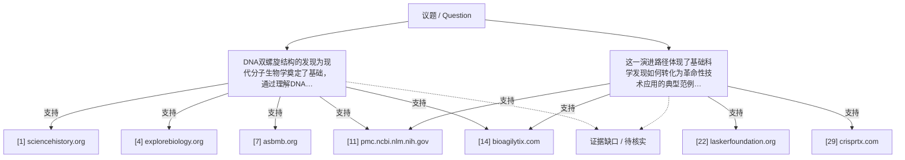

## 结论

DNA双螺旋结构的发现为理解遗传信息存储机制奠定了基础，通过分子生物学研究的逐步深入，最终实现了CRISPR基因编辑技术的突破，体现了基础科学向技术应用转化的典型范例

<!-- confidence:mid -->
**置信度：中**

## 要点

- DNA双螺旋结构的发现为现代分子生物学奠定了基础，通过理解DNA作为遗传物质的特性，科学家们逐步发展出基因编辑技术，最终实现了CRISPR技术的突破。
- 这一演进路径体现了基础科学发现如何转化为革命性技术应用的典型范例。

## 证据与来源

## 深入了解

### 内容分析 / Content Analysis

围绕各条结论拆解：支持来源、反驳来源与仍不确定处。下表为结构后处理生成的支持度摘要，须结合正文证据阅读。

1. **DNA双螺旋结构的发现为现代分子生物学奠定了基础，通过理解DNA作为遗传物质的特性，科学家们逐步发展出基因编辑技术，最终实现了CRISPR技术的突破。** — 未核实（独立来源数无法判定：仅摘要，未读全文；正文未参与裁决；支持依据未能在传入的正文片段中核对）
2. **这一演进路径体现了基础科学发现如何转化为革命性技术应用的典型范例。** — 未核实（独立来源数无法判定：仅摘要，未读全文；正文未参与裁决；支持依据未能在传入的正文片段中核对）

### 关系拓扑 / Relationship Map

实线=注册表内有依据的支持关系，粗线=反驳，虚线=未知或未核实；连线只表示来源与主张的关系，不代表事实已核实。

### DNA结构发现的重要性

1953年，詹姆斯·沃森和弗朗西斯·克里克发现了DNA的双螺旋结构，这一发现揭示了遗传信息的存储和传递机制。DNA双螺旋模型不仅解释了基因如何复制，还阐明了遗传信息如何在细胞间传递，为现代分子生物学奠定了理论基础 [1, 3, 4, 7]。

### 分子生物学基础的发展

DNA结构发现后，科学家们开始深入理解基因的功能和调控机制。这包括：
- DNA复制机制的研究
- 基因表达调控的发现
- 限制性内切酶等分子工具的开发 [4, 24]

这些进展为后来的基因编辑技术提供了必要的理论基础和技术工具。

## References

- [1] [Francis Crick, Rosalind Franklin, James Watson, and ...](<https://www.sciencehistory.org/education/scientific-biographies/francis-crick-rosalind-franklin-james-watson-and-maurice-wilkins/>) — 仅摘要
  These four scientists codiscovered the double-helix structure of DNA, which formed the basis for modern biotechnology. DNA was a double helix.

- [2] [The DNA Double Helix Discovery — HHMI BioInteractive Video](<https://www.youtube.com/watch?v=1vm3od_UmFg>) — 仅摘要
  In this educational video, explore Watson and Crick&\#x27;s quest to understand DNA&\#x27;s structure, and Rosalind Franklin&\#x27;s key insights via x-ray ...

- [3] [The discovery of DNA: unravelling the double helix](<https://www.yourgenome.org/theme/the-discovery-of-dna-unravelling-the-double-helix/>) — 仅摘要
  In 1953 James Watson and Francis Crick published their theory that DNA must be shaped like a double helix. A double helix resembles a twisted ladder.

- [4] [The twisting path to the dna double helix](<https://explorebiology.org/collections/cell-biology/the-twisting-path-to-the-dna-double-helix>) — 仅摘要
  The model of the DNA double helix proposed by Jim Watson and Francis Crick unexpectedly led to an elegant model for the replication and inheritance of genes, ...

- [5] [70 years of the DNA double helix: An interview with ...](<https://www.sciencedirect.com/science/article/pii/S1097276523002423>) — 仅摘要
  by D Rhodes · 2023 · Cited by 6 — Daniela Rhodes spoke with Molecular Cell about the discovery of the double helical structure of DNA in 1953 and its impact on modern science.

- [6] [The discovery of the molecular structure of DNA](<https://educationalgames.nobelprize.org/educational/medicine/dna_double_helix/readmore.php>) — 仅摘要
  Watson and Crick used stick-and-ball models to test their ideas on the possible structure of DNA. Other scientists used experimental methods ...

- [7] [Discoveries made possible by DNA](<https://www.asbmb.org/asbmb-today/science/112425/discoveries-made-possible-by-dna>) — 仅摘要
  James Watson and Francis Crick proposed the double-helix model of DNA, transforming how scientists understood heredity and launching the field ...

- [8] [The Double Helix](<https://www.biointeractive.org/classroom-resources/double-helix>) — 仅摘要
  James Watson and Francis Crick collected and interpreted key evidence to determine that DNA molecules take the shape of a twisted ladder, a ...

- [9] [The Watson-Crick Nobel: Was Someone Left Out?](<https://www.utmb.edu/mdnews/podcast/episode/the-watson-crick-nobel-was-someone-left-out>) — 仅摘要
  Drs. Watson and Crick used this data to propose a detailed physical model that explained DNA structure and sealed the argument. The pair were ...

- [10] [The Discovery of the Double Helix, 1951-1953 \| Francis Crick](<https://profiles.nlm.nih.gov/spotlight/sc/feature/doublehelix>) — 仅摘要
  Watson and Crick developed their ideas about genetic replication in a second article in Nature, published on May 30, 1953. The two had shown that in DNA, form ...

- [11] [CRISPR–Cas9: A History of Its Discovery and Ethical ... - PMC](<https://pmc.ncbi.nlm.nih.gov/articles/PMC9377665/>) — 已抓取全文（不代表事实核实）
  by I Gostimskaya · 2022 · Cited by 414 — CRISPR – clustered regularly interspaced short palindromic repeats – were first discovered in the sequences of DNA from Escherichia coli ...

- [12] [Discovery of the Structure of DNA – Science Technology ...](<https://opentextbooks.clemson.edu/sciencetechnologyandsociety/chapter/discovery-of-the-structure-of-dna/>) — 仅摘要
  by MH Rodgers · 2020 — The discovery of the structure of DNA was an essential breakthrough for the field of genetics and its progression throughout history.

- [13] [CRISPR Timeline](<https://www.broadinstitute.org/what-broad/areas-focus/project-spotlight/crispr-timeline>) — 抓取失败（仅摘要）
  Discovery of CRISPR and its function 1993 - 2005 — Francisco Mojica, University of Alicante, Spain.

- [14] [Origins of CRISPR: How it Came to Be](<https://www.bioagilytix.com/blog/origins-of-crispr-how-it-came-to-be/>) — 已抓取全文（不代表事实核实）
  CRISPR \(Clustered Regularly Interspaced Short Palindromic Repeat\) sequences were first discovered in the E. coli genome in 1987, but it wasn&\#x27;t until 2007. ...

- [15] [The History of DNA Timeline](<https://www.dna-worldwide.com/resource/160/history-dna-timeline>) — 仅摘要
  Discover the historical timeline of DNA, starting with Charles Darwin in the 1800s through to the current developments and future of DNA.

- [16] [70 years since the discovery of the structure of DNA](<https://www.crick.ac.uk/news/2023-04-25_70-years-since-the-discovery-of-the-structure-of-dna-where-are-we-now>) — 仅摘要
  This year marks 70 years since the publication of the papers that first described the structure of DNA. We spoke to five Crick sciences ...

- [17] [Chemical structure of DNA discovered by Watson and Crick](<https://www.history.com/this-day-in-history/february-28/watson-and-crick-discover-chemical-structure-of-dna>) — 仅摘要
  On February 28, 1953, Cambridge University scientists James Watson and Francis Crick announce that they have determined the double-helix structure of DNA, ...

- [18] [A short history of CRISPR Gene Editing \| IDT](<https://www.idtdna.com/page/support-and-education/decoded-plus/a-short-history-of-crispr>) — 仅摘要
  Learn about history of CRISPR gene editing, and why it became one of the most widely used genome editing tools.

- [19] [The twisting path to the dna double helix](<https://explorebiology.org/collections/neuroscience/the-twisting-path-to-the-dna-double-helix>) — 仅摘要
  The model of the DNA double helix proposed by Jim Watson and Francis Crick unexpectedly led to an elegant model for the replication and inheritance of genes, ...

- [20] [Discovery of DNA&\#x27;s double helix structure by James ...](<https://www.facebook.com/groups/849994733672039/posts/1206293941375448/>) — 仅摘要
  For centuries, scientists searched for the secret of heredity. What carried traits from parent to child? What invisible thread bound generations together? ...

- [21] [The Fulbright Program](<https://www.facebook.com/fulbright/posts/in-the-1950s-a-scientific-breakthrough-changed-the-course-of-modern-medicine-in-/1454154940092624/>) — 仅摘要
  In 1953, American molecular biologist James D. Watson co-discovered the double-helix structure of DNA, laying the foundation for modern ...

- [22] [How Understanding DNA Revolutionized Biology](<https://laskerfoundation.org/from-messy-glob-to-driving-force-how-understanding-dna-revolutionized-biology/>) — 仅摘要
  Topping the list is CRISPR, a gene editing tool developed in the early 2000s. “\[It\] is really the most exciting thing that&\#x27;s happened in the ...

- [23] [MOLECULAR BIOLOGY OF THE GENE BY WATSON](<https://oye.odwire.org/manuscript/Maw5578AD261/Molecular-Biology-Of-The-Gene-By-Watson>) — 仅摘要
  A: The book has been revised to include topics like epigenetics, CRISPR gene editing, and advances in genomic technologies, reflecting the ...

- [24] [History of Genetic Engineering and the Rise of Genome ...](<https://www.synthego.com/learn/genome-engineering-history/>) — 仅摘要
  Paul Berg became the first scientist to ever accomplish creating recombinant DNA from more than one species, which came to be known as the &quot;cut-and-splice&quot; ...

- [25] [American scientists discover DNA structure, unlocking ...](<https://www.facebook.com/groups/ojlkixcwdwdowdocscso/posts/25948216531452963/>) — 仅摘要
  The Discovery of DNA&\#x27;s Structure occurred in 1953. Did you know that if James Watson and Francis Crick hadn&\#x27;t discovered the double-helix ...

- [26] [CRISPR: A Biotech Breakthrough](<https://www.nsf.gov/impacts/crispr>) — 仅摘要
  In 2023, NSF-supported researchers developed a new method called STING-seq, which combines CRISPR with other tools to connect genetic variants ...

- [27] [Unraveling CRISPR-Cas9 with Jennifer Doudna](<https://www.youtube.com/watch?v=E573S0Ezy6g>) — 仅摘要
  that led to the discovery of CRISPR-Cas9, a revolutionary tool for gene editing. In the conversation, they explore the implications of CRISPR- ...

- [28] [Exploring CRISPR-Cas: The transformative impact of gene ...](<https://www.sciencedirect.com/science/article/pii/S2162253125002719>) — 仅摘要
  by V Pandey · 2025 · Cited by 22 — This review traces the evolution of clustered regularly interspaced short palindromic repeats \(CRISPR\) technology from a prokaryotic immune ...

- [29] [Gene Editing](<https://crisprtx.com/gene-editing>) — 仅摘要
  CRISPR/Cas9 – a revolutionary gene-editing technology that can be used to modify or correct precise regions of our DNA to treat serious diseases.

- [30] [Genetics Unzipped podcast: A brief history of CRISPR](<https://frontlinegenomics.com/genetics-unzipped-podcast-a-brief-history-of-crispr-how-we-learned-to-edit-the-genome/>) — 仅摘要
  The origins of CRISPR start back in 1987, when Japanese scientist Yoshizumi Ishino discovered repeating sections of DNA in bacteria. His paper ...
