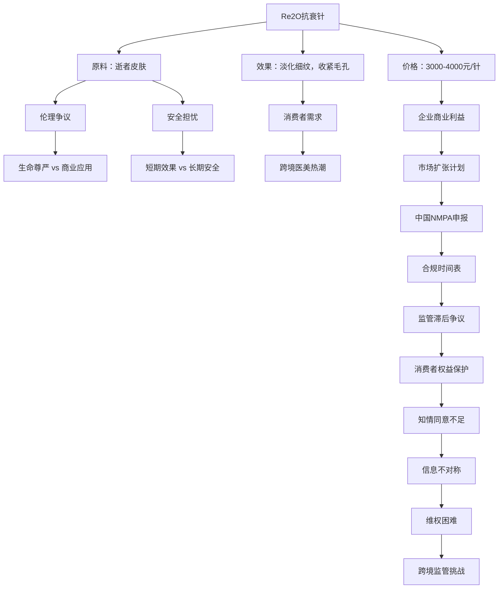

## 结论

韩国Re2O抗衰针原料确实含有逝者皮肤成分，经过脱细胞处理后保留胶原蛋白和弹性蛋白构成的细胞外基质。，理由：超过20个独立来源一致确认原料来源和处理工艺，包括中国大陆、香港、台湾地区及国际媒体，且工艺描述高度一致。

<!-- confidence:high -->
**置信度：高**

## 要点

- 韩国Re2O抗衰针原料确实含有逝者皮肤成分，经过脱细胞处理后保留胶原蛋白和弹性蛋白构成的细胞外基质。
- ，理由：超过20个独立来源一致确认原料来源和处理工艺，包括中国大陆、香港、台湾地区及国际媒体，且工艺描述高度一致。

## 争议与不确定

| 争议点 | 支持方说法 | 反对方/质疑方说法 | 冲突点 |
|--------|------------|-------------------|--------|
| **原料安全性** | L&C BIO宣称：经过脱细胞处理，去除了细胞和遗传物质，只剩胶原蛋白和弹性蛋白组成的"纯化框架"，安全无风险 [10] | 专家质疑：脱细胞难彻底清除遗传物质，可能带来排异和遗传风险 [27]；没有任何长期临床安全数据，短期效果与长期安全性未知 [28] | 技术处理能否完全消除遗传物质存在争议；长期安全性数据缺失 |
| **知情同意** | 韩国医生：仅声称能起到"为皮肤深层注射营养的效果" [4] | 消费者：注射后才从社交媒体得知原料来自逝者皮肤，怒喊"早知道就拒绝！" [7] | 信息不对称，消费者知情权未得到充分保障 |
| **伦理边界** | L&C BIO：原材料从美国进口，仅使用经过当地捐赠程序同意的皮肤组织 [18] | 批评者：即使有捐赠同意，将逝者组织用于美容目的仍然存在伦理问题 [18] | 生命尊严与商业应用的伦理边界争议 |
| **监管合规** | 企业方：计划在2026年启动Re2O在中国的NMPA注册申报 [14] | 监管方：目前尚未取得中国NMPA医疗器械注册证，国内注射属非法行为 11（引用未登记） | 合规时间表与实际监管现状存在时间差 |
| **临床效果** | 企业宣传：能淡化细纹，收紧毛孔，重建皮肤深层结构 3（引用未登记） | 专家质疑：概念跑在证据前面，营销跑在监管前面 [29] | 短期效果与长期疗效的证据基础不充分 |

## 证据与来源

### 时间线 / Timeline

- **2024年11月**：Re2O在韩国上市 2（引用未登记）
- **2025年**：Re2O进入日本、新加坡等国市场 1（引用未登记）
- **2026年1月**：爱恩斯官方账号称，将在2026年启动Re2O在中国的NMPA注册申报 [14]
- **2026年9月**：Re2O在中国引发广泛争议，媒体报道"尸皮针"事件 1（引用未登记）[4]
- **2026年9月15日**：韩国网红抗衰针"Re2O"争议引发广泛关注 [29]

### Evidence

- **原料成分**：Re2O原料为逝者捐献皮肤经脱细胞处理得到的细胞外基质 [1]
- **价格区间**：单针售价约为3000-4000元人民币 1（引用未登记）[25]
- **月产量**：月产8万支仍售罄 [24]
- **企业背景**：Re2O是韩国生物技术公司L&C BIO旗下的皮肤填充剂 [24]
- **国际销售**：目前在韩国、日本、新加坡等国销售 [20]
- **中国合规状态**：尚未取得中国NMPA医疗器械注册证，在国内开展相关注射操作为非法行为 11（引用未登记）
- **申报计划**：2026年启动Re2O在中国的NMPA注册申报 [14]
- **长期安全性**：专家指出需要5-10年长期观察和随访才能检验实际效果 [28]
- **消费者反应**：有消费者表示"早知道就拒绝！" [7]

## 深入了解

### 内容分析 / Content Analysis

**主要角色与主张**：
- **企业方（L&C BIO）**：强调产品科学性和安全性，计划拓展中国市场
- **专家群体**：质疑长期安全性、伦理边界和监管滞后
- **消费者**：关注知情权和实际效果，存在信息不对称
- **监管机构**：尚未批准，强调合规重要性
- **媒体**：报道争议，推动公众讨论

**舆情焦点**：
- 伦理争议：逝者组织用于美容的伦理边界
- 安全担忧：长期风险和遗传物质残留问题
- 权益保障：消费者知情权和选择权
- 监管挑战：跨境医美的监管标准差异

### 关系拓扑 / Relationship Map

### Conclusions

韩国Re2O抗衰针是一款由韩国L&C BIO公司生产的皮肤填充剂，品牌名取自"Return to Your 20s"（重返20岁），于2024年11月在韩国上市。该产品核心争议在于其原料取自逝者捐献的人体皮肤组织，经过脱细胞处理后制成可注射微颗粒。主要争议点包括：原料伦理问题、求美者知情同意不足、长期安全性数据缺失、跨境监管标准差异等。该产品在韩国、日本、新加坡等国销售，但尚未取得中国NMPA医疗器械注册证，在国内开展相关注射操作为非法行为。

### 已确认 vs 未确认

- **已确认**：
  - Re2O原料取自逝者捐献的人体皮肤组织
  - 经过脱细胞处理，保留胶原蛋白和弹性蛋白构成的细胞外基质
  - 单针售价约3000-4000元人民币
  - 在韩国、日本、新加坡等国销售
  - 尚未取得中国NMPA医疗器械注册证
  - 计划在2026年启动中国的NMPA注册申报

- **未确认 / 无法确认**：
  - 脱细胞处理能否完全消除遗传物质和细胞残留
  - 长期临床安全性和有效性数据
  - 捐赠者家属的知情同意程序是否完善
  - 在中国灰色市场的具体流通规模
  - 实际临床效果的科学验证数据

### Gaps in Knowledge

1. **长期安全性数据缺失**：缺乏5-10年以上的长期临床观察数据
2. **技术处理验证不足**：脱细胞处理效果的科学验证数据有限
3. **伦理程序细节不明**：捐赠者家属知情同意的具体程序和范围
4. **中国市场灰色规模**：无法核实在中国市场的实际流通数量
5. **不良反应监测数据**：缺乏系统性的不良反应监测和报告机制

## References

- [1] [死人皮肤变抗衰针？韩国Re2O风波起底](<https://www.jiemian.com/article/15117101.html>) — 已抓取全文（不代表事实核实）
  其原料为逝者捐献皮肤经脱细胞处理得到的细胞外基质。该针剂单针售价约为3000‑4000元人民币，其声称能淡化细纹，收紧毛孔，现已进入日本、 ...

- [2] [死者皮肤，打进活人的脸？3000元一针的“尸皮针”火了](<https://news.ifeng.com/c/8wPo0GxsCdi>) — 仅摘要
  Re2O即“return to your 20s”（重返20岁）的缩写，由已故捐献者的皮肤组织制成。该产品于2024年11月在韩国上市，目前在韩国、日本、新加坡等国销售，声称能 ...

- [3] [韩国网红抗衰针原料竟是逝者皮肤专家提醒](<https://www.sznews.com/news/content/2026-09/14/content_32171745.htm>) — 仅摘要
  近期，一款号称能让人“重返20岁”的韩国医美针剂Re2O受追捧，单针售价约合人民币3200至4000元。 其核心原料竟是取自逝者捐献的人体皮肤组织。

- [4] [韩国网红抗衰针原料竟来自逝者皮肤，求美者注射后才知](<https://cj.sina.cn/articles/view/7096020433/1a6f4add106801o70u?froms=ggmp>) — 仅摘要
  近期，一款号称能“重返20岁”的韩国网红抗衰针Elravie Re2O被曝出原料竟来自逝者捐献的皮肤组织，更令人后怕的是，许多求美者直到注射后才从社交媒体得知 ...

- [5] [南韓興起一款「遺體皮膚抗老針」Elravie Re2O](<https://www.threads.com/@bastille_post_official/post/DbUnflHGLU-/%E5%8D%97%E9%9F%93%E8%88%88%E8%B5%B7%E4%B8%80%E6%AC%BE%E9%81%BA%E9%AB%94%E7%9A%AE%E8%86%9A%E6%8A%97%E8%80%81%E9%87%9Delravie-re2o%E7%94%A8%E7%BE%8E%E5%9C%8B%E9%81%BA%E9%AB%94%E6%8D%90%E8%B4%88%E8%80%85%E7%9A%AE%E8%86%9A%E7%B6%93%E8%99%95%E7%90%86%E5%BE%8C%E6%8A%BD%E8%B5%B0%E7%B4%B0%E8%83%9E%E4%BF%9D%E7%95%99%E8%86%A0%E5%8E%9F%E5%BD%88%E6%80%A7%E8%9B%8B%E7%99%BD%E9%80%8F%E6%98%8E%E8%B3%AA%E9%85%B8%E7%B5%84%E6%88%90%E7%9A%84%E7%B4%B0%E8%83%9E%E5%A4%96%E5%9F%BA%E8%B3%AA%E5%81%9A%E5%A4%A9%E7%84%B6%E6%94%AF%E6%9E%B6%E5%AE%A3%E7%A8%B1%E6%B7%A1%E7%B4%8B%E6%94%B6%E6%AF%9B%E5%AD%94%E5%A5%BD%E5%A4%9A%E7%B6%B2%E7%B4%85%E6%89%93/>) — 仅摘要
  韓國熱門醫美注射產品Re2O（俗稱「屍皮針」）近日爆紅，該產品聲稱能淡化細紋、緊緻毛孔，惟因其原料提取自「已故捐贈者的皮膚組織（同種異體皮）」，引發 ...

- [6] [死者皮肤打进活人脸，韩国“尸皮针”盯上中国](<https://www.guokr.com/article/470318/>) — 仅摘要
  Re2O最惹眼的地方，还是它的原料——核心材料来自已故捐献者的人体皮肤组织，也因此被不少网友称为“尸皮针”。 Re2O通过注射人源性真皮成分直接补充细胞外 ...

- [7] [原料竟來自逝者皮膚？網美施打後怒喊：「早知道就拒絕了！」](<https://tw.news.yahoo.com/%E9%9F%93%E5%9C%8B-%E5%B1%8D%E7%9A%AE%E9%87%9D-%E7%88%AD%E8%AD%B0%E5%BB%B6%E7%87%92-%E8%99%9F%E7%A8%B1%E9%87%8D%E8%BF%94-20-023948316.html>) — 仅摘要
  韓國爆紅抗老針Elravie Re2O（簡稱Re2O）近來爭議連環爆！這款號稱「重返20 歲」的皮膚填充劑，原料竟取自已故捐贈者的皮膚，被網友戲稱為「屍皮針」 ...

- [8] [這款針劑的膠原蛋白，竟然是直接從「遺體捐贈者」的皮膚 ...](<https://www.instagram.com/p/Dbe0voPDcR2/>) — 仅摘要
  韓國醫美市場近期一款名為「Elravie Re2O」的皮膚注射產品受到關注，因原料來自已故人體組織捐贈者的皮膚，被部分網友以「屍皮針」、「人皮針」形容。隨著 ...

- [9] [韓國潮興「屍皮針」 用死者皮膚製膠原蛋白回春注射安全存隱憂](<https://www.hk01.com/%E5%8D%B3%E6%99%82%E5%9C%8B%E9%9A%9B/60391034/%E9%9F%93%E5%9C%8B%E6%BD%AE%E8%88%88-%E5%B1%8D%E7%9A%AE%E9%87%9D-%E7%94%A8%E6%AD%BB%E8%80%85%E7%9A%AE%E8%86%9A%E8%A3%BD%E8%86%A0%E5%8E%9F%E8%9B%8B%E7%99%BD%E5%9B%9E%E6%98%A5-%E6%B3%A8%E5%B0%84%E5%AE%89%E5%85%A8%E5%AD%98%E9%9A%B1%E6%86%82>) — 仅摘要
  韓國一款名為Re2O、俗稱「屍皮針」的注射劑，聲稱是「從遺體捐贈者的皮膚提取膠原蛋白」再製成抗老針劑，可讓人「逆齡回春」。此一醫美技術近年在韓國 ...

- [10] [一针3000元&quot;重返20岁&quot;，韩国爆火抗衰针原料竟是死人皮肤](<https://www.sohu.com/a/1076441620_122603294>) — 仅摘要
  厂商的说辞，听起来很高级：原料经过脱细胞处理，去除了细胞和遗传物质，只剩胶原蛋白和弹性蛋白组成的&quot;纯化框架&quot;，可以给求美者自身的皮肤细胞当生长支架 ...

- [11] [死人皮肤变抗衰针？韩国Re2O风波起底](<https://finance.sina.com.cn/jjxw/2026-09-20/doc-inismvph6841110.shtml?froms=ggmp>) — 仅摘要
  需注意的是，该针剂尚未取得中国NMPA医疗器械注册证，在国内开展相关注射操作为非法行为。 Re2O自面世以来争议不断，尽管其母公司L&amp;C BIO ...

- [12] [月产8万支仍售罄！重返20岁的韩国“尸皮针”引发伦理争议](<https://www.163.com/dy/article/L7222BH10514D3UH.html>) — 仅摘要
  在中国市场，Re2O尚未取得NMPA注册证，国内医美从业者刘女士告诉记者，在国内，相关注射操作属于非法行为，如果消费者赴韩注射，这属于境外医美行为 ...

- [13] [韩国Re2O，主打嫩肤抗衰，一针约3000元人民币。原料来源](<https://www.toutiao.com/w/1876451776691212/>) — 仅摘要
  韩国Re2O,主打嫩肤抗衰,一针约3000元人民币。 Re2O没有获得中国NMPA批准,国内正规医美机构绝对不允许开展。

- [14] [“尸皮针”盯上中国人，3000元一针的抗衰生意引争议](<https://timeline.sohu.com/news/7jlRHmNC4A>) — 仅摘要
  Re2O也被列入了下一步计划。今年1月，爱恩斯官方账号称，公司将在2026年启动Re2O和软骨修复产品MegaCarti在中国的NMPA注册申报。

- [15] [韓國熱門「屍皮針」Re2O爆爭議！內地旅客打針後始知原料取 ...](<https://utravel.com.hk/news/detail/20110533/%E9%9F%93%E5%9C%8B%E7%86%B1%E9%96%80-%E5%B1%8D%E7%9A%AE%E9%87%9D-re-o%E7%88%86%E7%88%AD%E8%AD%B0-%E5%85%A7%E5%9C%B0%E6%97%85%E5%AE%A2%E6%89%93%E9%87%9D%E5%BE%8C%E5%A7%8B%E7%9F%A5%E5%8E%9F%E6%96%99%E5%8F%96%E8%87%AA%E9%80%9D%E8%80%85-%E5%B0%88%E5%AE%B6%E6%8F%AD%E7%9B%A3%E7%AE%A1%E6%BC%8F%E6%B4%9E%E8%88%87%E5%AE%89%E5%85%A8%E9%9A%B1%E6%82%A3>) — 仅摘要
  專家提醒，目前Re2O 在部分地區（如中國內地）尚未取得合法註冊，私自進行注射屬違法行為。港人前往韓國體驗醫美療程時，切勿盲目跟風，務必在療程前 ...

- [16] [Re2O是什麼？真皮膠原「肌密水光」免飛韓國也能打](<https://tresure-clinic.com/collagen-skin-booster/>) — 仅摘要
  Re2O、CellREDM 是韓國熱門的真皮膠原水光，但受《再生醫療法》規範無法在台施作。本文說明兩者差異，並介紹台灣合法替代方案「肌密水光／肌密針」的原理、適合族群與 ...

- [17] [韓女現在已經不打麗珠蘭了！？最新的水光針是這個⋯ 🇰🇷 弘大 ...](<https://www.instagram.com/reel/DUp5i6Rk0sI/>) — 仅摘要
  我做的項目是Re2O異體真皮膠原水光+LDM水滴提升 Re2O的成分跟我們皮膚真的很契合，內含89% 膠原蛋白+ 3% 彈性蛋白。 它不含交聯 ...

- [18] [韩国“尸皮针”爆红：用死者皮肤做医美你敢打吗？](<https://www.wenxuecity.com/news/2026/09/15/126775854.html>) — 仅摘要
  目前，关于是否应将已故捐献者的皮肤组织用于医美用途，也存在诸多争议。 据韩媒报道，L&amp;C BIO表示，Re2O的原材料从美国进口，仅使用经过当地捐赠程序同意 ...

- [19] [死人皮肤变抗衰针？韩国Re2O风波起底](<https://www.lg-9game.com/posts/si-ren-pi-fu-bian-kang-shuai-zhen-han-guo-re2o-feng-bo-qi-di.html>) — 仅摘要
  韩国Re2O抗衰针因原料来自逝者捐献皮肤而引发伦理与安全争议。该产品在韩国获批上市，单针售价约3000-4000元，声称可淡化细纹、收紧毛孔，但尚未取得 ...

- [20] [网红“尸皮针”引争议，跨境医美风险仍需警惕](<https://www.sohu.com/a/1077177798_121925623>) — 仅摘要
  Re2O是韩国生物技术公司L&amp;C BIO旗下皮肤填充剂,目前在韩国、日本、新加坡等国销售。 声称能帮助求美者淡化细纹,收紧毛孔,并为其自身细胞的再生奠定基础。

- [21] [韩国Re2O 抗衰针被指使用逝者皮肤](<https://www.sina.cn/news/detail/5343219039601125.html>) — 仅摘要
  韩国一款名为Re2O 的抗衰针剂因原料取自已故捐献者皮肤引发争议，被戏称为“尸皮针”。该产品单次价格超3000 元，虽宣称经脱细胞处理，但存在细胞残留 ...

- [22] [RE2O 疼痛指數8分） 很推薦大家，如果現在要 ...](<https://www.threads.com/@natao.light/post/DV2fOq0lAA1/video-%E7%8D%B2%E5%BE%97%E7%84%A1%E7%91%95%E8%82%8C%E9%80%99%E6%AC%A1%E4%BE%86%E4%BB%8B%E7%B4%B9%E5%89%8D%E9%99%A3%E5%AD%90%E5%8E%BB%E9%9F%93%E5%9C%8B%E5%81%9A%E7%9A%84%E6%9C%80%E6%96%B0%E9%86%AB%E7%BE%8E%E6%8A%80%E8%A1%93-re2ore2o%E7%B0%A1%E5%96%AE%E4%BE%86%E8%AA%AA%E6%98%AF%E6%96%B0%E7%89%88%E7%9A%84%E7%9C%9F%E7%9A%AE%E9%80%86%E9%BD%A1%E9%87%9D%E8%88%87%E5%82%B3%E7%B5%B1%E6%B0%B4%E5%85%89%E9%87%9D%E5%96%AE%E7%B4%94%E8%A3%9C%E6%B0%B4%E6%88%96%E9%BA%97%E7%8F%A0%E8%98%AD%E4%BF%AE%E5%BE%A9%E5%8F%97%E6%90%8D%E6%9C%80%E5%A4%A7%E7%9A%84%E4%B8%8D%E5%90%8C%E5%9C%A8%E6%96%BC%E6%9B%B4%E5%BC%B7%E8%AA%BF%E7%89%A9%E7%90%86%E6%80%A7%E7%B5%90%E6%A7%8B%E6%94%AF>) — 仅摘要
  Re2O屍皮針是一種源自人體去細胞真皮組織的膠原水光針，主要用來重建皮膚的深層結構。什麼是Re2O？成分來源：它從人類「捐贈」的真皮組織中去除細胞，保留 ...

- [23] [今天來了位42歲的女性，幾個月前去\#韓國平價醫美， ...](<https://www.facebook.com/Dr.MingMing/posts/%E4%BB%8A%E5%A4%A9%E4%BE%86%E4%BA%86%E4%BD%8D42%E6%AD%B2%E7%9A%84%E5%A5%B3%E6%80%A7%E5%B9%BE%E5%80%8B%E6%9C%88%E5%89%8D%E5%8E%BB-%E9%9F%93%E5%9C%8B%E5%B9%B3%E5%83%B9%E9%86%AB%E7%BE%8E%E7%B5%90%E6%9E%9C%E8%85%A6%E6%B3%A2%E5%BC%B1%E5%BC%B1%E7%9A%84%E8%A2%AB%E6%8E%A8%E9%8A%B7%E4%BA%86%E5%AE%A3%E7%A8%B1%E8%83%BD%E9%87%8D%E5%A1%91%E7%9C%9F%E7%9A%AE%E5%B1%A4%E7%9A%84%E9%9F%93%E5%9C%8Bre2o%E6%B0%B4%E5%85%89%E9%87%9D%E5%8F%AA%E7%82%BA%E4%BA%86%E6%92%AB%E5%B9%B3%E7%9C%BC%E5%BA%95%E7%B4%B0%E7%B4%8B%E8%AE%93%E7%9C%BC%E9%80%B1%E6%9B%B4%E5%B9%B4%E8%BC%95%E7%B5%90%E6%9E%9C%E9%AC%BC%E6%95%85%E4%BA%8B%E7%99%BC%E7%94%9F%E4%BA%86%E5%8E%9F%E4%BB%A5%E7%82%BA%E8%83%BD%E8%BF%8E/1295683746109141/>) — 仅摘要
  今天來了位42歲的女性，幾個月前去 \#韓國平價醫美，結果腦波弱弱的被推銷了宣稱能重塑 真皮層的韓國Re2O水光針只為了撫平眼底細紋讓眼週更 年輕…結果鬼 ...

- [24] [月产8万支仍售罄！重返20岁的韩国“尸皮针”引发伦理争议](<https://m.thecover.cn/news_details.html?eid=lKVbPlDf8jOH90qSdq8Jkw==>) — 仅摘要
  Re2O是韩国生物技术公司L&amp;C BIO旗下的皮肤填充剂，品牌名取自“Return to Your 20s”（简称Re2O），寓意重返20岁。单针售价约60万至80万韩元，折合人民币 ...

- [25] [一针3000元、原料来自死人皮肤！韩国“尸皮针”爆火引争议](<https://news.mydrivers.com/1/1151/1151560.htm>) — 仅摘要
  制作时将捐献者遗体皮肤做脱细胞处理，去除活细胞与大部分遗传物质，只保留胶原蛋白、弹性蛋白构成的基质支架，制成微粒注射到真皮层。 厂商宣传，该基质 ...

- [26] [引發全球醫美圈話題。近日更有網紅打完後大讚「膚質好到 ...](<https://www.instagram.com/p/DbQBPYyGqPx/>) — 仅摘要
  隨著產品走紅，其原材料來源引發廣泛爭議。有知情網民曝光，該針劑原材料提取自已故捐贈者人體皮膚組織，輿論對此看法分歧，有消費者認為產品經專業 ...

- [27] [韩国Re2O 抗衰针原料来源与价格争议](<https://www.sina.cn/news/detail/5343716145629180.html>) — 仅摘要
  抗衰嫩肤。 逝者皮肤,引发伦理与安全质疑。 抗衰嫩肤。 赴韩打完抗衰针才知… 证据薄弱,长期安全性未知,脱细胞难彻底清除遗传物质,可能带来排异和遗传风险 ...

- [28] [海报时评丨韩国爆火抗衰针原料竟是死人皮肤！专家](<https://hb.dzwww.com/p/p6NM49SRxa.html>) — 仅摘要
  商家宣传经过脱细胞处理，安全无风险。但业内专家点出致命问题：这类人体皮肤填充剂，没有任何长期临床安全数据。短期看着皮肤变好，未来五到十年会不会 ...

- [29] [从韩国“尸皮针”争议看医美原料的伦理与安全边界](<https://www.163.com/dy/article/L6UPEKSQ0519RE6Q.html>) — 仅摘要
  2026年9月15日，一则关于韩国网红抗衰针“Re20”的报道引发广泛关注。这款由韩国L&amp;CBIO公司生产的皮肤填充剂，2024年11月在韩国上市，单针售价约3000 ...

- [30] [南韓熱捧醫美針劑取自逝者皮膚被指「屍皮針」 安全倫理爭議大](<https://www.orangenews.hk/international/VVMiMVV/%E5%8D%97%E9%9F%93%E7%86%B1%E6%8D%A7%E9%86%AB%E7%BE%8E%E9%87%9D%E5%8A%91%E5%8F%96%E8%87%AA%E9%80%9D%E8%80%85%E7%9A%AE%E8%86%9A%E8%A2%AB%E6%8C%87-%E5%B1%8D%E7%9A%AE%E9%87%9D--%E5%AE%89%E5%85%A8%E5%80%AB%E7%90%86%E7%88%AD%E8%AD%B0%E5%A4%A7.shtml>) — 仅摘要
  南韓醫美針劑Re2O近期爆紅，知情者稱原材料取自逝者皮膚。 消費者花費約4300港元注射，事後才知來源。 專家質疑臨床不足，或殘留基因及安全風險。
