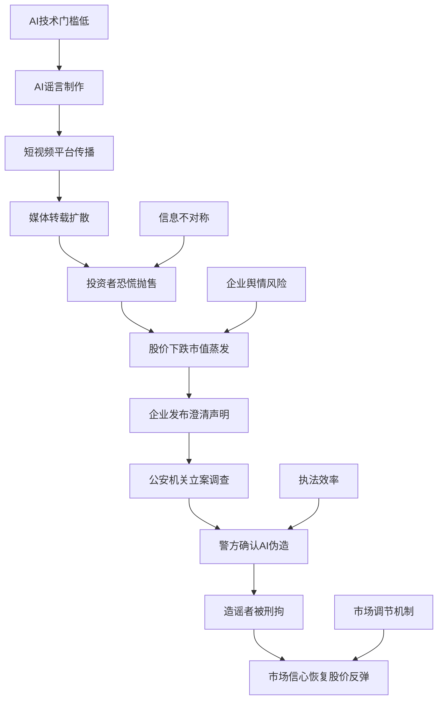

## 结论

- 基于多家权威媒体和官方通报的一致报道，事件核心事实清晰。

<!-- confidence:high -->
**置信度：高**

## 争议与不确定

| 主体 | 说法 | 冲突点 | 可能原因 |
|------|------|--------|----------|
| 谣言传播者 | 东鹏特饮创始人林木勤在饭局上表示"不喝自家饮料" | 与官方澄清完全相反 | 利用AI技术伪造视频，恶意抹黑企业 |
| 东鹏饮料官方 | 视频为凭空捏造，通过虚构场景、伪造言论等手段恶意捏造虚假信息 | 与谣言版本直接冲突 | 企业澄清，维护品牌形象 |
| 深圳警方 | 确认视频为AI制作，言论为编造，造谣者罗某某已被刑拘 | 与谣言版本完全相反 | 官方调查结果，具有法律效力 |
| 市场投资者 | 谣言传播期间股价持续下跌，市值蒸发超70亿元 | 与官方澄清后的股价反弹形成对比 | 市场恐慌情绪，信息不对称 |
| 第三方媒体 | AI造谣呈现门槛低、批量化、识别难等特点 | 与传统谣言治理方式存在冲突 | AI技术发展带来的新挑战 |

## 证据与来源

### 时间线 / Timeline

- **2026年6月22日** - 短视频平台开始流传"东鹏特饮创始人不喝自家饮料"的虚假视频
- **2026年6月22-26日** - 东鹏饮料A、H股持续下跌，市值蒸发超70亿元
- **2026年6月27日** - 东鹏饮料发布官方澄清声明，指出视频为凭空捏造，已固定证据并向公安机关报案
- **2026年6月27日** - 张雪（自媒体从业者）在重庆机车总部接待东鹏饮料联席总裁蒋薇薇，澄清事实
- **2026年6月29日** - 深圳市公安局南山分局发布警情通报，确认事件为AI伪造，造谣者罗某某已被刑事拘留
- **2026年6月29日** - 东鹏饮料A股涨停，报121.99元/股，总市值回到约896亿元

### Evidence

- 东鹏饮料A、H股在6月22-26日期间持续下跌，市值蒸发超70亿元 [21, 28, 31]
- 虚假视频传播后，东鹏饮料单日市值蒸发超13亿元 [37]
- 6月27日东鹏饮料发布澄清声明，指出视频为凭空捏造 [21, 27, 29]
- 6月29日深圳警方确认视频为AI制作，言论为编造 [28, 32, 34]
- 造谣者罗某某为自媒体从业人员，已被依法刑事拘留 [28, 35]
- 东鹏饮料A股6月29日涨停，报121.99元/股，总市值约896亿元 [30, 33, 34]

## 深入了解

### 内容分析 / Content Analysis

**角色分析**：
- **造谣者**：自媒体从业者罗某某，利用AI技术降低造谣门槛
- **受害者**：东鹏饮料及其股东，承受巨额经济损失
- **执法者**：深圳警方，快速介入并依法处理
- **市场反应**：投资者恐慌性抛售，澄清后迅速反弹

**传播路径**：
AI视频制作 → 短视频平台传播 → 媒体转载 → 投资者恐慌 → 股价下跌 → 官方澄清 → 警方介入 → 市场恢复

**关键节点**：
- AI技术降低了造谣门槛，使虚假信息更加逼真
- 企业反应速度影响损失程度
- 官方澄清和执法介入是恢复市场信心的关键

### 关系拓扑 / Relationship Map

### Conclusions

东鹏饮料AI造假事件展示了AI技术在谣言传播中的强大破坏力。通过AI技术伪造的虚假视频能够以假乱真，在短时间内引发大规模市场恐慌，造成企业巨额经济损失。这一事件凸显了AI时代企业面临的舆情风险，以及传统信息验证机制在AI谣言面前的局限性。事件最终通过官方澄清和警方介入得到解决，但已造成的市值损失难以完全挽回。

### 已确认 vs 未确认

**已确认**：
- 东鹏饮料确实发布了澄清声明
- 深圳警方确实发布了警情通报
- 罗某某确实已被刑事拘留
- 东鹏饮料股价确实在谣言传播期间下跌，澄清后反弹

**未确认 / 无法确认**：
- 谣谣视频的具体制作技术细节
- 罗某某的具体造谣动机和背后是否有组织
- 事件是否涉及其他同谋人员
- 东鹏饮料是否还有其他未披露的损失

### Gaps in Knowledge

1. **技术细节缺失**：警方未公开具体的AI技术鉴定方法和过程
2. **动机不明**：罗某某的具体造谣动机和利益链条尚不清楚
3. **组织性未知**：事件是否为个人行为还是有组织的恶意行为
4. **损失评估**：除了市值损失外，东鹏饮料在其他方面的损失难以量化
5. **预防机制**：企业如何建立更有效的AI谣言预防机制尚不明确

## References

- [1] [为什么我们要警惕“AI生成谣言”？](<http://www.news.cn/government/20250325/ee315b4a00ea4ab1af32354fea27d5dc/c.html>) — 仅摘要
  AI谣言正在批量生产近半年来,AI的生成能力多次被注入谣言生产线。 经核实,这些图片均为通过AI制作生成的虚假图片,其画面明显夸大了灾情。

- [2] [利用AI炮制虚假信息严重误导公众干扰秩序多部门联动整治 ...](<https://www.cac.gov.cn/2026-06/05/c_1782399706641180.htm>) — 仅摘要
  2026年5月，网络谣言主要集中在民生政策、交通运输、自然灾害等领域。这些谣言或断章取义、歪曲政策，或利用AI炮制虚假信息，或拼接旧闻画面、虚构突 ...

- [3] [AI让造谣更简单谣言更“科学”？ 记者调查AI谣言乱象](<https://lt.cas.cn/lnzj/wlflfw/202412/t20241210_5042285.html>) — 仅摘要
  接受《法治日报》记者采访的专家指出，便利的AI工具大幅降低了造谣的制造成本，提升了谣言的数量级和传播力。AI造谣呈现出门槛低、批量化、识别难等特点， ...

- [4] [“AI谣言”为何易传播难防治？（深阅读） - 社会·法治- 人民网](<http://society.people.com.cn/n1/2025/0818/c1008-40544244.html>) — 仅摘要
  聚焦利用AI制作发布谣言、不实信息等乱象开展重点整治。 造的科学研究是由AI工具创作。 再者,AI应用降低了造谣门槛。 输入“生成一张某市发生恐袭的图片”, ...

- [5] [AI让造谣更简单谣言更“科学”？记者调查AI谣言乱象](<http://www.china.com.cn/txt/2024-07/17/content_117314711.shtml>) — 仅摘要
  接受《法治日报》记者采访的专家指出，便利的AI工具大幅降低了造谣的制造成本，提升了谣言的数量级和传播力。AI造谣呈现出门槛低、批量化、识别难等特点， ...

- [6] [AI造假逼真，“真”得赶紧还手](<https://zqb.cyol.com/pc/content/202502/26/content_407469.html>) — 仅摘要
  其中有一名从未接触过电脑技术、仅有初中学历的成员，利用AI自动生成视频素材，便能像流水线一样批量生成假新闻，用时最短仅需1分钟。2024年4月披露的另一 ...

- [7] [大反转！假的，确认系AI生成](<https://www.piyao.org.cn/20260911/abecee6c21b7497cabf2b171ff51b30d/c.html>) — 仅摘要
  面对井喷式增长的AI谣言，仅靠传统的人工核查显然力不从心。有效遏制AI谣言，需树立“以技治技”的解决思路，搭建起覆盖实时监测、智能识别、追本溯源、风险 ...

- [8] [一键生成谣言！50个国内AI舆情风险案例，AI造谣占两成](<https://m.mp.oeeee.com/a/BAAFRD0000202502191052861.html>) — 仅摘要
  据南都大数据研究院不完全统计，2024年搜索热度较高的50个国内AI风险相关舆情案例中，超1/5与AI造谣有关。专家认为，治理AI谣言，提高公众AI素养是关键。

- [9] [有图未必有真相！揭开利用AI技术编造谣言的真相](<https://m.gmw.cn/2024-07/22/content_1303798827.htm>) — 仅摘要
  近期，多地公安机关发布了多起利用AI工具实施造谣的相关案件。这些案件，颠覆了“有图就有真相”的常规认知，让网络谣言难辨真假。

- [10] [你看到的新闻有几分真假：AI生成假新闻引发舆论危机！](<https://cj.sina.cn/articles/view/7986487113/1dc081f4900101p0ic?froms=ggmp>) — 仅摘要
  事实上，类似乱象早有端倪。2024年11月，某MCN机构被曝日均生成4000至7000篇AI假新闻，通过编造“某地重大事故”“名人虚假言论”等内容，利用平台算法精准 ...

- [11] [网警提醒：甄别AI生成网络谣言，勿让“神器”变“凶器”！](<https://www.dailyqd.com/guanhai/373971_1.html>) — 仅摘要
  AI生成谣言常出现时间矛盾（如“2024年政策”引用2025年数据）、地名错误等。 ... 通过官方平台验证信息，发现AI谣言立即举报，保存证据协助溯源。 3 ...

- [12] [仅9秒钟，男子被骗走245万！](<https://www.xinghuozhiku.com/329480.html>) — 仅摘要
  不仅普通人，上市公司也深受AI假新闻困扰，甚至“掐”起来了。 5月24日 ... 官方辟谣、账号封禁等传统虚假信息治理措施难以发挥预期效果。 深度 ...

- [13] [手机环球体育网官网下载\(中国\)官方网站 - 游戏爱好者](<https://www.golue.com/hxqy/detail/56be1179.html>) — 仅摘要
  2026年7月的一个早晨，数百万人的手机上弹出一条推送：“某地发生8.2级地震，已致千人伤亡。”恐慌瞬间蔓延，直到半个小时后官方辟谣 ... AI假新闻最擅长的 ...

- [14] [贝博在线登录- GO策略 - 游戏爱好者](<https://www.golue.com/hxqy/news/53cfebb4/>) — 仅摘要
  ”恐慌瞬间蔓延，直到半个小时后官方辟谣 ... 心理学家指出，人在看到危险信息时，第一反应是转发给亲友，而不是去查证来源，这恰恰是AI假新闻最擅长的突破口 ...

- [15] [眼见不再为实，AI造假围猎名企](<https://finance.sina.com.cn/roll/2026-07-10/doc-inihhram5118250.shtml?froms=ggmp>) — 仅摘要
  近年AI开始深度赋能日常办公与生活，与此同时，利用AI炮制虚假舆情、恶意抹黑企业的事件也层出不穷。 ... AI谣言：传播路径与治理策略全解析》研究报告指出 ... 上市公司 ...

- [16] [造谣视频让东鹏饮料蒸发70亿市值，AI造假围猎名企](<https://www.163.com/dy/article/L1FJVPDG05568W0A.html>) — 仅摘要
  近年AI开始深度赋能日常办公与生活，与此同时，利用AI炮制虚假舆情、恶意抹黑企业的事件也层出不穷。 ... AI谣言：传播路径与治理策略全解析》研究报告指出 ... 上市公司 ...

- [17] [生成式AI引发的“认知污染”：社交媒体虚假信息的治理困局](<https://blog.csdn.net/m0_37946517/article/details/145966832>) — 仅摘要
  这种\*\*“先入为主”效应使AI谣言的危害难以完全消除。另外，用户互动方面 ... 例如，有不法分子利用AI合成某上市公司CEO的声音发布假消息，导致股价剧烈波动。

- [18] [AI平权时代，舆情治理为什么已是一把手工程](<https://www.163.com/dy/article/L4O1CQCE0556407H.html>) — 仅摘要
  2025年8月，两名自媒体从业者冯某某和班某某，借助微信公众号编造涉及某芯片上市公司订单的虚假信息。其中一人编造原稿，另一人利用AI工具对内容进行 ...

- [19] [人间百态嘚吧嘚](<https://www.ximalaya.com/album/119979742.xml>) — 仅摘要
  ... 企业投资信心足，你的消费却很谨慎。那么普通人该怎么办？别再只盯着GDP数字 ... 官方澄清评分流程的严谨，但家长们的焦虑依然存在。节目深入分析了程序公平与 ...

- [20] [36氪·8点1氪Podcast Republic](<https://www.podcastrepublic.net/podcast/1554431464>) — 仅摘要
  相关上市公司回应人造钻石被带火｜苹果手表被曝将移除血氧传感器技术. Read ... 美团推出一站式企业消费管理服务“美团企业版”. Read the full episode description.

- [21] [造谣视频让东鹏饮料蒸发70亿市值，AI造假围猎名企](<https://finance.sina.com.cn/stock/companyt/2026-07-10/doc-inihhvki5137512.shtml?cre=tianyi&mod=pchp&loc=21&r=0&rfunc=71&tj=cxvertical_pc_hp&tr=12>) — 仅摘要
  造谣视频让东鹏饮料蒸发70亿市值，AI造假围猎名企 ... 同日，东鹏饮料发布官方澄清声明，指出视频为凭空 ... 市值蒸发超870亿！存储大牛股，最大的风险点曝光. 侃见 ...

- [22] [【西街观察】莫让AI造谣成为企业“不能承受之重”](<https://finance.sina.com.cn/jjxw/2026-07-01/doc-iniffivk1355398.shtml>) — 已抓取全文（不代表事实核实）
  网络谣言的“飞来横祸”，造成了一家上市公司数十亿的市值蒸发。 ... 事后追责，虽然可以在一定程度上澄清事实，却不可能给企业挽回已经造成的经济损失。 ... 造谣视频让东鹏饮料 ...

- [23] [就为了几千块，他让东鹏损失70亿- \[澡盆发表在生活/情感/求助\]](<https://club.isso.com.cn/Default.aspx?class=Topic&Topic=40003303&Pink=False>) — 仅摘要
  根据报道，东鹏饮料A股、港股持续下跌，一周市值合计蒸发超70亿元 ... 但是，它改变不了造谣者的账本。 发一条造谣视频，爆了，涨粉。没爆，删 ...

- [24] [爱奇艺深陷AI艺人库风波，市值8年蒸发97%，AI人脸买卖爆火](<https://finance.sina.com.cn/wm/2026-04-22/doc-inhvkcsk4363214.shtml>) — 仅摘要
  八年时间，市值蒸发97%，价值折合人民币超2180亿元。 21世纪经济报道 ... 造谣视频让东鹏饮料蒸发70亿市值，AI造假围猎名企. 市场资讯07-09 19:59 ...

- [25] [蹊跷！核酸检测龙头企业员工涉嫌传播病毒，市值蒸发26亿](<https://finance.sina.com.cn/stock/s/2022-01-12/doc-ikyamrmz4789055.shtml>) — 仅摘要
  核酸检测龙头企业员工涉嫌传播病毒，市值蒸发26亿，易方达踩雷 ... 造谣视频让东鹏饮料蒸发70亿市值，AI造假围猎名企 ... 澄清. 第一财经07-12 19:33. JUDE市值刚刚蒸发98 ...

- [26] [造谣视频让东鹏饮料蒸发70亿市值，AI造假围猎名企\_新浪财经\_新浪网](<https://finance.sina.com.cn/stock/companyt/2026-07-10/doc-inihhvki5137512.shtml>) — 已抓取全文（不代表事实核实）
  未返回摘要。

- [27] [网络“黑嘴大起底” \| 眼见不再为实，AI造假围猎名企](<https://www.sohu.com/a/1048309009_121010226>) — 仅摘要
  ... 蒋薇薇替换为东鹏饮料创始人林木勤，将厂区互动篡改为“饭局”， ... 官方澄清声明，指出视频为凭空捏造，已固定证据并向公安机关报案。6 ...

- [28] [复盘东鹏饮料7日劫：70亿市值不翼而飞 - 财闻](<https://www.caiwennews.com/article/1497706.shtml>) — 仅摘要
  谣言猛于虎，深圳警方通报自媒体从业者用AI造谣，致东鹏饮料市值蒸发70亿。 6月29日，就网传“东鹏特饮创始人不喝自家饮料”事件，深圳市公安局 ...

- [29] [警方通报“东鹏老板不喝东鹏”系AI伪造，造谣男子已被刑拘](<https://www.stcn.com/article/detail/3986392.html>) — 仅摘要
  6月27日，东鹏饮料发布澄清声明称，关注到相关人员通过虚构场景、伪造言论等手段，在网络上恶意捏造并散布关于公司的虚假信息。 东鹏饮料表示，所谓饭局 ...

- [30] [东鹏特饮遭AI“做空”：造谣者进去了，但腰斩的600亿找谁报销？](<https://www.tmtpost.com/8053364.html>) — 仅摘要
  股连跌超8%,A+ … 借助AI工具编造虚假信息散布谣言,已被刑拘。东鹏A股股价当日涨停,报121.99元/股,总市值回到约896亿元。

- [31] [造谣视频让东鹏饮料蒸发70亿市值，AI造假围猎名企](<https://finance.sina.com.cn/stock/companyt/2026-07-10/doc-inihhvki5137512.shtml?cre=tianyi&mod=pchp&loc=15&r=0&rfunc=44&tj=cxvertical_pc_hp&tr=12>) — 仅摘要
  近期，一段经AI篡改的短视频将东鹏饮料推至舆论漩涡，6月22 - 26日其A、H股持续下跌，市值蒸发超70亿。6月27日张雪和东鹏澄清，29日造谣者罗某某被 ...

- [32] [警方出手！东鹏饮料惊天大反转](<https://zhuanlan.zhihu.com/p/2055407308461675650>) — 仅摘要
  盘中消息，就网传“东鹏特饮创始人不喝自家饮料”事件，深圳市公安局南山分局发布警情通报：事件是假的，视频是AI做的，话也是编的，造谣者已经被刑拘。 因为警方的通报， ...

- [33] [一段AI生成假视频，让东鹏饮料股价坐上“过山车”](<https://m.21jingji.com/article/20260629/herald/388b16811577a0fc8634986ac2b12f16.html>) — 仅摘要
  截至发稿，东鹏饮料仍封板涨停，报121.99元/股，总市值达895.65亿元。 在深圳警方通报落地后，市场恐慌情绪已逐渐消退。事件源于6月22日短视频平台流传的 ...

- [34] [一天市值上涨70亿，磨平一周跌幅！东鹏饮料A股10CM涨停](<https://m.jrj.com.cn/madapter/stock/2026/06/29150057614655.shtml>) — 仅摘要
  一天市值上涨70亿，磨平一周跌幅！东鹏饮料A股10CM涨停，“创始人不喝自家饮料”为谣言，深圳警方：男子借助AI编造散布谣言被刑拘. 2026-06-29 15:00:25.

- [35] [AI造謠「中國東鵬飲料創辦人不喝自家飲料」市值蒸發70億 ...](<https://finance.biggo.com.tw/news/ca849a60-78bf-4e09-9afd-27592472b80a>) — 仅摘要
  深圳警方6月29日通報，自媒體從業人員羅某某利用AI工具編造並散佈「東鵬特飲創辦人不喝自家飲料」的虛假影片與言論，已被依法刑事拘留。

- [36] [“汕头首富”被造“我不喝”谣言，东鹏饮料跌没了70亿](<https://www.jiemian.com/article/14660376.html>) — 仅摘要
  市值跌没70亿以后，东鹏饮料终于出手了。 2026年6月27日，东鹏饮料发布了一份措辞严厉的澄清声明。 声明称，近日公司关注到“相关人员通过虚构场景、伪造 ...

- [37] [AI时代，如何整治涉企谣言 - 南方日报](<https://epaper.nfnews.com/nfdaily/html/202607/01/content_10174525.html>) — 仅摘要
  数据显示，虚假视频传播后，东鹏饮料单日市值蒸发超13亿元，阶段性总市值缩水近70亿元。 ... 以深圳警方为例，从6月27日企业固定证据报案，到6月29日 ...
