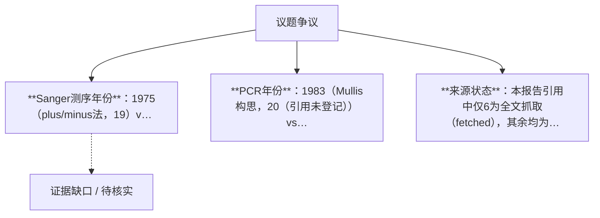

## 结论

DNA双螺旋确立了“序列即信息、配对即识别”的原理，经遗传密码破译、限制酶、测序与PCR、基因打靶与ZFN/TALEN、RNA干扰等中间发现层层工具化，最终使CRISPR-Cas9在2012年被工程化为以20个Watson-Crick碱基对定位靶点的可编程基因组编辑技术

<!-- confidence:mid -->
**置信度：中**

## 要点

- 1953年DNA双螺旋结构的发现确立了“遗传信息以线性碱基序列存储、通过互补配对识别”的基本原理2（引用未登记）。
- 此后近六十年间，这一原理经由遗传密码破译、限制性内切酶、重组DNA与测序技术、基因打靶与可编程核酸酶、RNA干扰等中间发现逐步工具化，最终在2012年由Jinek、Charpentier与Doudna将细菌CRISPR-Cas9免疫系统工程化为可编程基因组编辑技术6（引用未登记）。

## 争议与不确定

- **Sanger测序年份**：1975（plus/minus法，[19]）vs 1977（双脱氧法，通行说法），系两代方法，非事实冲突。
- **PCR年份**：1983（Mullis构思，20（引用未登记））vs 1985（首次发表，[26]），口径为“发明”与“发表”之别。
- **来源状态**：本报告引用中仅[6]为全文抓取（fetched），其余均为搜索摘要（snippet_only），事实表述以摘要与多来源交叉一致为准。

## 证据与来源

## 深入了解

### 内容分析 / Content Analysis

围绕争议点拆解：各方主张、可核对证据、仍不确定处。下表为冲突要点摘要（由结构后处理生成，需结合正文证据阅读）。

1. **Sanger测序年份**：1975（plus/minus法，[19]）vs 1977（双脱氧法，通行说法），系两代方法，非事实冲突。
2. **PCR年份**：1983（Mullis构思，20（引用未登记））vs 1985（首次发表，[26]），口径为“发明”与“发表”之别。
3. **来源状态**：本报告引用中仅[6]为全文抓取（fetched），其余均为搜索摘要（snippet_only），事实表述以摘要与多来源交叉一致为准。

### 关系拓扑 / Relationship Map

实线=注册表内有依据的支持关系，粗线=反驳，虚线=未知或未核实；连线只表示来源与主张的关系，不代表事实已核实。

### 二、第一环：读懂序列——遗传密码（1961–1966）

双螺旋揭示了DNA“如何存储”信息，但尚未破译其“语言”。Nirenberg等在1961–1966年间破译了全部64个密码子，确立了DNA→RNA→蛋白质的信息流66（引用未登记）。证据：ACS国家历史性地标明确记载“到1966年Nirenberg已破译64个三联密码子，DNA的语言由此被理解”[66]。这一环确立了“序列即信息”的世界观，是后续一切序列操作技术的思想前提65（引用未登记）。

### 三、第二环：会切DNA的酶——限制性内切酶（1968–1978）

Arber于1968年提出位点特异性限制酶假说，Smith于1970年纯化出首个II型限制酶，Nathans示范其用于DNA切割与图谱构建；三人获1978年诺贝尔奖11（引用未登记）14（引用未登记）。证据：Roberts在PNAS中指出限制酶“已成为DNA物理作图的无价工具”[11]。限制酶使人类首次能在特定序列处切开DNA，直接催生了1973年Cohen与Boyer的重组DNA实验15（引用未登记）。MPG专文明确将Cas9定位为限制酶的技术后裔——“从限制酶到CRISPR-Cas9”[103]。

## References

- [1] [The Discovery of the Double Helix, 1951-1953 \| Francis Crick](<https://profiles.nlm.nih.gov/spotlight/sc/feature/doublehelix>) — 仅摘要
  During the 1970s and 1980s, it helped to produce new and powerful scientific techniques, specifically recombinant DNA research, genetic engineering, rapid gene ...

- [2] [Francis Crick, Rosalind Franklin, James Watson, and ...](<https://www.sciencehistory.org/education/scientific-biographies/francis-crick-rosalind-franklin-james-watson-and-maurice-wilkins/>) — 仅摘要
  These four scientists codiscovered the double-helix structure of DNA, which formed the basis for modern biotechnology.

- [3] [National DNA Day celebrates two historic scientific milestones ...](<https://www.facebook.com/genomicsengland/videos/national-dna-day-celebrates-two-historic-scientific-milestones-the-discovery-of-/1331575434742246/>) — 仅摘要
  It highlights how, in 1953, the discovery of the molecule \(cod\) by scientists led to a major breakthrough in biology, transforming the field ...

- [4] [70 years of the DNA double helix: An interview with ...](<https://www.cell.com/molecular-cell/fulltext/S1097-2765(23)00242-3>) — 仅摘要
  by D Rhodes · 2023 · Cited by 6 — Daniela Rhodes spoke with Molecular Cell about the discovery of the double helical structure of DNA in 1953 and its impact on modern science.

- [5] [The twisting path to the dna double helix](<https://explorebiology.org/collections/neuroscience/the-twisting-path-to-the-dna-double-helix>) — 仅摘要
  The DNA double helix, one of the most influential discoveries in the history of science, revealed how information is stored and replicated in living organisms.

- [6] [CRISPR–Cas9: A History of Its Discovery and Ethical ... - PMC](<https://pmc.ncbi.nlm.nih.gov/articles/PMC9377665/>) — 已抓取全文（不代表事实核实）
  by I Gostimskaya · 2022 · Cited by 427 — For the first time in history a Nobel prize was awarded to two women, Emmanuelle Charpentier and Jennifer Doudna, who made key discoveries in ...

- [7] [CRISPR Timeline](<https://www.broadinstitute.org/what-broad/areas-focus/project-spotlight/crispr-timeline>) — 仅摘要
  The discovery of the CRISPR-Cas. June, 2012 — Charpentier and Jennifer Doudna, University of California, Berkeley … were reported at almost the same time by ...

- [8] [A Brief History of CRISPR-Cas9 Genome-Editing Tools](<https://bitesizebio.com/47927/history-crispr/>) — 仅摘要
  Learn the history of the CRISPR-Cas system from the first identification of CRISPRs in 1987 to the development of the CRISPR-Cas genome-editing tool.

- [9] [Timeline: CRISPR-Cas9](<https://www.whatisbiotechnology.org/index.php/timeline/science/CRISPR-Cas9>) — 仅摘要
  1987 The CRISPR mechanism first published 18 Jan 2000. CRISPR-Cas9 published for first time 2005 Jennifer Doudna and Jillian Banfield started investigating ...

- [10] [Origins of CRISPR: How it Came to Be](<https://www.bioagilytix.com/blog/origins-of-crispr-how-it-came-to-be/>) — 仅摘要
  CRISPR-Cas9 was first used as a gene-editing tool in 2012. In just a few years, the technology has exploded in popularity thanks to its promise of making ...

- [11] [How restriction enzymes became the workhorses of ...](<https://www.pnas.org/doi/10.1073/pnas.0500923102>) — 仅摘要
  by RJ Roberts · 2005 · Cited by 346 — Restriction enzymes have proved to be invaluable for the physical mapping of DNA. Nobel Committee decided in 1978 who should be on the ticket for the discovery ...

- [12] [Restriction enzymes \| Summary](<https://www.whatisbiotechnology.org/index.php/science/summary/restriction>) — 仅摘要
  Nathans was the first scientist to demonstrate how restriction enzymes could be used to cleave DNA and how to piece together its fragments to construct a … ...

- [13] [Recombinant DNA the Bio-Revolution, Between Promise ...](<https://pmc.ncbi.nlm.nih.gov/articles/PMC12294703/>) — 仅摘要
  by MR El-Gewely · 2025 · Cited by 2 — Werner Arber, Dan Nathans, and Hamilton Smith, received the Nobel prize in 1978. restriction enzymes to cut pieces of DNA, termed the ...

- [14] [Hamilton O. Smith - Nobel Lecture](<https://www.nobelprize.org/uploads/2018/06/smith-lecture.pdf>) — 仅摘要
  by HO SMITH · Cited by 284 — Arber postulated the existence of site- specific restriction enzymes and suggested that modification might be produced by hostspecific DNA methylases \(5\).

- [15] [The Genesis of Recombinant DNA: The 1972 Cohen-Boyer ...](<https://www.facebook.com/ecogenezap/posts/the-genesis-of-recombinant-dna-the-1972-cohen-boyer-breakthroughin-1972-stanley-/122167853750923316/>) — 仅摘要
  In 1973, scientists Herbert Boyer and Stanley Cohen performed the world&\#x27;s first recombinant DNA experiment. They used restriction enzymes to cut ...

- [16] [Smith and Nathans discover enzymes that dissect DNA](<https://scalar.fas.harvard.edu/the-river-divides-into-thousands-of-branches/chapter-18-smith-and-nathans-discover-enzymes-that-dissect-dna>) — 仅摘要
  Discovery of endonuclease restriction enzymes. This discovery was reported by Linn and Arber in 1968. A key to their finding was that the enzyme ...

- [17] [Hamilton O. Smith \| Biography, Nobel Prize, &amp; Facts](<https://www.britannica.com/biography/Hamilton-O-Smith>) — 仅摘要
  The possibility for recombinant DNA technology emerged with the discovery of restriction enzymes in 1968 by Swiss microbiologist Werner Arber.

- [18] [Restriction enzyme](<https://en.wikipedia.org/wiki/Restriction_enzyme>) — 仅摘要
  The discovery of restriction enzymes allows DNA to be manipulated, leading to the development of recombinant DNA technology that has many applications,

- [19] [The genome editing revolution](<https://edepot.wur.nl/588225>) — 仅摘要
  by J van der Oost · 2023 · Cited by 146 — DNA recombination. Berg\*. 1975. DNA sequencing. Sanger\*, Maxim\*. 1986. PCR and site-directed mutagenesis. Mullis\* and Smith\*. 1992. Laboratory ...

- [20] [Polymerase chain reaction](<https://en.wikipedia.org/wiki/Polymerase_chain_reaction>) — 仅摘要
  PCR was invented in 1983 by American biochemist Kary Mullis at Cetus Corporation. ... Site-directed mutagenesis: PCR can be used to create mutant genes with ...

- [21] [Development of PCR &amp; Sanger Sequencing](<https://openpress.wheatoncollege.edu/molecularecologyv1/chapter/development-of-pcr-sanger-sequencing/>) — 仅摘要
  Developed in the 1980s by Kary Mullis, PCR revolutionized molecular biology by enabling rapid and efficient amplification of DNA,

- [22] [The Invention of PCR](<https://bitesizebio.com/13505/the-invention-of-pcr/>) — 仅摘要
  Kary Mullis is generally credited with inventing PCR in 1983. Mullis was hatching an idea to detect the point mutations using Sanger-type DNA ...

- [23] [Major Milestones in PCR Technology](<https://www.thermofisher.com/us/en/home/brands/thermo-scientific/molecular-biology/molecular-biology-learning-center/molecular-biology-resource-library/spotlight-articles/pcr-landmark-publications.html>) — 仅摘要
  1983 PCR invented Kary Mullis, working at Cetus, creates PCR to synthesize DNA from a single, specific location in the genome.

- [24] [Exponentially Important: The Scientific Origins of PCR](<https://www.simonsfoundation.org/news/exponentially-important-the-scientific-origins-of-pcr/>) — 仅摘要
  Ever since Kary Mullis, PhD, won a share of the Nobel Prize in Chemistry in 1993 for the invention of PCR, the scientific origin story of the ...

- [25] [The genome editing revolution](<https://www.sciencedirect.com/science/article/pii/S016777992200350X>) — 仅摘要
  by J van der Oost · 2023 · Cited by 146 — A few years later, another milestone in the molecular biology field was the groundbreaking discovery of the polymerase chain reaction \(PCR\) by Kary Mullis \(1983\) ...

- [26] [History of the Polymerase Chain Reaction, 1992-1993.](<https://siarchives.si.edu/oldsite/research/videohistory_catalog9577.html>) — 仅摘要
  The Polymerase Chain Reaction \(PCR\) technique, invented in 1985 by Kary B. Mullis, allowed scientists to make millions of copies of a scarce sample of DNA.

- [27] [Gene Modification in Mice](<https://www.nobelprize.org/prizes/medicine/2007/advanced-information/>) — 仅摘要
  Mario Capecchi and Oliver Smithies, independently of each other, discovered how homologous recombination between segments of DNA molecules can be used to target ...

- [28] [Pros and cons of ZNFs, TALENs, and CRISPR/Cas](<https://www.jax.org/news-and-insights/jax-blog/2014/march/pros-and-cons-of-znfs-talens-and-crispr-cas>) — 仅摘要
  In 2007, the importance of gene targeting technology in advancing our understanding of mammalian biology was recognized by the Nobel Prize Selection ...

- [29] [Expanding the genetic editing tool kit: ZFNs, TALENs ... - PMC](<https://pmc.ncbi.nlm.nih.gov/articles/PMC4191047/>) — 仅摘要
  by RM Gupta · 2014 · Cited by 877 — Gene targeting by homologous recombination in mouse zygotes mediated by zinc-finger nucleases. Proc Natl Acad Sci U S A. 2010;107\(34\):15022–15026. doi ...

- [30] [History of genome editing: From meganucleases to CRISPR](<https://kups.ub.uni-koeln.de/36822/1/Manuscript_KUPS_publish.pdf>) — 仅摘要
  by SE Tröder · Cited by 82 — Oliver Smithies and Mario Capecchi employed the process of homologous recombination. Mario Capecchi, Martin Evans and Oliver Smithies the 2007 Nobel Prize in ...

- [31] [2007 Nobel Prize, Medicine: Gene Modifications in Mice](<https://sites.dartmouth.edu/dujs/2008/04/08/2007-nobel-prize-mario-r-capecchi-martin-k-evans-and-oliver-smithies-medicine-gene-modifications-in-mice-by-use-of-embryonic-stem-cells/>) — 仅摘要
  Capecchi and Smithies demonstrated that genes could be targeted by homologous recombination in cultured cells, and Evans contributed the ...

- [32] [History of genome editing: From meganucleases to CRISPR](<https://journals.sagepub.com/doi/pdf/10.1177/0023677221994613>) — 仅摘要
  by SE Tröder · 2022 · Cited by 82 — Oliver Smithies and Mario Capecchi employed the process of homologous recombination. Mario Capecchi, Martin Evans and Oliver Smithies the 2007 Nobel Prize in ...

- [33] [ZFNs, TALENs, and CRISPR-Cas9 - Harvard DASH](<https://dash.harvard.edu/bitstreams/7312037d-9d8e-6bd4-e053-0100007fdf3b/download>) — 仅摘要
  by R Gupta · 2014 · Cited by 877 — Gene targeting by homologous recombination in mouse zygotes mediated by zinc-finger nucleases.

- [34] [PRESS RELEASE: Nobel Prize awarded to Gene ...](<https://www.fiercebiotech.com/biotech/press-release-nobel-prize-awarded-to-gene-targeting-trio>) — 仅摘要
  Capecchi and Smithies had demonstrated that genes could be targeted by homologous recombination in cultured cells, and Evans had contributed ...

- [35] [The Nobel Prize in Physiology or Medicine 2006 - Popular ...](<https://www.nobelprize.org/prizes/medicine/2006/popular-information/>) — 仅摘要
  Andrew Fire and Craig Mello published their discovery of RNA interference in 1998. Their surprising discovery was that double-stranded RNA \(dsRNA\) plays an ...

- [36] [Craig Mello and RNA interference Nobel Prize 2006](<https://www.facebook.com/nobelprize/posts/rna-has-multiple-functions-among-these-messenger-rna-mrna-carries-genetic-inform/1532116012283556/>) — 仅摘要
  In 1998, Craig Mello \(pictured\) and Andrew Fire. RNA blocks mRNA so that certain genetic information is not converted during protein formation. ...

- [37] [RNAi vs. CRISPR: Guide to Selecting the Best Gene ...](<https://www.synthego.com/blog/rnai-vs-crispr-guide/>) — 仅摘要
  RNAi silences genes by generating knockdowns at the mRNA level, while CRISPR generates knockouts at the DNA level. This article compares the ...

- [38] [RNA interference: big applause for silencing in Stockholm](<https://pubmed.ncbi.nlm.nih.gov/17174883/>) — 仅摘要
  by PD Zamore · 2006 · Cited by 112 — Craig Mello, Andrew Fire, and their coworkers provided the first demonstration that double-stranded RNA \(dsRNA\) triggers the gene-silencing technique that we ...

- [39] [2006 Nobel Prize](<https://nemaplex.ucdavis.edu/General/News/2006_nobel_prize.htm>) — 仅摘要
  Fire, Mello and colleagues discovered that certain RNA molecules could be used to turn off specific genes in animal cells.

- [40] [What is RNAi - RNAi Biology](<https://www.umassmed.edu/rti/biology/rna/how-rnai-works/>) — 仅摘要
  Andrew Fire and the RTI&\#x27;s Craig Mello discovered how to use RNA to find and regulate specific genes. It&\#x27;s known as RNA interference \(or RNAi\) and it earned ...

- [41] [RNA interference](<https://www.animalresearch.info/en/medical-advances/nobel-prizes/rna-interference/>) — 仅摘要
  Andrew Fire and Craig Mello studied regulation of gene expression in the nematode Caenorhabditis elegans. They found that injecting mRNA which ...

- [42] [RNA Interference - C&amp;EN - American Chemical Society](<https://cen.acs.org/articles/84/i40/RNA-Interference.html>) — 仅摘要
  Fire and Mello unearthed RNAi while studying the regulation of gene expression in the worm Caenorhabditis elegans. When the mRNA for making a ...

- [43] [Crispr cas a bacterial immune system](<https://explorebiology.org/collections/cell-biology/crispr-cas-a-bacterial-immune-system>) — 仅摘要
  This Key Discovery traces how a bacterial immune system, called CRISPR-Cas, emerged unexpectedly from putting together clues about mysterious DNA sequences in ...

- [44] [History of CRISPR-Cas from Encounter with a Mysterious ... - PMC](<https://pmc.ncbi.nlm.nih.gov/articles/PMC5847661/>) — 仅摘要
  by Y Ishino · 2018 · Cited by 882 — The first hint of their existence came in 1987, when an unusual repetitive DNA sequence, as a CRISPR, was discovered in the Escherichia coli ...

- [45] [CRISPR](<https://en.wikipedia.org/wiki/CRISPR>) — 仅摘要
  The CRISPR/Cas system evolved in nature as a means for bacteria to protect themselves from invading viruses and bacteriophages by inserting pieces of their DNA ...

- [46] [Review The CRISPR-Cas immune system: Biology, mechanisms and ...](<https://www.sciencedirect.com/science/article/pii/S0300908415001042>) — 仅摘要
  by D Rath · 2015 · Cited by 915 — The CRISPR-Cas system targets DNA or RNA as a way of protecting against viruses and other mobile genetic elements \[2\], \[4\]. The CRISPR locus, first observed in ...

- [47] [the generation of memory by CRISPR-Cas immune systems](<https://onlinelibrary.wiley.com/doi/full/10.1111/mmi.12640>) — 仅摘要
  by R Heler · 2014 · Cited by 156 — The adaptive feature of CRISPR-Cas immune systems relies on their ability to memorize DNA sequences of invading molecules and integrate them in ...

- [48] [The Discovery of the CRISPR-Cas System: How Unexpected Bacterial ...](<https://exploratiojournal.com/the-discovery-of-the-crispr-cas-system-how-unexpected-bacterial-immunity-transformed-the-field-of-genetics/>) — 仅摘要
  The discovery of CRISPR began unexpectedly in 1987 when Ishino and colleagues identified an unusual pattern of repetitive DNA sequences while ...

- [49] [A Programmable Dual-RNA–Guided DNA Endonuclease ...](<https://www.science.org/doi/10.1126/science.1225829>) — 仅摘要
  by M Jinek · 2012 · Cited by 25589 — The dual-tracrRNA:crRNA, when engineered as a single RNA chimera, also directs sequence-specific Cas9 dsDNA cleavage. Our study reveals a family ...

- [50] [A programmable dual-RNA-guided DNA endonuclease in ...](<https://pubmed.ncbi.nlm.nih.gov/22745249/>) — 仅摘要
  by M Jinek · 2012 · Cited by 25589 — Our study reveals a family of endonucleases that use dual-RNAs for site-specific DNA cleavage and highlights the potential to exploit the system ...

- [51] [Programmable DNA Scissors Found for Bacterial Immune ...](<https://newscenter.lbl.gov/2012/06/28/programmable-dna-scissors/>) — 仅摘要
  Doudna and her colleagues demonstrated that the dual tracrRNA:crRNA molecules can be engineered as a single RNA chimera for site-specific DNA ...

- [52] [Jennifer Doudna and Emmanuelle Charpentier&\#x27;s Experiment ...](<https://embryo.asu.edu/pages/jennifer-doudna-and-emmanuelle-charpentiers-experiment-about-crisprcas-9-systems-role-adaptive>) — 仅摘要
  Doudna, Charpentier, and their colleagues confirmed that both crRNA and tracrRNA were necessary for guiding cas-9 in recognizing and cleaving ...

- [53] [A programmable dual RNA-guided DNA endonuclease ... - PMC](<https://pmc.ncbi.nlm.nih.gov/articles/PMC6286148/>) — 仅摘要
  by M Jinek · 2012 · Cited by 25589 — Cas9 is thought to be the sole protein responsible for crRNA-guided silencing of foreign DNA \(25-27\). 9 can be programmed with a single chimeric RNA.

- [54] [Examining CRISPR-Cas9: A Primer for “A Programmable Dual ...](<https://pubs.lib.umn.edu/index.php/djub/article/download/1546/1339/4174>) — 仅摘要
  The paper by Jinek and colleagues, “A Programmable Dual-RNA- Guided DNA Endonuclease was the first to describe the functions of all the molecular components in ...

- [55] [14 years ago, the revolutionary genetic tool CRISPR/Cas9 ...](<https://www.facebook.com/ScienceMagazine/posts/14-years-ago-the-revolutionary-genetic-tool-crisprcas9-was-published-in-science-/1471766498148648/>) — 仅摘要
  Jinek et al. \(2012\), Science “A Programmable Dual-RNA–Guided DNA Endonuclease in Adaptive Bacterial Immunity” uses CRISPR sequences as a guide ...

- [56] [Twenty Letters That Aim the Scissors: How a 2012 Paper ...](<https://www.jerrycards.com/news/doudna-charpentier-2012-crispr-cas9-birth-of-programmable-gene-editing>) — 仅摘要
  In June 2012, Jinek, Chylinski, Fonfara, Hauer, Doudna and Charpentier showed that a bacterial protein called Cas9 could be aimed at any DNA ...

- [57] [CRISPR/Cas9 for Human Genome Engineering and Disease Research](<https://www.annualreviews.org/content/journals/10.1146/annurev-genom-083115-022258>) — 仅摘要
  by X Xiong · 2016 · Cited by 140 — Highly efficient RNA-guided genome editing in human cells via delivery of purified Cas9 ribonucleoproteins. Zhang F, Cong L,

- [58] [CRISPR-Cas9 System as a Versatile Tool for Genome Engineering in ...](<https://pmc.ncbi.nlm.nih.gov/articles/PMC5155327/>) — 仅摘要
  by X Wang · 2016 · Cited by 40 — We discuss the most recent advancements in the molecular basis of the type II CRISPR/Cas system and encapsulate applications and elements ...

- [59] [CRISPR/Cas9 Genome-Editing System in Human Stem Cells](<https://www.sciencedirect.com/science/article/pii/S2162253117302597>) — 仅摘要
  by Z Zhang · 2017 · Cited by 164 — Since its introduction in 2013, the CRISPR/Cas9 genome-editing system has been rapidly developed and widely used in all human stem cell studies.

- [60] [New system for human genome editing has potential to increase ...](<https://news.mit.edu/2015/crispr-editing-dna-genome-engineering-0925>) — 仅摘要
  The application of the CRISPR-Cas9 system for mammalian genome editing was first reported in 2013, by Zhang and separately by George Church at ...

- [61] [Enhanced homology-directed human genome engineering by controlled ...](<https://elifesciences.org/articles/04766>) — 仅摘要
  by S Lin · 2014 · Cited by 1677 — The CRISPR/Cas9 system is a robust genome editing technology that works in human cells, animals and plants based on the RNA-programmed DNA ...

- [62] [RNA-Guided Human Genome Engineering via Cas9](<https://courses.cs.duke.edu/compsci662/current/pdf/cong.2013.pdf>) — 仅摘要
  by C Almendros · 2012 · Cited by 13421 — Mali et al., Science 339, 823 \(2013\). we engineer the type II bacterial CRISPR system to function with custom guide RNA \(gRNA\) in human cells. ...

- [63] [CRISPR gene editing](<https://en.wikipedia.org/wiki/CRISPR_gene_editing>) — 仅摘要
  Successful CRISPR-Cas9 genome editing was first achieved in plants in August 2013. ... &quot;Modeling human disease in rodents by CRISPR/Cas9 genome editing&quot;.

- [64] [CRISPR technology: A decade of genome editing is only the beginning](<https://www.science.org/doi/10.1126/science.add8643>) — 仅摘要
  by JY Wang · 2023 · Cited by 1363 — Over the past decade, scientists have utilized CRISPR technology as a readily adaptable tool to probe biological function, dissect genetic ...

- [65] [The Genetic Code: Francis Crick&\#x27;s Legacy and Beyond - PMC](<https://pmc.ncbi.nlm.nih.gov/articles/PMC5041012/>) — 仅摘要
  by K Tamura · 2016 · Cited by 27 — In 1961, Francis Crick, That was the moment that scientists cracked the code of life. the genetic code was cracked, and it is the greatest ...

- [66] [Deciphering the Genetic Code - National Historic ...](<https://www.acs.org/education/whatischemistry/landmarks/geneticcode.html>) — 仅摘要
  By 1966 Nirenberg had deciphered the 64 RNA three-letter code words \(codons\) for all 20 amino acids. The language of DNA was now understood and the code could ...

- [67] [How the Code was Cracked](<https://educationalgames.nobelprize.org/educational/medicine/gene-code/history.html>) — 仅摘要
  In 1953 James Watson and Francis Crick revealed the structure and properties of DNA, arranged in a double helix, like a twisted rope ladder ...

- [68] [Breaking the Code](<https://www.sciencehistory.org/stories/magazine/breaking-the-code/>) — 仅摘要
  James Watson and Francis Crick electrified the world by revealing their double-helix model of DNA structure in their 1953 Nature article. ...

- [69] [Cracking the genetic code](<https://www.genomicseducation.hee.nhs.uk/blog/cracking-the-genetic-code/>) — 仅摘要
  At last, the genetic code had been cracked. Nirenberg revealed how the information to build proteins was translated from the genetic material.

- [70] [Cracking the Genetic Code](<https://www.encyclopedia.com/science/encyclopedias-almanacs-transcripts-and-maps/cracking-genetic-code>) — 仅摘要
  In 1966 the genetic code was cracked when Nirenberg and his team announced that a specific sequence of three nucleotide bases \(a codon\) determined each of ...

- [71] [How Understanding DNA Revolutionized Biology](<https://laskerfoundation.org/from-messy-glob-to-driving-force-how-understanding-dna-revolutionized-biology/>) — 仅摘要
  Cracking the genetic code, and learning how the linear molecule of DNA determines the three-dimensional structure of proteins, marked the dawn ...

- [72] [Nirenberg Cracks the Genetic Code \| Health and Medicine](<https://www.ebsco.com/research-starters/health-and-medicine/nirenberg-cracks-genetic-code/>) — 仅摘要
  Nirenberg developed a breakthrough experimental method that unraveled the genetic code, enabling scientists to understand the language in which DNA describes ...

- [73] [Crystal Structure of Cas9 in Complex with Guide RNA ... - PMC](<https://pmc.ncbi.nlm.nih.gov/articles/PMC4139937/>) — 仅摘要
  by H Nishimasu · 2014 · Cited by 3097 — Watson-Crick base pairing to facilitate nucleic acid destruction. The guide \(nucleotides 1–20\) and target DNA \(nucleotides 1′–20′\) form the guide:target ...

- [74] [Structural basis for Cas9 off-target activity - PMC - NIH](<https://pmc.ncbi.nlm.nih.gov/articles/PMC10103147/>) — 仅摘要
  by M Pacesa · 2022 · Cited by 255 — The target DNA specificity of the CRISPR-associated genome editor nuclease Cas9 is determined by complementarity to a 20-nucleotide segment in its guide RNA.

- [75] [Crystal Structure of Cas9 in Complex with Guide RNA and ...](<https://www.sciencedirect.com/science/article/pii/S0092867414001561>) — 仅摘要
  by H Nishimasu · 2014 · Cited by 3097 — The CRISPR-associated endonuclease Cas9 can be targeted to specific genomic loci by single guide RNAs \(sgRNAs\). Here, we report the crystal ...

- [76] [Crystal Structure of Cas9 in Complex with Guide RNA and ...](<https://cast.cau.edu.cn/Upload/PDFs/Crystal%20Structure%20of%20Cas9%20in%20Complex%20with%20Guide%20RNA%20and%20Target%20DNA-20150720.pdf>) — 仅摘要
  by N Dohmae · 2014 · Cited by 2961 — The guide \(nucleotides 1–20\) and target DNA \(nucleotides 10– 200\) form the guide:target heteroduplex via 20 Watson-Crick base pairs \(Figures 4A and 4B\).

- [77] [DNA interrogation by the CRISPR RNA-guided... : Nature](<https://www.ovid.com/00006056-201403060-00039>) — 仅摘要
  Cas9–RNA must destabilize the adjacent duplex and initiate strand separation to enable base pairing between the target DNA strand and the crRNA ...

- [78] [How does the CRISPR/Cas9 system target specific DNA ...](<https://www.chegg.com/homework-help/questions-and-answers/crispr-cas9-system-target-specific-dna-sequences-editing-q153140694>) — 仅摘要
  How does the CRISPR/Cas9 system target specific DNA sequences for editing?

- [79] [Structural basis for Cas9 off-target activity](<https://www.cell.com/cell/pdf/S0092-8674(22)01198-9.pdf>) — 仅摘要
  by M Pacesa · 2022 · Cited by 255 — The target DNA specificity of the CRISPR-associated genome editor nuclease Cas9 is determined by complementarity to a 20-nucleotide segment ...

- [80] [The Complete Guide to Understanding CRISPR sgRNA](<https://www.synthego.com/guide/how-to-use-crispr/sgrna/>) — 仅摘要
  The guide RNA \(gRNA\) provides the specificity of the system. It contains a sequence that recognizes a complementary region of DNA and directs the Cas nuclease ...

- [81] [Crystal Structure of Cas9 in Complex with Guide RNA and ...](<https://stacks.cdc.gov/view/cdc/30086>) — 仅摘要
  by H Nishimasu · 2014 · Cited by 3097 — Here, we report the crystal structure of Streptococcus pyogenes Cas9 in complex with sgRNA and its target DNA at 2.5 Å resolution. The structure revealed a ...

- [82] [A Needle in a Base-Stack: Cas9 Structural Biology](<https://blog.addgene.org/a-needle-in-a-base-stack-cas9-structural-biology>) — 仅摘要
  The crystal structure in Figure 3 shows the guide RNA stabilizing the DNA-binding protein portion of the CTD, ready to check for PAM sequencines ...

- [83] [Article Crystal Structure of Staphylococcus aureus Cas9](<https://www.sciencedirect.com/science/article/pii/S009286741501020X>) — 仅摘要
  by H Nishimasu · 2015 · Cited by 627 — Here, we report the crystal structures of SaCas9 in complex with a single guide RNA \(sgRNA\) and its double-stranded DNA targets, containing the 5′-TTGAAT-3′ PAM ...

- [84] [Crystal Structure of Staphylococcus aureus Cas9](<https://www.cell.com/fulltext/S0092-8674(15)01020-X>) — 仅摘要
  by H Nishimasu · 2015 · Cited by 627 — Here, we report the crystal structures of SaCas9 in complex with a single guide RNA \(sgRNA\) and its double-stranded DNA targets, containing the 5′-TTGAAT-3′ PAM ...

- [85] [5b2q - Crystal structure of Francisella novicida Cas9 RHA ...](<https://pdbj.org/mine/summary/5b2q>) — 仅摘要
  Here, we report the 1.7 Å resolution crystal structures of Cas9 from Francisella novicida 9\), one of the largest Cas9 orthologs, in complex with a guide RNA ...

- [86] [Structural basis for the promiscuous PAM recognition by ...](<https://www.nature.com/articles/s41467-019-09741-6>) — 仅摘要
  by S Hirano · 2019 · Cited by 66 — we report the crystal structure of CdCas9 in complex with the guide RNA. Crystal structure of Cas9 in complex with guide RNA and target DNA. ...

- [87] [Structure and Engineering of Francisella novicida Cas9](<https://escholarship.org/content/qt26v3v5z8/qt26v3v5z8.pdf?v=lg>) — 仅摘要
  by H Hirano · 2016 · Cited by 480 — The crystal structures of SpCas9 and SaCas9 have provided mechanistic insights into the. RNA-guided DNA recognition and cleavage by Cas9 \(Jinek ...

- [88] [CRISPR-Cas9-mediated homology-directed repair for ... - PMC](<https://pmc.ncbi.nlm.nih.gov/articles/PMC11531618/>) — 仅摘要
  by H Liao · 2024 · Cited by 269 — CRISPR-Cas9-mediated gene editing can be achieved through either non-homologous end joining \(NHEJ\) or homology-directed repair \(HDR\) pathways. NHEJ introduces ...

- [89] [HDR vs NHEJ: DNA Repair Pathway Comparison](<https://invivobiosystems.com/crispr/hdr-vs-nhej/>) — 仅摘要
  HDR and NHEJ are the two key pathways responsible for repairing the double-strand breaks created by CRISPR.

- [90] [CRISPR 101: Homology Directed Repair](<https://blog.addgene.org/crispr-101-homology-directed-repair>) — 仅摘要
  In this post, we will describe the mechanism of homology directed repair, one of the repair pathways of DSBs, with a focus on repair for genome ...

- [91] [strategies to enhance the frequency of homology-directed ...](<https://www.bmbreports.org/journal/view.html?uid=1289>) — 仅摘要
  by S Devkota · 2018 · Cited by 96 — DSB repair mechanisms are grouped under two major categories: Non-Homologous End Joining \(NHEJ\) and Homology-directed Repair \(HDR\) \(15\). The choice of NHEJ ...

- [92] [Homology Directed Repair - an overview](<https://www.sciencedirect.com/topics/neuroscience/homology-directed-repair>) — 仅摘要
  It is well known that double strand breaks \(DSBs\) caused by CRISPR/Cas9 can be repaired by nonhomologous end joining \(NHEJ\) or homology-directed repair \(HDR\) ...

- [93] [Homology-Directed Repair: How the Cell Edits DNA After a ...](<https://www.youtube.com/watch?v=Rv6-RB20f0s>) — 仅摘要
  Sometimes DNA breaks because of insults like x-rays, UV rays, or genetic scissors \(e.g., CRISPR-Cas9\). DNA breakage can have serious ...

- [94] [CRISPR-Cas9-mediated homology-directed repair for ...](<https://www.cell.com/molecular-therapy-family/nucleic-acids/fulltext/S2162-2531(24)00231-2>) — 仅摘要
  by H Liao · 2024 · Cited by 269 — CRISPR-Cas9-mediated homology-directed repair \(HDR\) is a versatile platform for creating precise site-specific DNA insertions, deletions, and ...

- [95] [HDR vs. NHEJ: CRISPR Gene Editing Techniques](<https://www.zeclinics.com/blog/hdr-vs-nhej-in-crispr-gene>) — 仅摘要
  NHEJ is an error-prone DNA repair pathway that rejoins broken DNA ends without requiring a template with homologous sequences.

- [96] [Applications of a New Tool for Genome Editing in Biotech](<https://www.sciencedirect.com/science/article/pii/S2162253118303123>) — 仅摘要
  by SK Saha · 2019 · Cited by 62 — CRISPR-Cas9 RNA-guided nucleases \(CRISPR-Cas9\). use three types of endonucleases: zinc-finger nucleases \(ZFNs\), TALENs, and CRISPR-Cas9. the ...

- [97] [CRISPR-Cas9 works like programmable molecular ...](<https://www.facebook.com/Themech.mind/posts/crispr-cas9-works-like-programmable-molecular-scissorsa-guide-rna-directs-the-ca/1705576651136204/>) — 仅摘要
  CRISPR-Cas9 works like programmable molecular scissors\! A guide RNA directs the Cas9 enzyme toward a matching DNA sequence, where it cuts ...

- [98] [Restriction Enzymes versus CRISPR-Cas](<https://blog.edvotek.com/2025/06/19/restriction-enzymes-versus-crispr-cas/>) — 仅摘要
  It uses a guide RNA \(gRNA\) to direct the Cas9 nuclease to a certain DNA sequence. it can be programmed to target nearly any sequence by ...

- [99] [Genome Editing — DRZE](<https://www.drze.de/en/research-publications/in-focus/somatic-gene-therapy/modules/genome-editing>) — 仅摘要
  Cas9 is an enzyme with a so-called nuclease activity that enables it to completely cut through a DNA strand. Such enzymes are called restriction enzymes

- [100] [Science &amp; Technology \| Understanding CRISPR/Cas9](<https://ersgenomics.com/science>) — 仅摘要
  Cas9 nuclease, an enzyme that binds and cuts DNA, and a guide RNA \(gRNA\) that directs the Cas9 to its specific target sequence.

- [101] [From Bioengineering to CRISPR/Cas9 - PMC - NIH](<https://pmc.ncbi.nlm.nih.gov/articles/PMC5790776/>) — 仅摘要
  by A Jeltsch · 2018 · Cited by 1 — The CRISPR/Cas9 system targets DNA with a short, single-stranded, so called crRNA that brings the Cas9 nuclease to homologous DNA sequences \( ...

- [102] [Cas9 Nuclease: Structure, Mechanism &amp; Genome Editing](<https://lifesciences.danaher.com/us/en/library/cas9-nuclease.html>) — 仅摘要
  Cas9 is an RNA‐guided endonuclease. It acts as programmable molecular scissors, introducing double‐stranded DNA breaks at sequences specified by a guide RNA \( ...

- [103] [From restriction enzymes to CRISPR-Cas9](<https://www.mpg.de/11825120/crispr-cas9-methods>) — 仅摘要
  These enzymes recognize characteristic DNA sequences and cut them. Bacteria and Archaea can also use these enzymes to locate foreign DNA and render it harmless.
