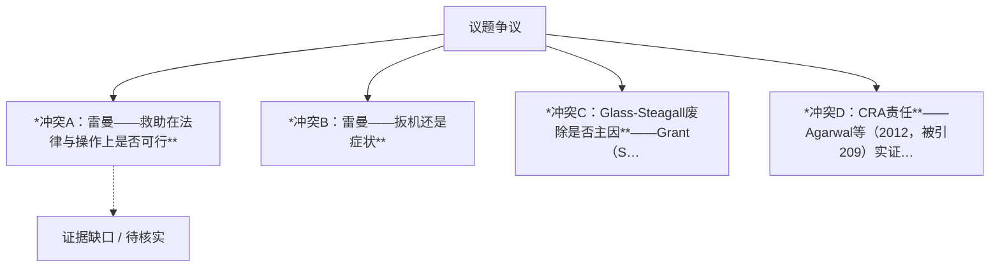

## 结论

冲突A：雷曼——救助在法律与操作上是否可行

<!-- confidence:high -->
**置信度：高**

## 要点

- 2008年金融危机的主因存在稳固的共识层与六个长期未决的争议层。
- **共识层（）**：房地产泡沫破裂、抵押贷款承销标准恶化、证券化与衍生品扩散风险、金融机构过度杠杆、监管缺位——这些在FCIC官方报告[36]、FDIC官方史料[1]与布鲁金斯学会分析[3]中相互印证。
- **争议层（）**：《格拉斯-斯蒂格尔法案》废除、CRA、货币政策、政府住房政策、评级机构责任各自存在至少两种对立且有独立来源支撑的解释，官方调查委员会自身即告分裂30（引用未登记）。

## 争议与不确定

冲突A：雷曼——救助在法律与操作上是否可行

## 证据与来源

### 时间线 / Timeline

**冲突E：货币政策**——Taylor（2008，FCIC证词，被引2065）：2002–2005年利率偏离Taylor规则压低借贷成本、吹大泡沫[26]，并在回复Bernanke时坚持"利率过低太久"[25]；Bernanke（2010年1月3日演讲）：全球储蓄过剩压低长期实际利率，Fed政策并无违规[22]；芝加哥联储Barsky等论证储蓄过剩必然压低世界利率[29]；Fitwi（2015，J. Econ. & Business，被引10）直接对比"Bernanke vs Taylor"两种解释[28]；EconomicsOne提出"两者兼有"[23]；Cato博客指出Bernanke（储蓄过剩说）与Summers（长期停滞说）内部亦有分歧[27]。

**冲突F：政府住房政策/GSE**——FCIC的Wallison单独异议（2011，被引56）：Fannie/Freddie为满足HUD可负担住房目标大量收购高风险贷款，是承销恶化的真正起点30（引用未登记）[34]，并公开与委员会决裂[32]；FCIC多数派不采纳此说[36]；CAP反驳称Wallison依赖Pinto的"有缺陷数据"[33]，并指Fannie/Freddie并非私募MBS需求的主要创造者[37]。

**冲突G：评级机构**——主流指控（FCIC[36]、Hill被引142[39]、White NYU Stern被引112[43]、

### Evidence（证据含来源与日期）

（结构自动补全）原文缺少独立 Evidence / 证据 标题；以下为从正文抽取的来源线索，禁止据此伪造确定性。

2008年金融危机的主因存在稳固的共识层与六个长期未决的争议层。**共识层（置信度：高）**：房地产泡沫破裂、抵押贷款承销标准恶化、证券化与衍生品扩散风险、金融机构过度杠杆、监管缺位——这些在FCIC官方报告[36]、FDIC官方史料[1]与布鲁金斯学会分析[3]中相互印证。**争议层（置信度：中）**：《格拉斯-斯蒂格尔法案》废除、CRA、货币政策、政府住房政策、评级机构责任各自存在至少两种对立且有独立来源支撑的解释，官方调查委员会自身即告分裂30（引用未登记）。**雷曼问题（置信度：中）**："雷曼倒闭是危机扳机还是症状"以及"美联储当时能否依法救助"至今无裁决，Ball（NBER WP 22410）与官方说法形成最尖锐的正面冲突56（引用未登记）。

**背景与主线**：危机遵循典型的繁荣-萧条周期，起源于数年前的房地产市场[1]；低利率环境下监管者"睁一只眼闭一只眼"，金融机构不断加杠杆[3]；金融工程（证券化）与放松管制被学界并列为两大主因[4]；抵押贷款违约上升使MBS贬值，侵蚀机构净资产并引发连锁抛售[2]。FCIC多数派报告将危机归因于监管失败、过度杠杆、衍生品与影子银行崩溃[36]。

**雷曼子线的新发现**：我全文抓取了Ball的NBER论文[56]。其核心主张有两层：(1) "缺乏法律授权"并非美联储不救雷曼的真实原因；(2) 美联储**确实拥有**救助所需的法律权限。Fed官员（从Bernanke以下）反复坚称"想救但不能救，因雷曼缺乏足够抵押品"[56]。对照事实：雷曼是危机中唯一破产的大型金融机构，而处境类似的贝尔斯登与AIG均获美联储紧急贷款获救[56]。FCIC第18章的官方版本则称，不救助的原因包括缺乏愿意且有能力接盘的私人买家等[50]。"症状派"（布鲁金斯/Yale）则认为雷曼倒闭只是影子银行体系脆弱性的暴露，回购市场挤兑在此之前早已开始46（引用未登记）；雷曼破产后货币市场 indeed 发生挤兑，ABCP、CP与回购融资出现短缺[62]，但挤兑的起点时间正是争议所在。

**冲突A：雷曼——救助在法律与操作上是否可行**
| 一方 | 另一方 | 冲突点 |
|---|---|---|
| Ball：美联储**有**法律授权，抵押品充足（书稿提及抵押品本可产生约$95相关现金流，仅摘要片段，数字不完整）56（引用未登记）；不救的真实原因含政治顾虑 | 官方（Bernanke等）：雷曼抵押品不足，Fed缺乏放贷的法律授权 | Ball直接称官方说法"在两种意义上都不正确"[56] |
| FCIC第18章：无法救助因缺乏私人买家与法律授权[50] | AEI转载Ball观点：Bernanke Fed本可救而选择不救[60] | 同一官方调查对"能否救"给出与Ball相反的结论 |

**冲突B：雷曼——扳机还是症状**
| 一方 | 另一方 |
|---|---|
| 流行叙事（Wikipedia"Crash of '08"等）：雷曼破产是次贷危机的高潮/定义性事件47（引用未登记） | 布鲁金斯Baily等：该叙事是错误的——雷曼是系统性脆弱的症状而非火种[46]；Yale Wiggins（被引166）：影子银行短期融资收缩在雷曼之前已开始[48] |
| 可能的口径原因：叙事派依赖事后时间顺序（雷曼→恐慌升级），症状派依赖资金市场数据的先行变化 | |

## 深入了解

### 内容分析 / Content Analysis

围绕争议点拆解：各方主张、可核对证据、仍不确定处。下表为冲突要点摘要（由结构后处理生成，需结合正文证据阅读）。

1. *冲突A：雷曼——救助在法律与操作上是否可行**
2. *冲突B：雷曼——扳机还是症状**
3. *冲突C：Glass-Steagall废除是否主因**——Grant（SSRN，被引78）[8]与Wilmarth（2017）[13]认为废除促成了危机；Cato [6]与CEI [12]认为即便不废除危机也会"基本同样地"展开；NPR事实核查认为至多是部分背景因素[10]；Investopedia持"部分贡献"折中立场[7]；Mahoney（法评，被引44）系统检视该流行指控[5]。CRS法律分析确认GS时代正式终结于1999年GLBA[9]。
4. *冲突D：CRA责任**——Agarwal等（2012，被引209）实证发现银行在CRA考核期前后放贷风险平均升高约5%[17]；明尼阿波利斯联储称证据"与CRA是危机根源的说法相反"[15]，美联储FEDS Notes（2015）显示CRA相关贷款表现几乎与优质贷款相当[14]，OCC附录称CRA机构的高成本贷款表现显著更强[16]，FRBSF的Laderman发现CRA机构份额较低[18]，Bhutta（2009）亦持否定结论[21]；CAP明确否认[19]。

### 关系拓扑 / Relationship Map

实线=注册表内有依据的支持关系，粗线=反驳，虚线=未知或未核实；连线只表示来源与主张的关系，不代表事实已核实。

### Conclusions

本轮深挖聚焦争议六（雷曼倒闭），并整合前几轮已固化的六条争议线索。

**背景与主线**：危机遵循典型的繁荣-萧条周期，起源于数年前的房地产市场[1]；低利率环境下监管者"睁一只眼闭一只眼"，金融机构不断加杠杆[3]；金融工程（证券化）与放松管制被学界并列为两大主因[4]；抵押贷款违约上升使MBS贬值，侵蚀机构净资产并引发连锁抛售[2]。FCIC多数派报告将危机归因于监管失败、过度杠杆、衍生品与影子银行崩溃[36]。

**雷曼子线的新发现**：我全文抓取了Ball的NBER论文[56]。其核心主张有两层：(1) "缺乏法律授权"并非美联储不救雷曼的真实原因；(2) 美联储**确实拥有**救助所需的法律权限。Fed官员（从Bernanke以下）反复坚称"想救但不能救，因雷曼缺乏足够抵押品"[56]。对照事实：雷曼是危机中唯一破产的大型金融机构，而处境类似的贝尔斯登与AIG均获美联储紧急贷款获救[56]。FCIC第18章的官方版本则称，不救助的原因包括缺乏愿意且有能力接盘的私人买家等[50]。"症状派"（布鲁金斯/Yale）则认为雷曼倒闭只是影子银行体系脆弱性的暴露，回购市场挤兑在此之前早已开始46（引用未登记）；雷曼破产后货币市场 indeed 发生挤兑，ABCP、CP与回购融资出现短缺[62]，但挤兑的起点时间正是争议所在。

### 已确认 vs 未确认 / Confirmed vs Unconfirmed

- **已确认**：见正文有明确多源支持的陈述（若无则标注“无”）。
- **未确认**：单方宣称、无法交叉核验或来源冲突的陈述。
（结构自动补全占位；禁止据此伪造确定性。）

## References

- [1] [Origins of the Crisis](<https://www.fdic.gov/media/18636>) — 仅摘要
  The U.S. financial crisis of 2008 followed a boom and bust cycle in the housing market that originated several years earlier and exposed vulnerabilities in ...

- [2] [Subprime mortgage crisis](<https://en.wikipedia.org/wiki/Subprime_mortgage_crisis>) — 仅摘要
  There were many causes of the crisis, The decline in mortgage payments also reduced the value of mortgage-backed securities, which eroded the net worth and ...

- [3] [The Origins of the Financial Crisis](<https://www.brookings.edu/wp-content/uploads/2016/06/11_origins_crisis_baily_litan.pdf>) — 仅摘要
  by MN Baily · Cited by 330 — With interest rates so low and with regulators turning a blind eye, financial institutions borrowed more and more money \(i.e. increased their leverage\)

- [4] [The biggest causes of financial crisis](<https://www.saintpeters.edu/wp-content/uploads/blogs.dir/270/files/2022/12/Suneha-Bamboli-Financial-Engineering-and-Deregulation-The-Biggest-Causes-of-Financial-Crises.pdf>) — 仅摘要
  Regulators themselves had confidence in collateralised mortgage lending. This paper highlights the two major factors that led to the financial crisis of 2008.

- [5] [DEREGULATION AND THE SUBPRIME CRISIS](<https://www.virginialawreview.org/wp-content/uploads/2018/04/104VaLRev235.pdf>) — 仅摘要
  by PG Mahoney · Cited by 44 — Many popular and academic commentators identify deregulation as a cause of the 2007-2008 financial crisis. Some argue that the Gramm-. Leach-Bliley Act \(&quot;GLBA&quot;\).

- [6] [The Repeal of the Glass-Steagall Act: Myth and Reality](<https://www.cato.org/policy-analysis/repeal-glass-steagall-act-myth-reality>) — 仅摘要
  by O McDonald · Cited by 12 — Glass-Steagall could not have prevented the bank failures of the 1920s and early 1930s had it been in force earlier, and wouldn&\#x27;t have averted ...

- [7] [Impact of the Glass-Steagall Act&\#x27;s Partial Repeal on ...](<https://www.investopedia.com/ask/answers/050515/did-repeal-glasssteagall-act-contribute-2008-financial-crisis.asp>) — 仅摘要
  The partial repeal of the Glass-Steagall Act may have contributed in part to the 2008 recession, as it allowed banks to become both commercial ...

- [8] [How the Gramm-Leach-Bliley Act Contributed to the 2008- ...](<https://papers.ssrn.com/sol3/papers.cfm?abstract_id=1525670>) — 仅摘要
  by JK Grant · 2010 · Cited by 78 — Gramm-Leach-Bliley explicitly repealed the Glass-Steagall Act passed in the 1930&\#x27;s to stamp out much of the evil that caused the Great ...

- [9] [The Glass-Steagall Act: A Legal and Policy Analysis](<https://www.congress.gov/crs-product/R44349>) — 仅摘要
  The Glass-Steagall era formally ended in 1999 when the Gramm-Leach-Bliley Act \(GLBA\) repealed the Glass-Steagall Act&\#x27;s restrictions on ...

- [10] [Fact Check: Did Glass-Steagall Cause The 2008 Financial ...](<https://www.nprillinois.org/2015-10-14/fact-check-did-glass-steagall-cause-the-2008-financial-crisis>) — 仅摘要
  Some Democratic candidates have blamed the 1999 scaling back of the Glass-Steagall Act for the financial collapse. That&\#x27;s arguably only ...

- [11] [Owning the Consequences: Clinton and the Repeal of Glass ...](<https://www.demos.org/blog/owning-consequences-clinton-and-repeal-glass-steagall>) — 仅摘要
  The 2008 financial crisis was no accident. It was the result of a decades-long deregulation effort, lobbied for by the financial industry ...

- [12] [Glass-Steagall Would Not Have Prevented the Financial ...](<https://cei.org/blog/glass-steagall-would-not-have-prevented-the-financial-crisis/>) — 仅摘要
  If the Glass-Steagall Act had not been partially repealed in 1999, the 2007-08 financial crisis would have unfolded in largely the same way. The ...

- [13] [The Road to Repeal of the Glass-Steagall Act](<https://scholarship.law.gwu.edu/faculty_publications/1301/>) — 仅摘要
  by AE Wilmarth Jr · 2017 · Cited by 26 — Some authors have argued that Glass-Steagall&\#x27;s demise was an important factor that helped to fuel the financial crisis, while others have contended that Glass- ...

- [14] [FEDS Notes: Assessing the Community Reinvestment Act&\#x27;s ...](<https://www.federalreserve.gov/econresdata/notes/feds-notes/2015/assessing-the-community-reinvestment-acts-role-in-the-financial-crisis-20150526.html>) — 仅摘要
  A recent study shows that loans originated from 2003 to 2006 through a major CRA-related lending program performed almost as well as prime loans ...

- [15] [Did the CRA cause the mortgage market meltdown?](<https://www.minneapolisfed.org/article/2009/did-the-cra-cause-the-mortgage-market-meltdown>) — 仅摘要
  On balance, the evidence runs counter to the contention that the CRA lies at the root of the current mortgage crisis.

- [16] [appendix c: impact of the community reinvestment act on](<https://www.occ.gov/news-issuances/news-releases/2010/nr-occ-2010-39e.pdf>) — 仅摘要
  compelling evidence that the performance of \[higher cost\] loans made by CRA-regulated institutions has been significantly stronger than those by ...

- [17] [Did the Community Reinvestment Act \(CRA\) Lead to Risky ...](<https://chicagounbound.uchicago.edu/cgi/viewcontent.cgi?article=1008&context=housing_law_and_policy>) — 仅摘要
  by S Agarwal · 2012 · Cited by 209 — the CRA did indeed induce riskier lending by banks. in the six quarters banks ・ is elevated on average by 5 percent ・ loans originated by treatment group ...

- [18] [CRA Lending During the Subprime Meltdown](<https://www.frbsf.org/wp-content/uploads/cra_lending_during_subprime_meltdown1.pdf>) — 仅摘要
  by E Laderman · Cited by 39 — On one side, detractors argue that the CRA helped to precipitate the current crisis by encouraging lending in low- and moderate-income neighborhoods.1 … 8.16 ...

- [19] [The Community Reinvestment Act Didn&\#x27;t Cause ...](<https://www.americanprogress.org/article/idea-of-the-day-the-community-reinvestment-act-didnt-cause-the-financial-crisis/>) — 仅摘要
  The argument that the Community Reinvestment Act is the cause of the subprime mortgage mess doesn&\#x27;t hold up.

- [20] [On the Community Reinvestment Act](<https://civilrights.org/edfund/resource/on-the-community-reinvestment-act/>) — 仅摘要
  As the crisis unfolded, some blamed the Community Reinvestment Act as a driving force in the subprime mortgage disaster.

- [21] [Did the CRA Cause the Mortgage Market Meltdown?](<https://elischolar.library.yale.edu/cgi/viewcontent.cgi?article=7874&context=ypfs-documents>) — 仅摘要
  by N Bhutta · 2009 · Cited by 1 — As the current financial crisis has unfolded, an argument that the Community Reinvestment Act. \(CRA\) is at its root has gained a foothold.

- [22] [Speech--Chairman Ben S. Bernanke](<https://www.federalreserve.gov/newsevents/speech/bernanke20100103a.pdf>) — 仅摘要
  The well-known Taylor rule relates the prescribed setting of the overnight federal funds rate--the … low long-term real interest rates in the ...

- [23] [Too Low For Too Long Or Global Saving Glut? Both\!](<https://economicsone.com/2015/05/31/too-low-for-too-long-or-global-saving-glut-both/>) — 仅摘要
  In an interesting new paper, “The U.S. Housing Price Bubble: Bernanke versus Taylor,” forthcoming in Journal of Economics and Business, ...

- [24] [Global Saving Glut, Monetary Policy, and Housing Bubble](<https://www.brookings.edu/wp-content/uploads/2016/06/Global-Saving-Glut-Monetary-Policy-and-Housing-Bubble.pdf>) — 仅摘要
  by Q Yu · Cited by 4 — Bernanke concluded that the estimated federal funds rate by the Taylor rule using forecast inflation is a more useful policy benchmark than that using current ...

- [25] [The Fed and the Crisis: A Reply to Ben Bernanke](<https://www.researchgate.net/publication/265230801_The_Fed_and_the_Crisis_A_Reply_to_Ben_Bernanke>) — 仅摘要
  By this measure U.S. interest rates were too low for too long, reducing borrowing costs and accelerating the housing boom. The deviation from the Taylor rule, ...

- [26] [An Empirical Analysis of What Went Wrong](<https://fcic-static.law.stanford.edu/cdn_media/fcic-testimony/2009-1020-Taylor-article.pdf>) — 仅摘要
  by JB Taylor · 2008 · Cited by 2065 — It argues that there was an excess of world savings—a global savings glut—which pushed interest rates down in the United States and other ...

- [27] [Was Monetary Policy Loose During the Housing Boom?](<https://www.cato.org/blog/was-monetary-policy-loose-during-housing-boom-0>) — 仅摘要
  Bernanke believes the natural interest rate level was low because of a saving glut while Summers holds that its was depressed because of secular ...

- [28] [The U.S. housing price bubble: Bernanke versus Taylor](<https://ideas.repec.org/a/eee/jebusi/v80y2015icp62-80.html>) — 仅摘要
  by AM Fitwi · 2015 · Cited by 10 — This paper examines the effects of two major macro-economic forces argued by opposing renowned U.S. economists to have contributed most significantly to the ...

- [29] [The Global Saving Glut and the Fall in U.S. Real Interest ...](<https://www.chicagofed.org/publications/economic-perspectives/2021/1>) — 仅摘要
  by R Barsky · Cited by 19 — This disequilibrium situation—the global saving glut \(GSG\)—both necessitated a fall in world interest rates and showed up as capital inflows to ...

- [30] [fcic\_final\_report\_wallison\_dissent.pdf](<https://fcic-static.law.stanford.edu/cdn_media/fcic-reports/fcic_final_report_wallison_dissent.pdf>) — 仅摘要
  by PJ WALLISON · Cited by 29 — Fannie Mae and Freddie Mac had been acquiring large numbers of subprime and other high risk loans in order to meet HUD&\#x27;s affordable housing goals.

- [31] [Dissent from the Majority Report of the Financial Crisis ...](<https://www.aei.org/research-products/report/dissent-from-the-majority-report-of-the-financial-crisis-inquiry-commission/>) — 仅摘要
  Congress prepares to debate how to replace Fannie Mae and Freddie Mac, those in politics and real estate who support a government-backed housing finance system ...

- [32] [Peter Wallison Dissents Again, with Feeling](<https://www.cato.org/regulation/spring-2015/hidden-plain-sight>) — 仅摘要
  Wallison distinguished himself as a lone dissenter with his arguments that government housing policy was at the core of the causes of the financial crisis.

- [33] [Faulty Conclusions Based on Shoddy Foundations–FCIC ...](<https://www.americanprogress.org/press/release-faulty-conclusions-based-on-shoddy-foundations-fcic-commissioner-peter-wallison-and-other-commentators-rely-on-flawed-data-from-edward-pinto-to-misplace-the-causes-of-the-2008-financial-cris/>) — 仅摘要
  Wallison concludes federal affordable housing policies were the driving cause behind the financial crisis, causing a decline in underwriting ...

- [34] [Dissent from the Majority Report of the Financial Crisis ...](<https://ideas.repec.org/b/aei/rpbook/50848.html>) — 仅摘要
  by PJ Wallison · 2011 · Cited by 56 — The FCIC&\#x27;s report fails to address the cause of the deterioration in mortgage underwriting standards that led to the housing bubble widely accepted as the key ...

- [35] [How Housing Policy Caused the Financial Crisis](<https://www.youtube.com/watch?v=yuGU1QXRfpU>) — 仅摘要
  Financial Crisis Inquiry Commission, of the 2008 meltdown. ce. Wallison publicly broke with the commission over the report.

- [36] [FINANCIAL CRISIS](<https://www.govinfo.gov/content/pkg/GPO-FCIC/pdf/GPO-FCIC.pdf>) — 仅摘要
  Final Report of the National Commission on the Causes of the Financial and Economic Crisis in the United States. DISSENTING FROM THE REPORT:

- [37] [Why Wallison Is Wrong About the Genesis of the U.S. ...](<https://www.americanprogress.org/article/why-wallison-is-wrong-about-the-genesis-of-the-u-s-housing-crisis/>) — 仅摘要
  Fannie and Freddie were creating most of the demand for these privately issued securities, which most analysts blame for the housing crisis.

- [38] [Financial Crisis Inquiry Report](<https://www.congress.gov/crs_external_products/IF/HTML/IF11916.web.html>) — 仅摘要
  Credit rating agencies \(CRAs\) provide investors with evaluations of the creditworthiness of debt \(i.e., how likely a debt is to be repaid in full\) issued by ...

- [39] [Why Did Rating Agencies Do Such a Bad Job Rating ...](<https://scholarship.law.umn.edu/cgi/viewcontent.cgi?article=1084&context=faculty_articles>) — 仅摘要
  by C Hill · 2010 · Cited by 142 — The SEC&\#x27;s report on credit rating agencies also cited the conflict of interest as a contributor to the subprime crisis, noting in its Summary Report

- [40] [The Negative Impact of Credit Rating Agencies and ...](<https://www.swp-berlin.org/publications/products/arbeitspapiere/The_Negative_Impact_of_Credit_Rating_Agencies_KS.pdf>) — 仅摘要
  They have been accused both of failing to predict the crisis, and then of precipitating it by downgrading the ratings of Eurozone sovereigns too far and too ...

- [41] [Credit Rating Agencies In the Crosshairs](<https://www.brookings.edu/articles/credit-rating-agencies-in-the-crosshairs/>) — 仅摘要
  Given their role in America&\#x27;s economic meltdown, credit rating organizations have been heavily scrutinized, and critics have not been ...

- [42] [An Analysis of CRA Liability Following the Enactment](<https://scholarlycommons.law.wlu.edu/cgi/viewcontent.cgi?article=3309&context=wlulr>) — 仅摘要
  by S Harper · 2011 · Cited by 37 — Credit for the 2007–2008 Financial. Overdependence on Credit Ratings Was a Primary Cause of the Crisis 1. Although CRAs are blameworthy, by &\#x27;recognized rating ...

- [43] [Credit Rating Agencies and the Financial Crisis - NYU Stern](<https://www.stern.nyu.edu/sites/default/files/assets/documents/con_039549.pdf>) — 仅摘要
  by LJ White · Cited by 112 — The central role that the three large U.S.-based rating agencies played in the subprime mortgage lending debacle and the subsequent financial crisis has led ...

- [44] [Credit Rating Agency Conflicts of Interest Again Fueling A ...](<https://bettermarkets.org/sites/default/files/CRA_Fact_Sheet_updated_5-19-20.pdf>) — 仅摘要
  Virtually every post-mortem of the 2008 crash puts grossly inflated or fraudulent credit ratings on complex mortgage-backed securities \(“RMBS”\) ...

- [45] [Credit Rating Agencies: How Moody&\#x27;s, S&amp;P and Fitch Failed](<https://www.tavakolistructuredfinance.com/credit-rating-agencies/>) — 仅摘要
  The global financial crisis of 2008 exposed catastrophic failures in our financial system, with credit rating agencies playing a central role in the collapse.

- [46] [Lehman Brothers&\#x27; Collapse: Financial Crisis Myth or Fact?](<https://www.brookings.edu/articles/history-credits-lehman-brothers-collapse-for-the-2008-financial-crisis-heres-why-that-narrative-is-wrong/>) — 已抓取全文（不代表事实核实）
  According to this narrative, the failure to rescue Lehman was the defining event of the 2008 crisis, the match that started the conflagration.

- [47] [Bankruptcy of Lehman Brothers](<https://en.wikipedia.org/wiki/Bankruptcy_of_Lehman_Brothers>) — 仅摘要
  The bankruptcy of Lehman Brothers, also known as the Crash of &\#x27;08 and the Lehman Shock, on September 15, 2008, was the climax of the subprime mortgage crisis.

- [48] [The Lehman Brothers Bankruptcy A: Overview - EliScholar](<https://elischolar.library.yale.edu/cgi/viewcontent.cgi?article=1000&context=journal-of-financial-crises>) — 仅摘要
  by RZ Wiggins · 2019 · Cited by 166 — When these markets began to slow down, they sparked a retraction in the “shadow banking system” for short-term loans as concerns about unknown ...

- [49] [Could the Fed Have Rescued Lehman Brothers? Q&amp;A with ...](<https://www.promarket.org/2017/01/30/fed-rescued-lehman-brothers-qa-laurence-ball/>) — 仅摘要
  A new study argues that the Federal Reserve could have saved Lehman Brothers from bankruptcy, but chose not to, partly because of political ...

- [50] [SEPTEMBER 2008: THE BANKRUPTCY OF LEHMAN](<https://fcic-static.law.stanford.edu/cdn_media/fcic-reports/fcic_final_report_chapter18.pdf>) — 仅摘要
  Federal government officials decided not to rescue Lehman for a variety of reasons, including the lack of a private firm willing and able to ...

- [51] [The structure of confidence and the collapse of Lehman ...](<https://www.emerald.com/books/edited-volume/12063/chapter/82106352/The-structure-of-confidence-and-the-collapse-of>) — 仅摘要
  On September 15, 2008, Lehman Brothers filed for bankruptcy and nearly caused a meltdown of the financial system. This article looks at the situation befor.

- [52] [Why did Lehman Brothers fail?](<https://www.economicsobservatory.com/why-did-lehman-brothers-fail>) — 仅摘要
  The short answer was that Lehman was illiquid and lacked sufficient collateral to borrow enough from the Fed or to renew the repurchase ...

- [53] [Why hadn&\#x27;t Federal Reserve rescued Lehman Brothers in ...](<https://www.reddit.com/r/Economics/comments/13621py/why_hadnt_federal_reserve_rescued_lehman_brothers/>) — 仅摘要
  Big issue is investment banks that did not hold consumer deposits did not have a clear resolution regime pre-2008. Effectively, the only route ...

- [54] [the fed and lehman brothers - Conferences](<https://conference.nber.org/confer/2016/SI2016/ME/Ball.pdf>) — 仅摘要
  by L Ball · 2016 · Cited by 23 — THE FED AND LEHMAN BROTHERS. Laurence Ball. Johns Hopkins University ... This finding means the Fed could have rescued Lehman without a new ...

- [55] [Could the Fed have prevented the Lehman Brothers collapse?](<https://hub.jhu.edu/2016/07/22/lehman-brothers-collapse-fed-laurence-ball/>) — 抓取失败（仅摘要）
  Ball makes his case in a paper titled &quot;The Fed and Lehman Brothers,&quot; the result of four years of research. He recently presented the ...

- [56] [The Fed and Lehman Brothers](<https://www.nber.org/system/files/working_papers/w22410/w22410.pdf>) — 已抓取全文（不代表事实核实）
  by L Ball · 2016 · Cited by 14 — Ball, Laurence, “The Fed and Lehman Brothers,” supplementary document for this working paper. Baxter, Thomas, testimony before the Financial Crisis Inquiry ...

- [57] [The Fed and Lehman Brothers: A new narrative](<https://cepr.org/voxeu/columns/fed-and-lehman-brothers-new-narrative>) — 抓取失败（仅摘要）
  The Fed and Lehman Brothers: A new narrative · Why didn&\#x27;t the Fed rescue Lehman? · An alternative narrative · What could have been · Concluding ...

- [58] [Larry Ball&\#x27;s The Fed and Lehman Brothers: A Review Essay](<https://www.aeaweb.org/articles?id=10.1257/jel.20221515>) — 仅摘要
  by VV Chari · 2022 · Cited by 1 — Larry Ball&\#x27;s The Fed and Lehman Brothers: A Review Essay by V. V. Chari. Published in volume 60, issue 4, pages 1503-08 of Journal of Economic Literature, ...

- [59] [Cambridge University Press &amp; Assessment 978-1-108-42096-9](<https://assets.cambridge.org/97811084/20969/index/9781108420969_index.pdf>) — 仅摘要
  The Fed and Lehman Brothers. Setting the Record Straight on a Financial Disaster. Laurence M. Ball. Index. More Information www.cambridge ...

- [60] [So Why Did the Fed Let Lehman Fail?](<https://www.aei.org/economics/so-why-did-the-fed-let-lehman-fail/>) — 仅摘要
  In the new NBER working paper “The Fed and Lehman Brothers: Introduction and Summary,” economist Laurence Ball argues that the Bernanke Fed ...

- [61] [Lehman Brothers crash, 10 years later](<https://slate.com/news-and-politics/2018/09/the-fed-and-lehman-brothers-great-recession-laurence-m-ball.html>) — 仅摘要
  But for a decade there has been a debate over whether they could or should have done more. In a new book, The Fed and Lehman Brothers ...

- [62] [Shadow Banking: A Review of the Literature](<https://www.newyorkfed.org/medialibrary/media/research/staff_reports/sr580.pdf>) — 仅摘要
  by T Adrian · 2012 · Cited by 475 — Following Lehman&\#x27;s bankruptcy on September 15, 2008, money markets experienced a run, leading to funding shortages of ABCP, CP, and repo issuers.

- [63] [Today in 2008, the Global Financial Crisis began. The collapse ...](<https://www.facebook.com/9NewsQueensland/posts/today-in-2008-the-global-financial-crisis-beganthe-collapse-of-investment-bank-l/1526372032869307/>) — 仅摘要
  It explains that the crisis was triggered by the collapse of Lehman Brothers and was fueled by the risky subprime mortgage lending and the ...

- [64] [Risk Management Lessons from the Global Banking Crisis ...](<https://www.fsb.org/uploads/r_0910a.pdf?page_moved=1>) — 仅摘要
  The events of 2008 clearly exposed the vulnerabilities of financial firms whose business models depended too heavily on uninterrupted access to ...

- [65] [The Fed and Lehman Brothers: Setting the Record Straight on a Financial ...](<https://dokumen.pub/the-fed-and-lehman-brothers-setting-the-record-straight-on-a-financial-disaster-1108420966-9781108420969.html>) — 仅摘要
  108 the fed and lehman brothers of collateral could have yielded $95 ... book, Too Big to Fail. Sorkin&\#x27;s account is based on anonymous sources, but ...

- [66] [The Fed and Lehman Brothers: Setting the Record Straight on a Financial ...](<https://www.amazon.com/Fed-Lehman-Brothers-Financial-Macroeconomic-ebook/dp/B07BNSN18K>) — 仅摘要
  &\#x27;Laurence Ball&\#x27;s new book The Fed and Lehman Brothers is an excellent book on the 2008 Financial Crisis … ... Too Big to Fail: The Inside Story of How Wall ...

- [67] [Repo ended 2020 like it began: causing trouble](<https://repowatch.org/2021/02/09/repo-ended-2020-like-it-began-causing-trouble/>) — 仅摘要
  Ball, The Fed and Lehman Brothers: Setting the Record Straight on a ... Too big to fail \(42\); Too interconnected to fail \(31\) ...

- [68] [How repo hurts Main Street Americans \(and how to fix it\)](<https://repowatch.org/2026/08/18/how-repo-hurts-main-street-americans-and-how-to-fix-it/>) — 仅摘要
  ... Too Big To Fail is a problem,\[205\] and both eras have had a ... Ball, The Fed and Lehman Brothers: Setting the Record Straight on a ...
