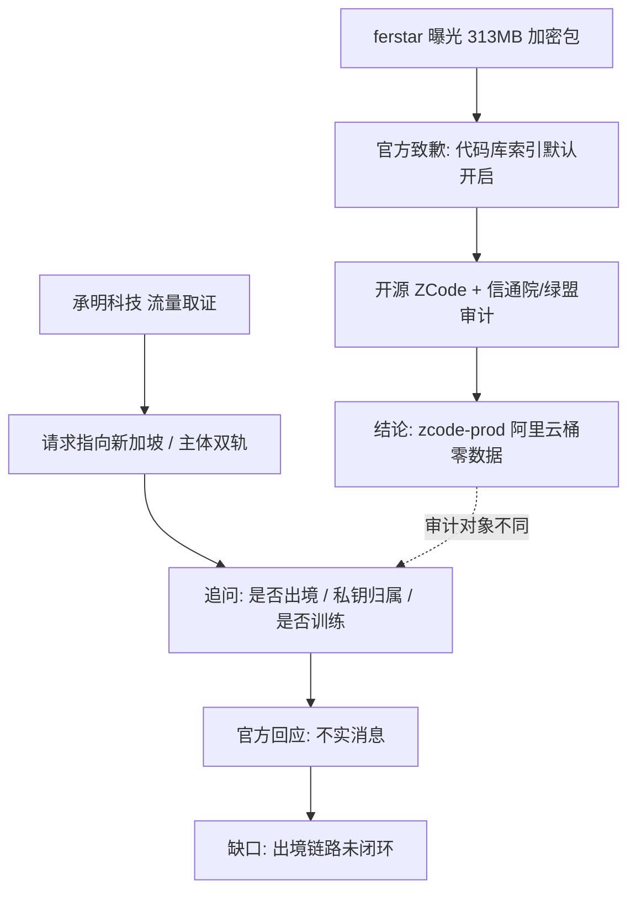

## 结论

智谱 ZCode 在 v3.14.0 之前，登录状态下会**默认整库打包工作区（含完整 .git 历史）并加密上传至阿里云 OSS**，官方承认该行为源于"代码库索引 / Repo Wiki"功能默认开启，并已致歉、修复、开源、引入第三方审计，同时强调**数据未留存、从未用于模型训练** 1（引用未登记）12（引用未登记）[55]。关于"是否跨境"，**事实层面高度存疑**：ZCode 客户端全部网络请求指向 `zcode.z.ai` 与 `cdn-zcode.z.ai`，而英文版协议与隐私政策将数据控制者明确为新加坡实体 **JINGSHENG HE…

<!-- confidence:mid -->
**置信度：中**

## 要点

- 智谱 ZCode 在 v3.14.0 之前，登录状态下会**默认整库打包工作区（含完整 .git 历史）并加密上传至阿里云 OSS**，官方承认该行为源于"代码库索引 / Repo Wiki"功能默认开启，并已致歉、修复、开源、引入第三方审计，同时强调**数据未留存、从未用于模型训练** 1（引用未登记）12（引用未登记）[55]。

## 争议与不确定

| 争议点 | 官方/审计口径 | 承明科技 / 质疑方口径 | 来源 |
|---|---|---|---|
| 上传范围 | 仅"代码库索引/Repo Wiki"所需数据 | 结构完整的归档文件，含完整源码、含已删除提交的历史、DB 密码、员工个人信息 | 4（引用未登记）[37] |
| 数据处置 | 生成 Wiki 后**立即销毁、不留存** | 质疑实际上传范围、流向及"修复时间" | 1（引用未登记）[42] |
| 是否用于训练 | **从未用于模型训练** | 要求说明是否被用于训练 | 11（引用未登记）[55] |
| 是否跨境 | 数据落在**境内阿里云 OSS**，已"零数据" | 流量追查**最终指向新加坡**，要求说明是否出境传输/境外存储 | 33（引用未登记）[72] |
| 责任主体 | 中文版签约为**北京智谱华章** | 英文版/域名指向**新加坡 JINGSHENG HENGXING**，主体不清 | 43（引用未登记）[78] |
| 官方对函件回应 | 相关人员称"**不实消息**" | 拿取证材料质疑"修复存疑"，双方"各说各话" | 65（引用未登记） |
| 问题定性 | "功能默认开启"、"为方便用户" | 从业者不认可"默认开启"解释，认为定性避重就轻 | [58] |

&gt; 口径差异的可能原因：核查对象不同（落盘存储桶 vs 完整链路）、协议版本不同（中/英文版）、以及官方与质疑方各自的法律立场。**分歧未被任何一方消抹。**

## 证据与来源

### 时间线 / Timeline

- **2026-07**：ZCode 作为智谱 AI 编程工具发布 [70]。
- **2026-08-28 至 09-14**：承明科技自测 **6 个以上工作区**被上传，最大 **391.94 MB** [21]。
- **2026-09-18**：开发者 ferstar 曝光 ZCode 静默打包上传完整工作区（含 .git），发现 **313MB 加密包**、**564 次上传失败** 1（引用未登记）[5]。
- **2026-09-18 17:44**：智谱首次回应，承认数据上传、归因"代码库索引"功能、致歉、称已修复、将开源 6（引用未登记）。
- **2026-09-19**：太原承明科技向北京智谱华章发**12 页法律函**，提出 12 项要求，保留索赔与诉讼权利 23（引用未登记）。
- **2026-09-21**：智谱宣布**开源 ZCode**、引入中国信通院与绿盟科技审计、上线"零数据留存"机制、提供额度补偿 29（引用未登记）[33]。
- **2026-09-21 后（审计结论）**：确认 `zcode-prod` 阿里云 OSS 桶"云端零数据"，v3.14.0 移除 Repo Wiki、切断上传链路 34（引用未登记）[54]。
- **2026-09-22**：智谱相关人员就承明函件内容回应媒体称"不实消息" 65（引用未登记）。
- **2026-09-27**：媒体集中报道"代码流向新加坡"及出境合规质疑 38（引用未登记）。

### Evidence

- **上传机制**：客户端先向 `zcode.z.ai` 的 `/api/v1/snapshot/upload-credential` 申请凭证与 RSA 公钥，本地 `tar.gz` 打包 → **AES-256-CTR** 加密 → **RSA-OAEP-SHA256** 封装密钥 → 上传阿里云 OSS [13]。
- **加密包体量**：`encryptedSizeBytes: 313070842`、`workspaceSizeBytes: 345549173`（约 313MB/345MB）2（引用未登记）。
- **文件构成**：42,411 个文件样本中 `.git` 占 **约 86.6%** 2（引用未登记）。
- **开关状态**：相关组件默认常开，UI 无关闭入口 5（引用未登记）。
- **单方取证**：承明称 **6+ 工作区**、最大 **391.94 MB**、**3 万余个文件**被上传 21（引用未登记）。
- **主体双轨**：中文版主体"北京智谱华章" [43]；英文版数据控制者"JINGSHENG HENGXING TECHNOLOGY PTE. LTD." 78（引用未登记）；该实体为智谱 **2023 年 11 月**新加坡注册的间接全资子公司（招股书）[77]。
- **官方跨境表述**：官方承认"境外运营实体……个人信息**存储于新加坡**……开展了**特定的跨境传输**" [74]。
- **官方定性**："代码库索引"功能上线初期**默认开启**，在用户未充分感知下触发上传 [12]。
- **审计结论**：信通院与绿盟确认 `zcode-prod` **阿里云 OSS 桶云端零数据**，v3.14.0 **移除 Repo Wiki** 33（引用未登记）[55]。
- **训练承诺**：智谱称相关代码数据**不会留存，从未用于模型训练** 11（引用未登记）[55]。
- **官方对函件**：以"**不实消息**"回应 65（引用未登记）。
- **质疑方口径**：承明称被上传的是**完整归档**、含**已删除提交历史、DB 密码、员工个人资料** 24（引用未登记）[46]。

## 深入了解

### 内容分析 / Content Analysis

- **智谱**：主打"功能善意 + 已整改 + 未滥用"，通过开源与第三方审计重建信任，但对"出境"问题采取回避/否认策略 11（引用未登记）74（引用未登记）。
- **承明科技**：以技术取证 + 法律函施压，把议题从"功能失误"升级为"数据合规与出境"，是唯一将"跨境"推到台前的角色 23（引用未登记）[72]。
- **ferstar/开发者社区**：提供技术物证（加密包、文件构成、上传链路），并对"默认开启"定性持保留态度 2（引用未登记）[58]。
- **媒体**：多平台（腾讯、虎嗅、搜狐、36氪、InfoQ）交叉报道，形成"取证—发函—回应—开源—审计"的叙事链 21（引用未登记）46（引用未登记）。

### 关系拓扑 / Relationship Map

### Conclusions

**1. 上传了什么？** 上传的是**完整工作区快照**而非"代码片段"。ferstar 对一个 **42,411 个文件**样本拆分显示 `.git` 目录占比高达 **86.6%**（含 `.git/lfs`、`.git/objects`、`.git/logs`），另含 LFS 缓存、reflog、全局配置 2（引用未登记）。承明科技指出内容为**结构完整的归档文件**，涵盖**完整源代码、含已删除提交的版本控制历史、数据库密码及员工个人资料** 24（引用未登记）。上传载体是一个 **313MB 加密包**（`encryptedSizeBytes: 313070842`），本地自解不开、私钥仅存服务端 2（引用未登记）[30]。承明自测 **2026-08-28 至 09-14** 期间有 **超过 6 个工作区**被上传，最大一个达 **391.94 MB** [21]；另有报道称 **3 万余个文件**被指上传云端 [62]。

**2. 是否跨境？** 存在三重疑点：(a) **流量指向**——承明"流量追查发现 ZCode 上传请求最终指向的服务器归属地为新加坡" 67（引用未登记）；(b) **主体双轨**——中文版《ZCode 用户协议》主体为"北京智谱华章科技股份有限公司" [43]，而英文版隐私政策明确"JINGSHENG HENGXING TECHNOLOGY PTE. LTD. 是数据控制者" 78（引用未登记），据港交所招股书该新加坡公司系智谱 2023 年 11 月注册的间接全资子公司 76（引用未登记）；(c) **口径自相矛盾**——官方一处承认"境外运营实体通过 Z.ai 收集的个人信息**存储于新加坡**，开展了**特定的跨境传输**" [74]，而中文版政策面对大陆用户称数据**存储境内、不跨境**。

**3. 官方如何回应？** 三步走：**9/18 致歉 + 定性**（承认"代码库索引"功能默认开启导致上传、Republish Wiki 后数据销毁不保存、已修复、将开源）1（引用未登记）12（引用未登记）；**9/21 开源 + 审计 + 零数据留存**（开源 ZCode、邀请中国信通院与绿盟科技审计，确认 `zcode-prod` 阿里云 OSS 桶"云端零数据"、v3.14.0 已移除 Repo Wiki 并切断上传链路）29（引用未登记）33（引用未登记）[55]；对**媒体采访则以"不实消息"**回应承明函件内容 65（引用未登记）。

**4. 核心冲突**：官方称"仅代码片段 + 数据即传即毁 + 未用于训练 + 境内存储"；质疑方称"完整归档 + 含已删提交/密钥/个人信息 + 流向新加坡 + 修复存疑"。二者所审视的对象不同——官方审计针对**最终落盘的境内存储桶**，质疑方针对**完整网络链路与主体中转**。

### 已确认 vs 未确认 / Confirmed vs Unconfirmed

- **已确认**：
  - ZCode 曾默认开启整库快照上传机制（官方承认）4（引用未登记）[14]。
  - 上传内容含 `.git` 历史（占比约 86.6%）、LFS、reflog 等 2（引用未登记）。
  - 官方已致歉、修复、开源、引入第三方审计并推出零数据留存 29（引用未登记）[55]。
  - 官方主体存在中/英文双轨：中文=北京智谱华章，英文=新加坡 JINGSHENG HENGXING 43（引用未登记）[79]。
  - 官方自身文件承认境外实体存在"特定跨境传输、存储于新加坡" [74]。
- **未确认 / 无法确认**：
  - 涉事 ZCode 上传数据**是否实际出境存储**（流量取证 vs 境内存储桶审计，两者核查对象不同）。
  - 上传凭证签发主体归属地、是否经新加坡节点中转。
  - 加密私钥的实际保管方与访问主体。
  - "564 次上传失败"等反证细节的独立复核（仅有 ferstar 单方取证）。
  - 12 项法律函诉求的官方逐条书面答复。

### Gaps in Knowledge

1. **出境链路的中间环节缺失**：公开证据只呈现"请求指向新加坡"与"落盘境内桶"两端，缺"凭证签发地—中转节点—回传落盘"的完整闭环。
2. **协议适用范围不明**：大陆用户究竟适用中文版（境内、不跨境）还是英文版（新加坡控制者）政策，未见明确界定。
3. **私钥保管主体**：RSA 私钥由境内还是境外主体持有，直接影响"能否被第三方解密"。
4. **审计的范围边界**：第三方审计确认的是"存储桶已空"，未确认"历史上是否发生过出境传输"。

## References

- [1] [智谱旗下AI 编程工具ZCode 被扒静默上传完整Git 历史](<https://www.oschina.net/news/502589>) — 已抓取全文（不代表事实核实）
  此次问题源于ZCode的代码库索引“功能。该功能昌在帮助用户在本地生成仓库索引，以支持包括历史版本在内的会话检查点恢复、历史版本回退及 ...

- [2] [智谱ZCode 静默上传Git 仓库全复盘：313MB 加密包](<https://zhuanlan.zhihu.com/p/2085753625423378173>) — 仅摘要
  智谱AI 编程工具ZCode 在登录状态下,会把用户本地Git 仓库整个谱后端登记。 … :ZCode 静默上传事件本地物证

- [3] [ZCode \| GLM-5.3 官方Harness](<https://zcode.z.ai/>) — 仅摘要
  简单、迅捷、氛围十足！ ZCode 是新一代氛围编程工具，多智能体协作完成复杂目标，随时随地尽在掌控。 立即下载ZCode. 适用于Linux \(x64\). 查看全部下载. 新建任务⌘N

- [4] [智谱ZCode上传用户仓库？官方道歉：已修复，将开源](<https://i.ifeng.com/c/8wWnBzJAx6Z>) — 已抓取全文（不代表事实核实）
  承认上传了数据，解释称是“代码库索引”功能导致上传了仓库数据，初衷是为了方便用户，并表示生成wiki页面后，仓库数据会被销毁，不会保存。

- [5] [智谱ZCode 静默上传整个工作区：连.git 历史一起打包，开关关不掉](<https://www.youtube.com/watch?v=zsHebptSdZE>) — 仅摘要
  2026 年9 月18 日，开发者ferstar 发现智谱官方AI 编程客户端ZCode 会在登录状态下静默打包整个工作区（含完整.git 历史）加密上传到阿里云OSS，且 ...

- [6] [电厂\| ZCode“静默上传”争议后，智谱开源仍难回答的问题\|代码](<https://www.163.com/dy/article/L7K8DVFM0553DXPD.html>) — 已抓取全文（不代表事实核实）
  9月18日当天17:44，智谱首次回应此事，解释“此次问题源于ZCode 的&\#x27;代码库索引&\#x27;功能…… ... 与ZCode事件相同，Grok Build也是将用户代码私自上传至厂商云端。

- [7] [智谱把ZCode 开源了：GLM-5.3 官方Harness 全解析- iTech](<https://www.cnblogs.com/itech/p/23085057>) — 仅摘要
  9 月18 日，一个叫ferstar 的开发者发了一篇排查文：智谱的官方AI 编程桌面端ZCode，只要登录了，就会在后台静默把整个工作区——包括完整的 .git 历史、LFS ...

- [8] [智谱在最新版本的ZCode 确实移除了仓库上传代码，后面经 ...](<https://x.com/coder_left/status/2104467542328955313>) — 仅摘要
  跟进一下智谱上传仓库代码事件的最新进展，在ZCode 最新更新公告表示，历史云端上传的仓库快照已经全部清除首先先澄清一下，之前的推文中，智谱在最新 ...

- [9] [智谱ZCode上传用户仓库？官方道歉：已修复，将开源 - 时间线](<https://timeline.sohu.com/news/hFsqXMkOBk>) — 仅摘要
  刚刚，智谱在Zcode官方社群里进行了回应。承认上传了数据，解释称是“代码库索引”功能导致上传了仓库数据，初衷是为了方便用户，并表示生成wiki ...

- [10] [313MB 自己都打不开的加密包：ZCode 静默上传代码事件全拆解](<https://www.bilibili.com/video/BV1nkhv6JEUW/>) — 仅摘要
  313MB 自己都打不开的加密包：ZCode 静默上传代码事件全拆解共计2条视频，包括：中文、English等，UP主更多精彩视频，请关注UP账号。

- [11] [智谱ZCode代码上传风波持续：开源整改回应信任危机](<https://finance.eastmoney.com/a/202609213880327785.html>) — 仅摘要
  围绕ZCode代码及Git历史数据上传争议，智谱近日回应称，社区提及的相关代码数据不会留存，公司也从未将其用于模型训练。

- [12] [智谱ZCode回应数据上传争议：功能默认开启致数据上传](<https://finance.sina.com.cn/roll/2026-09-19/doc-inisinhc2626091.shtml>) — 已抓取全文（不代表事实核实）
  问题根源在于该功能上线初期为默认开启状态，在用户未充分感知的情况下触发上传行为，波及部分使用者。目前该漏洞已经完成修复。 针对用户信任危机，ZCode ...

- [13] [ZCode上传代码追踪：86.6%是Git历史，日志被删](<https://zhuanlan.zhihu.com/p/2085008412828610829>) — 抓取失败（仅摘要）
  上传链路也被还原了：客户端先向 zcode.z.ai 的 /api/v1/snapshot/upload-credential 申请凭证和RSA公钥，本地 tar.gz 打包、AES-256-CTR加密、RSA-OAEP ...

- [14] [智谱ZCode就代码库数据上传致歉：已修复](<https://tech.ifeng.com/c/8wWkqtwNNZd>) — 已抓取全文（不代表事实核实）
  ... 智谱官方群组向受影响用户致歉，并发布回应称已第一时间完成自查，相关问题目前已经修复。 据官方说明，此次问题源于ZCode的“代码库索引”功能。该功能 ...

- [15] [ZCode疑似后台上传项目代码？一次完整排查记录](<https://www.cnblogs.com/wlor/articles/23027324>) — 已抓取全文（不代表事实核实）
  最近看到一篇针对智谱ZCode 的深度排查文章，作者从本地磁盘占用、程序日志、 app.asar 代码以及网络请求等多个角度进行了分析。文章声称ZCode 会在登录 ...

- [16] [\[Bug\] 智谱ZCode 被曝静默上传用户代码引争议\#771](<https://github.com/zai-org/feedback/issues/771>) — 已抓取全文（不代表事实核实）
  开发者ferstar 对ZCode 做逆向分析后称，只要处于登录状态，ZCode 会生成本地工作区快照，并可能包含.git 历史、LFS 缓存、reflog 等内容。他展示的一个 ...

- [17] [【深度拆解】被曝上传代码第5 天，ZCode 把源码全开源了](<https://www.bilibili.com/video/BV1mahx6NE1b/>) — 仅摘要
  智谱旗下AI 编程工具ZCode 被开发者曝出静默上传全量代码和Git 历史，5 天后 ... 回应：道歉、开源、交审计· 首轮审计结论：云端零数据、切断上传链 ...

- [18] [程序员亲历智谱ZCode事件：AI 代码助手偷偷上传全量仓库](<https://www.163.com/dy/article/L78TCA0V051481US.html>) — 仅摘要
  客观来看，智谱在产品工程与权限设计上存在严重失误。代码是开发者核心知识产权，面向程序员的生产力工具，静默打包上传包含完整版本历史的仓库，关闭界面 ...

- [19] [刚刚融完335亿，智谱就卷入“偷传数据”风波](<https://k.sina.com.cn/article_5953466437_162dab0450670bd3bm.html?from=tech>) — 仅摘要
  在函件中，承明科技还对上传的数据是否涉及出境的问题提出了质疑。 承明科技称，ZCode客户端的全部网络请求都指向zcode.z.ai与cdn-zcode.z.ai域名，而 ...

- [20] [“偷传代码”风波后，智谱把ZCode开源了：三天，三步](<https://zhuanlan.zhihu.com/p/2085473394431207370>) — 仅摘要
  承明科技查证发现，ZCode客户端的网络请求指向注册于新加坡的实体，而中文版服务协议签约主体为北京智谱华章。数据是否已经出境、是否受国内法律监管， ...

- [21] [智谱偷传数据风波扩大，有企业要求说明是否跨境传输 - 腾讯新闻](<https://view.inews.qq.com/a/20260920A072CN00>) — 已抓取全文（不代表事实核实）
  承明科技在函件中称，通过自行技术取证，发现自8月28日到9月14日期间公司有超过6个工作区遭到ZCode上传云端，其中最大一个体积达到391.94 MB。

- [22] [扒一扒承明科技发函智谱的来龙去脉，让你理清所有思路](<https://caifuhao.eastmoney.com/news/20260920201301607397440>) — 仅摘要
  智谱的回应里，这五条提了三条：停止上传、承诺开源、补偿额度。另外两条——打包范围要说清楚、已上传数据的处置——就是这封函正在追问的。 所以换个角度 ...

- [23] [智谱ZCode将开源并接受第三方审计遭指偷传代码企业发函追责 ...](<https://eu.36kr.com/zh/p/3992798380833792>) — 仅摘要
  9月19日，太原承明科技有限公司正式向北京智谱华章发出函件，要求就数据删除、私钥保管及是否发生跨境传输等问题作出书面说明，并保留索赔与诉讼权利。 承 ...

- [24] [从“偷传代码”到开源整改，智谱风波折射AI企业数据合规之困](<https://timeline.sohu.com/news/0JfSOD4mPM>) — 仅摘要
  承明科技指出,被上传的内容远不止官方所称的“代码片段”,而是结构完整的归档文件,涵盖完整源代码、含已删除提交的版本控制历史

- [25] [智谱偷传用户数据，背后藏着大问题](<https://www.163.com/dy/article/L7DS0F84051181GK.html>) — 仅摘要
  承明科技在函件中要求智谱说明，两家公司在此次上传中是什么法律关系，谁承担责任，数据是否发生出境传输或境外存储。如果发生出境，还要求提供所依据的合 ...

- [26] [数据安全争议后，智谱再道歉：开源ZCode](<https://www.sohu.com/a/1078916454_115479>) — 仅摘要
  就在两天前，智谱ZCode被曝在用户登录状态下，后台静默打包加密整个工作区数据上传阿里云端，并在成功后删除本地加密包，直到因某次上传持续失败才被 ...

- [27] [OSS 跨境电商全球分发方案](<https://www.aliyun.com/activity/store/ossds>) — 仅摘要
  OSS 传输加速基于全球分布的云机房，将用户访问请求智能路由至就近的阿里云接入点，再通过内部骨干网高速传输到目标Bucket 所在地域，避免数据在公共互联网上长距离传输， ...

- [28] [企业用户发函质疑ZCode上传数据，智谱致歉称已整改并引入 ...](<https://i.ifeng.com/c/8wb1UMRlRY2>) — 仅摘要
  在企业用户太原承明科技有限公司公开发函、质疑此前修复效果及数据处理方式后，9月21日早，智谱在最新回应中表示，已针对社区反馈的产品安全问题完成整改 ...

- [29] [智谱回应数据隐私争议：ZCode将正式开源，并开展安全审计](<https://es.tradingview.com/news/panews:25fbdb006acdf:0/>) — 仅摘要
  对于此前发生的问题，完成整改后，智谱邀请了中国信息通信研究院和绿盟科技开展安全审计。智谱方面表示，此次开源是回应外界对ZCode数据处理担忧的第一步 ...

- [30] [一个313MB加密包，撕开智谱等AI编程工具安全暗门](<https://weibo.com/ttarticle/x/m/geoshow/id/23093505345662186422387?domain=local>) — 仅摘要
  9月21日，智谱（2513.HK）就旗下桌面AI编程工具ZCode的数据安全争议完成整改并向用户致歉，同时正式将ZCode开源至GitHub，接受社区监督，并邀请中国 ...

- [31] [ZCode数据隐私争议后即将正式开源，智谱邀请信通院与绿盟 ...](<https://www.sohu.com/a/1078834649_114984>) — 仅摘要
  智谱（2513.HK）旗下AI编程工具ZCode在经历数据隐私争议后，即将正式开源。9月21日，智谱方面表示，此次开源是回应外界对ZCode数据处理担忧的第一步。

- [32] [智谱发上亿Token，能挽回开发者的信任吗？](<https://k.sina.com.cn/article_7502880618_1bf34df6a00101dh2i.html?from=tech&subch=otech>) — 仅摘要
  9月21日，智谱进一步宣布开源ZCode代码库，引入中国信通院与绿盟科技的第三方安全审计，并上线“零数据留存”机制。 ... 按照智谱的解释，争议源于 ...

- [33] [智谱回应ZCode隐私争议：开源、审计、数据不留存“三箭齐发”](<https://wap.eastmoney.com/a/202609213879931945.html>) — 仅摘要
  据悉，中国信息通信研究院与绿盟科技分别开展安全审计，确认zcode-prod（阿里云对象存储存储桶）全部数据对象已删除，处于云端零数据状态；ZCodev3. ... 智 ...

- [34] [交给社区监督。 官方同时表示，ZCode v3.14.0 已 ...](<https://x.com/MaxForAI/status/2101847323047542878>) — 仅摘要
  官方同时表示，ZCode v3.14.0 已移除Repo Wiki 功能，切断本地仓库快照生成和上传链路。 整改完成后，智谱还邀请了中国信通院和绿盟科技进行安全审计。

- [35] [智谱道歉之后，谁来给Agent划边界？](<https://m.36kr.com/p/3992992819943041>) — 仅摘要
  三天时间，智谱完成了从道歉、溯源到迭代、开源，从推出零数据留存到第三方安全审计的全套动作。 ... 第三方审计则由信通院和绿盟科技两大行业机构承接。这 ...

- [36] [智谱回应ZCode数据上传争议宣布开源并推零数据留存功能](<https://i.ifeng.com/c/8waxhYY6CVQ>) — 仅摘要
  同时，中国信通院和绿盟科技已完成对ZCode产品的第三方安全审计。审计报告显示，相关阿里云OSS存储桶及全部数据对象已删除，ZCode v3.14.0版本已移除Repo ...

- [37] [智譜ZCode 偷傳程式碼風波AI 編程代理信任焦點轉向「可 ...](<https://unwire.pro/2026/09/23/zhipu-zcode-code-leak-privacy-ai-agent-verification/ai/>) — 仅摘要
  事件中指控最嚴重的太原承明科技，曾向智譜發出12 頁法律函，指ZCode 上傳其6 個工作區，涉及完整原始碼、資料庫密碼及員工個人資料，並要求交代數據有否 ...

- [38] [ZCode代码偷偷流向新加坡，智谱“偷传代码”意欲何为？](<https://view.inews.qq.com/a/20260927A0D3VU00>) — 仅摘要
  承明科技在函件中要求智谱说明：本次上传的责任主体究竟是位于境内的北京智谱华章，还是位于境外的JINGSHENG HENGXING。数据是否发生出境传输或境外存储。

- [39] [智谱ZCode 的「偷传代码」风波开始升级到正式法律追责。 ...](<https://x.com/0xLogicrw/status/2101504886361735235>) — 仅摘要
  事情还牵出了数据出境问题。 … 承明科技因此要求智谱说明,这批数据究竟存在哪里、是否发生境外传输、是否提供给第三方,以及是否被用于模型训练。

- [40] [智谱致歉称是“代码库索引”功能引发，上传数据不会被保存， ...](<https://zhuanlan.zhihu.com/p/2085141023303398204>) — 仅摘要
  承明科技同时指出,ZCode客户端网络请求指向新加坡主体,而服务协议签约… 要求说明本次上传的责任主体,以及数据是否发生出境传输或境外存储。

- [41] [智谱ZCode被指擅自上传公司数据，承明科技发函追责 - 财富号](<https://caifuhao.eastmoney.com/news/20260920075805365909480>) — 仅摘要
  承明科技同时指出,ZCode客户端网络请求指向新加坡主体, … 要求说明本次上传的责任主体,以及数据是否发生出境传输或境外存储。

- [42] [智谱偷传数据风波扩大，有企业要求说明是否跨境传输](<https://www.sohu.com/a/1078536230_115479>) — 仅摘要
  数据被指疑似流向新加坡不过,承明科技则对智谱数据实际上传范围、流向及所谓的修复时间,提出了质疑。

- [43] [ZCode用户协议 - Z.ai](<https://zcode.z.ai/cn/terms>) — 仅摘要
  ZCode产品:指北京智谱华章科技股份有限公司经营的生成式人工智能产品所包含的服务、应用、功能、软件、模型、插件、智能体、API、工具、内容和文档及未来 ...

- [44] [连接模型与套餐 - ZCode - Z.ai](<https://zcode.z.ai/cn/docs/configuration>) — 仅摘要
  ZCode 支持多种方式接入GLM 模型用于编程工作流。国内用户推荐通过GLM Coding Plan（BigModel） 在ZCode 中运行GLM-5.3，账号登录即可使用，配置简单。 推荐方式.

- [45] [智谱ZCode“偷传用户代码”风波持续发酵，承明科技发函提出 ...](<https://www.163.com/dy/article/L7A0SAP30511U82T.html>) — 仅摘要
  ... 数据是否发生出境传输或境外存储。 最后，承明科技提出12项要求，包括立即停止相关数据处理并彻底删除已上传的全部数据及相关衍生数据、缓存与备份 ...

- [46] [Cursor 都狠？智谱ZCode“偷传代码”风波升级，企业发函追责](<https://www.infoq.cn/article/huOiZyyH32MpRwTFkoNe>) — 仅摘要
  ZCode客户端被曝默认整库打包上传用户代码，含Git历史、密钥等敏感数据，引发企业正式函件追责。智谱致歉后，数据删除、流向追溯与出境合规问题仍未澄清。

- [47] [ZCode 版本发布与更新\| GLM-5.3 编程Agent](<https://zcode.z.ai/cn/changelog>) — 仅摘要
  ZCode 3.15.3 已修复更新时应用无法正常退出的问题， 请优先选择前往ZCode 官网 下载最新版完整安装包。 从3.15.1 升级时，仍可能因旧版本问题出现卡住：. macOS：按 ⌥⌘ ...

- [48] [从开源到信任：ZCode给智谱出的难题｜深度](<https://k.sina.com.cn/article_5952915705_162d248f906703p3be.html?from=tech>) — 仅摘要
  9月18日下午，ZCode通过智谱官方群组向受影响用户致歉并说明情况。官方解释称，相关问题源于ZCode的“代码库索引”功能，该功能旨在支持历史版本回退、会话 ...

- [49] [智谱道歉之后，谁来给Agent划边界？](<https://zhuanlan.zhihu.com/p/2085430274603729191>) — 仅摘要
  它在回应时强调，用户代码从未用于模型训练。 从更加务实的商业角度来看，智谱也不希望这一风波继续扩大。 当前智谱最重要的客户，就是开发者和科技企业。

- [50] [解读智谱ZCode 上传数据争议\| 第553期](<https://www.youtube.com/watch?v=jwy--6yRQS8>) — 仅摘要
  解读智谱ZCode 上传数据争议\| 第553期 · Comments.

- [51] [AI编程工具ZCode私自上传用户数据，智谱AI道歉](<https://www.secrss.com/articles/94149>) — 仅摘要
  对此，智谱AI方面也于18日晚些时候做出回应，称此事是ZCode一个名为“代码库索引”的功能引发，称该功能在上线后是默认开启的，但表示上传的数据只会用于在 ...

- [52] [\[Bug\] 发现一个影响核心计费链路的严重Bug \#57](<https://github.com/zai-org/feedback/issues/57>) — 仅摘要
  我这边遇到一个问题：我之前开通过Coding Plan 体验卡，现在已经过期了。但当我用API 调用glm-5.2 时，返回的是“coding plan expired”错误，而实际上我 ...

- [53] [智谱：ZCode将开源并接受第三方审计-36氪](<https://m.36kr.com/p/3992798380833792>) — 仅摘要
  智谱同时表示，此次开源是回应外界对ZCode数据处理担忧的第一步；后续将建立常态化安全运营机制，每月定期公布代码安全审计报告，并设立公开的产品安全 ...

- [54] [智谱ZCode事件：AI Agent权限失控背后的安全困局](<https://www.moomoo.com/hans/news/post/1000015239>) — 仅摘要
  智谱邀请了信通院和绿盟科技开展安全审计，确认zcode-prod阿里云OSS存储桶状态为&quot;云端零数据&quot;。这是正确的方向，但全行业对&quot;谁来防范AI自身&quot;的答案才 ...

- [55] [智谱完成ZCode开源并整改，承诺相关代码数据未用于模型训练](<https://www.yicai.com/news/103371614.html>) — 仅摘要
  针对此前发生的问题，完成整改后，智谱邀请中国信息通信研究院和绿盟科技开展安全审计，经中国信息通信研究院技术评测，确认zcode-prod阿里云OSS存储桶状态为云端零数据。

- [56] [Z.ai 的ZCode 曾将开发者代码仓库上传到阿里云](<https://pasqualepillitteri.it/zh/news/17874/zcode-z-ai-daima-cangku-alibaba-cloud>) — 仅摘要
  目前没有任何公开证据显示数据被非法使用。数据在到达时存放于阿里云的一个存储桶，Z.ai 称该存储桶已被删除，两家外部机构也予以确认。不过，由于私 ...

- [57] [“偷传代码”风波后，智谱把ZCode开源了：三天，三步](<https://www.huxiu.com/article/4892970.html>) — 仅摘要
  2026年9月18日，独立开发者ferstar曝光智谱ZCode客户端自动打包并加密上传用户完整项目至阿里云OSS。智谱在72小时内致歉、修复、引入信通院与绿盟第 ...

- [58] [从开源到信任：ZCode给智谱出的难题｜深度](<https://www.ifnews.com/news.html?aid=872231&cid=49>) — 仅摘要
  “智谱的回应是代码库索引功能默认开启导致问题，我个人不太认可这个回答。”从事AI Computing（智能计算）的兰姆（化名）向记者指出，当前使用AI Coding ...

- [59] [智谱ZCode代码上传风波持续：开源整改回应信任危机](<https://news.ifeng.com/c/8wbp8pCWIH5>) — 仅摘要
  围绕ZCode代码及Git历史数据上传争议，智谱近日回应称，社区提及的相关代码数据不会留存，公司也从未将其用于模型训练。 智谱方面表示，ZCode已于今日（9 ...

- [60] [智谱ZCode上传全量代码库，是否合规？](<https://www.donews.com/news/detail/1/6716153.html>) — 仅摘要
  争议发酵数小时后，智谱于18 日傍晚在官方飞书群作出回应。其承认ZCode的“代码库索引”功能在生成Repo Wiki页面时，可能将仓库数据上传至云端。该功能上线 ...

- [61] [GLM-智谱 - 阿里云文档](<https://help.aliyun.com/zh/model-studio/glm-zhipu>) — 仅摘要
  本文档介绍如何在阿里云百炼平台调用智谱直供的模型推理服务。

- [62] [3万余个文件被指上传云端，智谱ZCode陷代码安全争议](<http://www.ifengweekly.com/detil.php?id=27981>) — 仅摘要
  承明科技要求智谱ZCode停止处理并彻底删除全部已上传数据，删除范围除原始数据外，还包含对象存储归档文件、服务器索引、知识库页面，以及依托该数据生成 ...

- [63] [刚刚融完335亿，智谱就卷入“偷传数据”风波](<https://zhuanlan.zhihu.com/p/2085147282589082797>) — 仅摘要
  基于这一情况，承明科技在函中要求智谱说明，此次上传行为的主体究竟是位于境内的北京智谱华章，还是位于境外的JINGSHENG HENGXING；此次上传的数据 ...

- [64] [ZCode代码偷偷流向新加坡，智谱“偷传代码”意欲何为？](<https://m.sohu.com/a/1081497096_217394?scm=10001.325_13-325_13.0.0-0-0-0-0.5_1334>) — 仅摘要
  承明科技在函件中要求智谱说明：本次上传的责任主体究竟是位于境内的北京智谱华章，还是位于境外的JINGSHENG HENGXING。数据是否发生出境传输或境外存储。

- [65] [智谱ZCode“偷传用户代码”风波持续发酵 - 时间线- 搜狐](<https://timeline.sohu.com/news/cQDHWikvGB>) — 仅摘要
  针对承明科技函件的内容和诉求，今日，红星资本局向智谱发去采访问题，相关人员就此事回应称“不实消息”。

- [66] [ZCode 客户端网络请求指向新加坡主体，而服务协议签约 ...](<https://x.com/_FORAB/status/2101472088792121433>) — 仅摘要
  还真有较真的公司，就智谱ZCode 擅自上传开发数据事件，公开发函了。 它们指责，ZCode 客户端网络请求指向新加坡主体，而服务协议签约主体，却是中国 ...

- [67] [智谱ZCode偷传代码遭发函追责：谁在借着AI的名义掏空企业 ...](<https://news.qq.com/rain/a/20260922A0989P00>) — 仅摘要
  第二处要害直接打到了数据合规的命门上。承明科技通过流量追查发现，ZCode客户端发起的数据上传请求，最终指向的服务器归属地居然是新加坡；而当初企业 ...

- [68] [明星公司，摊上事儿了](<https://www.sohu.com/a/1078664410_220095>) — 仅摘要
  而就在一天前，智谱刚刚承认，ZCode部分功能确实可能触发用户代码仓库上传，并为此公开致歉。 但承明科技质疑，事情远不只是“上传了部分代码”。 其在函件 ...

- [69] [智谱ZCode用户突破100万四项新功能正式上线](<https://wap.eastmoney.com/a/202608113838021297.html>) — 仅摘要
  智谱宣布其AI编程产品ZCode全面升级，Goal、Subagents、Remote Control及闲时任务四项新功能正式上线，推动Coding Agent（编程智能体）从对话辅助走向 ...

- [70] [ZCode - 维基百科，自由的百科全书](<https://zh.wikipedia.org/zh-hans/ZCode>) — 仅摘要
  ZCode是中国人工智能企业智谱（Z.ai）推出的人工智能编程工具，2026年7月发布。智谱将其定位为面向长周期任务的“智能体开发环境”（Agentic Development ...

- [71] [常见问题解答\(Q&amp;A\) \| ZCode Docs - Z.ai](<https://zcode.z.ai/cn/docs/qa>) — 仅摘要
  常见问题解答\(Q&amp;A\). 在这里，我们汇总了关于ZCode 的产品定位、费用说明以及在使用过程中可能遇到的技术问题的解答。 1. ZCode 的产品定位是什么？ ZCode 是一个全新的 ...

- [72] [ZCode代码偷偷流向新加坡，智谱“偷传代码”意欲何为？](<https://news.qq.com/rain/a/20260927A0D3VU00>) — 仅摘要
  查证发现，ZCode请求指向zcode.z.ai等域名，该域名由智谱新加坡子公司JINGSHENG HENGXING TECHNOLOGY PTE. LTD.控制。这家新加坡公司的隐私政策明确写着： ...

- [73] [ZCode隐私政策](<https://zcode.z.ai/cn/privacy>) — 仅摘要
  ZCode：指北京智谱华章科技股份有限公司开发、运营的内容生成、AI辅助操作或未来以其它形态向您提供的ZCode的产品或服务。 ZCode服务提供者：指ZCode的 ...

- [74] [智谱危局：境内电子政务合作遍地开花境外公司有存储+大模型 ...](<https://caifuhao.eastmoney.com/news/20260921165711046921520>) — 仅摘要
  但是智谱又说，“由我们的境外运营实体通过Z.ai网站收集的个人信息存储于新加坡。根据我们的隐私政策，我们的境外运营实体开展了用户数据的特定的跨境传输” ...

- [75] [智谱回应数据隐私争议：ZCode即将正式开源并开展安全审计](<https://m.cls.cn/detail/2488452>) — 仅摘要
  9月21日，智谱宣布将正式开源ZCode代码库，并联合中国信通院开展安全审计，同时推出MaaS平台“数据不留存”功能（注：涉及合规审查的数据需留存30天以上）。

- [76] [智谱偷传数据风波扩大，有企业要求说明是否跨境传输 - 虎嗅](<https://m.huxiu.com/article/4892594.html>) — 仅摘要
  在ZCode英文版中，其协议和隐私政策中明确，由JINGSHENG HENGXING提供服务和负责数据处理。但中文版的ZCode用户协议则规定，服务提供方是“北京智谱华章 ...

- [77] [智譜偷傳數據風波擴大，有企業要求說明是否跨境傳輸](<https://www.moomoo.com/hant/news/post/76490555>) — 仅摘要
  據智譜在港交所招股書顯示，JINGSHENG HENGXING爲智譜於2023年11月在新加坡註冊的間接全資子公司。在ZCode英文版中，其協議和隱私政策中明確，由JINGSHENG ...

- [78] [Privacy Policy - Overview - Z.AI DEVELOPER DOCUMENT](<https://docs.z.ai/legal-agreement/privacy-policy>) — 仅摘要
  JINGSHENG HENGXING TECHNOLOGY PTE.LTD is the controller and is responsible for the processing of your Personal Data as described in this Privacy ...

- [79] [ZCode 隐私政策](<https://zcode.net.cn/en/privacy>) — 仅摘要
  JINGSHENG HENGXING TECHNOLOGY PTE.LTD 是负责按照本隐私政策所述处理您个人数据的控制者。如果您对我们如何使用您的个人数据有任何疑问，请联系 ...

- [80] [隐私政策](<https://docs.bigmodel.cn/cn/terms/privacy-policy>) — 仅摘要
  一、定义及适用范围 · 二、我们如何收集、使用您的信息以及您可以如何管理您的信息 · 三、我们如何共享、转让、公开披露您的信息 · 四、我们如何保护您的信息 · 五、我们如何 ...

- [81] [全部文章\| 跨进通\| 出海生产力指南— 跨境网络优化与AI落地实战](<https://www.kuajintong.com/posts/page/8/>) — 仅摘要
  同日红星资本局向智谱发去采访问题，相关人员的回应是四个字——「不实消息」。 一边是企业用户拿取证说「修复存疑」，一边是官方对媒体采访回「不实消息」，两边各说各话。

- [82] [AI工具2026 \| 跨进通\| 出海生产力指南— 跨境网络优化与AI落地实战](<https://www.kuajintong.com/tags/ai%E5%B7%A5%E5%85%B72026/>) — 仅摘要
  同日红星资本局向智谱发去采访问题，相关人员的回应是四个字——「不实消息」。 一边是企业用户拿取证说「修复存疑」，一边是官方对媒体采访回「不实消息」，两边各说各话。

- [83] [耀才证券](<https://wap.yczq9.com/>) — 仅摘要
  ... 回应尊界SUV给赛力斯做：这是不实消息. 第一财经. 2026-10-12 16:49:00. 证监会：探索更加适配创新型中小企业的制度和实践. 中国证券报. 2026-10-12 15:57:00. 吴清将参加 ...

- [84] [&lt;\!\[CDATA\[IT之家\| 最新鲜科技资讯\]\]&gt;](<https://www.ximalaya.com/album/35149672.xml>) — 仅摘要
  ... 不实消息。截至发稿，赛力斯方面则并未对此进行回应。查看详情华为申请注册“星芒”商标：网传是最新子品牌命名，涵盖手机、电脑等分类国家知识产权局商标局最新信息显示 ...
