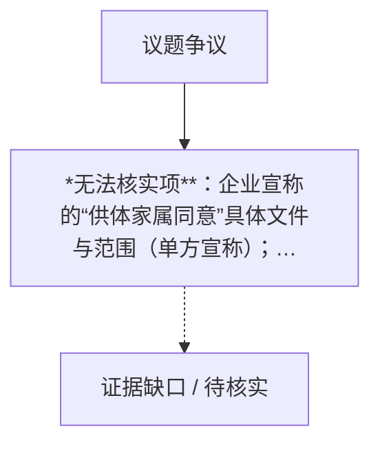

## 结论

1. 原料与工艺

<!-- confidence:high -->
**置信度：高**

## 要点

- **高置信度**：韩国 Re2O（Elravie Re2O，"Return to Your 20s"）抗衰针的核心原料**确为已故捐献者的人体皮肤组织**——经脱细胞工艺制成细胞外基质（ECM/hADM）注射剂，由韩国 L&C BIO 生产，2024年11月在韩上市，单针约60–80万韩元（约3000–4000元人民币）1（引用未登记）10（引用未登记）。
- 此点有中、韩、美、港多国媒体与官方口径一致印证，属高置信度事实。

## 争议与不确定

| # | 各方说法 | 冲突点 | 口径原因推断 |
|---|---|---|---|
| 1 | **企业方**（CEO李欢哲）：“往脸上打尸皮”是被挑衅性语言扭曲的框架，产品经脱细胞处理、已取得捐献同意71（引用未登记）[78] vs **媒体/专家**：核心原料确为逝者皮肤1（引用未登记）、伦理争议真实存在 | “尸皮针”定性之争：企业强调“脱细胞≠尸皮”，媒体强调“来源是逝者皮肤” | 企业维护商业利益与品牌形象；媒体强调可感知的伦理冲击 |
| 2 | **企业**：产品已在韩国合法获批并热销 vs **监管批评方**：其获批依赖“人体组织”分类漏洞，未经临床试验9（引用未登记）[26] | 合法性≠安全性：合规路径是否正当 | 韩国现行法框架下企业合规，但制度设计本身受质疑 |
| 3 | **企业**：宣称安全、早期研究显示皮肤更光滑[35] vs **专家**：唯一公开研究仅20人、20周、与玻尿酸混注无法单独归因、研究者兼产品顾问，缺5–10年长期数据7（引用未登记）[35] | 疗效与安全证据充分性 | 研究由关联方开展，独立性与随访期均不足 |
| 4 | **企业/辩护方**：已取得供体家属知情同意[71] vs **伦理学者/网友**：捐献者不可能预见“制成抗衰针销售”这一用途，不知利润链条13（引用未登记） | 供体同意边界：组织捐献勾选是否涵盖医美商业化 | 美国组织捐献登记场景（驾照勾选）与实际用途相距甚远 |
| 5 | **求美者端**：注射后才知情、“提前知道就不会打”1（引用未登记） vs **机构营销**：“第五代水光”“胶原水光”话术回避原料实质[48] | 受用端知情权缺失 | 营销话术规避反感与流失客户 |
| 6 | **外媒**：L&C BIO 称产品"available in China"[16] vs **每经/评论**：未获任何 NMPA 审批，仅水货流通21（引用未登记）[48] | 企业口径 vs 中国法律现实 | 企业可能以“水货+赴韩消费”口径模糊表述“有售” |
| 7 | **韩国**：合法热销 vs **中国**：无证违规 vs **香港**：涉《人体器官移植条例》刑事罪名 | 同一产品三地法律定性割裂 | 各地对人体组织产品的分类与立法不同 |
| 8 | **安全派**：脱细胞工艺成熟可控 vs **风险派**：工艺难以100%清除遗传片段，存在排异、免疫反应风险[7] | 残留风险是否可忽略 | 学术上脱细胞极限客观存在，无长期随访数据佐证 |
| 9 | **韩国官方（福祉部）**：国内捐献遗体不用于此产品、原料进口[68] vs **公众直觉**：“本国逝者皮肤” | 原料来源国别澄清 | 官方澄清未广泛传播，误解持续 |
| 10 | **香港卫生署**：从未收到注册申请[23] vs **市场**：港内有处方所暗售 | 监管真空 vs 实际流通 | 未注册产品经灰色渠道进入香港 |

**无法核实项**：企业宣称的“供体家属同意”具体文件与范围（单方宣称）；美国 FDA 对 Re2O 进入美国市场的最终定性（企业主张按 361 HCT/P 组织路径无需上市前审批16（引用未登记）[83]，但 Business Insider 指出可能引发监管对决[16]，未决）；“苏医广”文号真伪（公开渠道查无[48]）。

## 证据与来源

### 时间线 / Timeline

- **2011年**：L&C BIO 创立，专注人体组织再生医学[52]
- **2020年6月**：全资子公司爱恩斯生物科技（昆山）成立，注册资本777.7778万美元54（引用未登记）56（引用未登记）
- **2024年11月**：Re2O 在韩国上市5（引用未登记）
- **2026年3月3日**：朝鲜日报 Biz 报道“L&C Bio 利用韩国监管灰色地带”，呼吁明确规则[14]
- **2026年4月29日**：L&C BIO 公开为产品安全性辩护，称“未做临床试验”已引发安全与伦理争议71（引用未登记）
- **2026年7月21日**：纽约邮报报道“最热抗衰疗法？尸皮”[15]
- **2026年8月**：广东消费者符娜赴韩注射，事后才知原料来源1（引用未登记）[49]
- **2026年9月14日**：多家中国媒体集中披露 Re2O 原料含逝者皮肤、部分求美者不知情注射[31]
- **2026年9月16–19日**：海报时评、华夏时报、21财经、每经等中文媒体密集报道；每经曝光小红书引流链6（引用未登记）37（引用未登记）
- **2026年10月**：Business Insider 报道美国供体供应链与 FDA 定性悬念、企业称产品“在中国有售”[16]
- **2026年10月20日**：香港卫生署搜查四处所、检获20支、拘捕一名38岁女子22（引用未登记）[50]

### Evidence

1. 原料为逝者捐献皮肤：界面新闻[1]（2026-09，fetched）、果壳[10]（fetched）、凤凰网[2]（fetched）、The Retreat Clinic[72]、韩国中央日报[76]——多国多源一致，高置信度。
2. 价格与销量：单针60–80万韩元/约3000–4000元人民币2（引用未登记）[32]；已售约70万支、L&C BIO 上年销售额855亿韩元、同比+18.5%[2]（均源自已抓取中文媒体转引外媒）。
3. 韩国监管分类：《人体组织安全管理法》管理、无需 MFDS 器械审批9（引用未登记）64（引用未登记）；MFDS 正审查限制美容广告[66]（fetched）。
4. 原料进口而非韩国本土捐献：韩国福祉部 via 海峡时报[68]。
5. 知情同意案例：符娜事后知情1（引用未登记）[49]；专家告知义务主张33（引用未登记）；引流话术与查无实据的广告文号[48]（fetched）。
6. 中国合规：无 NMPA 注册、人体组织禁止商业交易3（引用未登记）[40]；子公司爱恩斯昆山2020年6月成立、注册资本777.7778万美元54（引用未登记）[56]；境内对应产品 MegaDerm®[53]。
7. 香港执法：检获20支、拘捕1人、涉“非法将人体器官作商业交易”、《人体器官移植条例》受规管产品、从未收到注册申请22（引用未登记）24（引用未登记）[50]。
8. 临床证据薄弱：唯一随机对照研究20人、20周、双脸split-face设计11（引用未登记）；缺5–10年随访[7]。
9. FDA 路径悬念：符合21 CFR 1271.10(a) 的 361 HCT/P 无需上市前批准79（引用未登记）83（引用未登记）；不符合则按器械/生物制品监管[87]；Re2O 具体归类未决[16]。

## 深入了解

### 内容分析 / Content Analysis

围绕争议点拆解：各方主张、可核对证据、仍不确定处。下表为冲突要点摘要（由结构后处理生成，需结合正文证据阅读）。

1. *无法核实项**：企业宣称的“供体家属同意”具体文件与范围（单方宣称）；美国 FDA 对 Re2O 进入美国市场的最终定性（企业主张按 361 HCT/P 组织路径无需上市前审批16（引用未登记）[83]，但 Business Insider 指出可能引发监管对决[16]，未决）；“苏医广”文号真伪（公开渠道查无[48]）。

### 关系拓扑 / Relationship Map

实线=注册表内有依据的支持关系，粗线=反驳，虚线=未知或未核实；连线只表示来源与主张的关系，不代表事实已核实。

### Conclusions

**1. 原料与工艺**
Re2O 的核心材料来自已故捐献者的人体皮肤组织1（引用未登记），经"AlloClean®"脱细胞工艺（冷冻、干燥、微粒化、去除细胞与遗传物质）保留胶原蛋白、弹性蛋白构成的细胞外基质骨架，以生理盐水稀释后注射，宣称淡化细纹、收紧毛孔2（引用未登记）。韩国福祉部确认：**韩国国内捐献的遗体不用于制造该产品，原料全部进口（主要来自美国组织库）**[68]。美国媒体报道了从圣安东尼奥逝者到韩国注射针的完整供应链16（引用未登记）。截至2026年9月已售约70万支，L&C BIO 上年销售额855亿韩元、同比增长约18.5%[2]。

**2. 监管套利的制度根源**
韩国将此类产品归为“人体组织”而非“医疗器械”，适用《人体组织安全管理法》，**无需食品医药品安全部（MFDS）按器械/药品审批、无需产品级临床试验即可上市**，监管仅限感染与污染控制4（引用未登记）14（引用未登记）63（引用未登记）[70]。这正是其迅速爆红又引发争议的制度原因，国会监察中已被点名为监管灰色地带，福祉部与食药处互相推诿主管责任14（引用未登记）；MFDS 正审查是否限制其美容用途广告[66]。

**3. 知情同意争议**
消费者符娜2026年8月在韩国注射后，才通过社交媒体得知原料为逝者皮肤，明确表示“提前知道就不会打”1（引用未登记）[49]；另一消费者称医生仅以“人源材料”表述。专家陈犹白指出，除供体家属的知情同意外，企业还须就产品成分向求美者充分告知33（引用未登记）。每经调查揭示跨境引流灰色链条：小红书多账号以“第五代水光”“胶原水光”话术明码标价引流赴韩，文末标注的“苏医广”文号公开渠道查无实据[48]。

**4. 中国合规现状**
- **产品层**：Re2O 无任何 NMPA 注册；中国法律禁止人体组织商业交易，舆论普遍判断其“永远不可能拿到 NMPA 医疗器械注册证”3（引用未登记）。
- **流通层**：淘宝、闲鱼存在水货暗中流通（约2000元/支）[48]；美容院、工作室宣称能打此针均属违规[21]。
- **企业层**：L&C BIO 2020年6月在江苏昆山设立全资子公司爱恩斯生物科技（昆山）有限公司，注册资本777.7778万美元，法定代表人 KIM DONG HYUN54（引用未登记）56（引用未登记）；但其境内业务对应的是 MegaDerm® 系列创面修复产品[53]，与 Re2O 医美注射无关。
- **香港执法**：2026年10月卫生署突击搜查尖沙咀、旺角、荃湾、元朗四处所，检获20支 Elravie Re2O，一名38岁女子因涉嫌非法将人体器官作商业交易及管有未经注册药剂制品被捕22（引用未登记）49（引用未登记）；卫生署称该产品属《人体器官移植条例》“受规管产品”，须先申请豁免获批方可售卖，且**从未收到其注册申请**23（引用未登记）。

### 已确认 vs 未确认 / Confirmed vs Unconfirmed

- **已确认**：原料含逝者捐献皮肤（多源一致）；韩国按“人体组织”管理、无产品级临床试验即上市；韩国国内捐献遗体不用于此产品、原料进口；中国无 NMPA 注册、人体组织交易违法；香港已刑事执法并检获产品；L&C BIO 在华子公司存在且其境内注册产品非 Re2O；知情同意缺失实例存在。
- **未确认 / 无法确认**：供体同意文件的具体范围与有效性（企业单方宣称）；产品长期安全性（无长期随访数据）；Re2O 在美国的最终监管定性；中国官方是否已对引流环节立案查处（未见公开查处公告）；“苏医广”文号真伪；国内水货流通的具体规模。

### Gaps in Knowledge

1. 供体端同意书的原始文本与用途授权范围从未公开，同意边界争议只能停留于伦理推断层面。
2. Re2O 若进入美国，FDA 是否接受其"361 HCT/P"主张（涉及"非结构性功能""不改变生物学活性"等判定标准）尚无官方裁定16（引用未登记）[87]。
3. 中国监管层面对“社交平台引流赴韩注射”这一环节的执法先例与

## References

- [1] [死人皮肤变抗衰针？韩国Re2O风波起底](<https://www.jiemian.com/article/15117101.html>) — 已抓取全文（不代表事实核实）
  韩国“尸皮针”风波正是跨境医美热潮下的典型警示：该产品虽在韩国获批，但长期临床数据不足，原料伦理与知情告知亦存多重争议。一方面，海外获批不等于 ...

- [2] [死者皮肤，打进活人的脸？3000元一针的“尸皮针”火了 - 凤凰网](<https://news.ifeng.com/c/8wPo0GxsCdi>) — 已抓取全文（不代表事实核实）
  据外媒报道，L&amp;C BIO去年年销售额为855亿韩元，较上年增长约18.5％。不过，Re2O自面世以来便饱受争议，一度被称为“尸皮针”。尽管L&amp;C BIO强调已对Re2O从 ...

- [3] [韓國熱門醫美注射產品Re2O（俗稱「屍皮針」）近日爆紅，該 ...](<https://www.instagram.com/p/DdYP9hwEhdP/>) — 仅摘要
  俗稱「屍皮針」的南韓醫美針劑Re2O近來大受追捧，其核心原料取自逝者捐獻的人體皮膚組織。內地專家指出，因人體組織嚴禁商業買賣，Re2O無法合法進入 ...

- [4] [如何看待医美行业存在的乱象？将死者皮肤打进活人的脸 ...](<https://www.zhihu.com/question/2082889782284259994>) — 仅摘要
  韩媒评论称，尽管Re2O使用与其他皮肤增强剂类似的注射程序，但因其使用已故捐献者的皮肤组织作为原材料，因此适用“人体组织”的法律框架。这也导致它在没有 ...

- [5] [韩国Re2O 抗衰针原料来源与价格争议](<https://www.sina.cn/news/detail/5343716145629180.html>) — 仅摘要
  韩国尸皮针价格核心重点韩国Re2O抗衰针引发舆论风波，原料取自逝者捐献者皮肤组织，单次注射约3000-4000元。 1. 产品2024年11月韩国上市，归类为人体 ...

- [6] [海报时评丨韩国爆火抗衰针原料竟是死人皮肤！专家](<https://www.dzwww.com/dzwpl/gdyc/202609/t20260916_18123319.htm>) — 仅摘要
  近期，韩国一款名为Re2O的网红抗衰针引发巨大争议。这款主打重返年轻、紧致嫩肤的医美针剂，一针售价三千多元，核心原料取自已故捐献者的皮肤，也被 ...

- [7] [一针3000元、原料来自死人皮肤！韩国“尸皮针”爆火引争议 - 新闻](<http://news.17173.com/content/09162026/150228425.shtml>) — 仅摘要
  但争议随之而起，有医美专家指出，脱细胞工艺很难做到100%清除所有遗传片段，存在潜在排异、免疫反应风险。 更关键的是，这款产品缺少5到10年长期大样本 ...

- [8] [近期，韩国一款名为Re2O的网红抗衰针引发巨大争议。这 ...](<https://www.youtube.com/shorts/QCk_Xh2Th8w>) — 仅摘要
  近期，韩国一款名为Re2O的网红抗衰针引发巨大争议。这款主打重返年轻、紧致嫩肤的医美针剂，一针售价三千多元，核心原料取自已故捐献者的皮肤，也被网友称 ...

- [9] [獵奇醫美？韓國興起打「屍皮針」回春用死者皮膚製膠原蛋白 ...](<https://www.stheadline.com/health-edu/3596480/%E7%8D%B5%E5%A5%87%E9%86%AB%E7%BE%8E%E9%9F%93%E5%9C%8B%E8%88%88%E8%B5%B7%E6%89%93%E5%B1%8D%E7%9A%AE%E9%87%9D%E5%9B%9E%E6%98%A5-%E7%94%A8%E6%AD%BB%E8%80%85%E7%9A%AE%E8%86%9A%E8%A3%BD%E8%86%A0%E5%8E%9F%E8%9B%8B%E7%99%BD-%E7%BE%8E%E5%9C%8BFDA%E6%9C%AA%E6%89%B9%E5%87%86%E5%A4%9A%E5%9C%8B%E8%A8%BA%E6%89%80%E6%90%B6%E5%85%88%E6%8F%90%E4%BE%9B>) — 仅摘要
  在監管方面，在韓國此類產品被歸類為「人體組織」而非「醫療器材」，無需食品醫藥品安全部門批准、即可供應，這解釋了它為何迅速「爆紅」同時也引發爭議。

- [10] [死者皮肤打进活人脸，韩国“尸皮针”盯上中国](<https://www.guokr.com/article/470318/>) — 已抓取全文（不代表事实核实）
  Re2O最惹眼的地方，还是它的原料——核心材料来自已故捐献者的人体皮肤组织，也因此被不少网友称为“尸皮针”。 Re2O通过注射人源性真皮成分直接补充细胞外 ...

- [11] [Injectable Particulated Human Acellular Dermal Matrix ... - PMC](<https://pmc.ncbi.nlm.nih.gov/articles/PMC12985180/>) — 仅摘要
  by YI Lee · 2026 · Cited by 8 — This randomized, split-face, double-blinded clinical trial evaluated the efficacy of phADM as a facial skin booster in 20 adults with moderate cheek roughness.

- [12] [What is the &\#x27;cadaver skin jab&\#x27; beauty trend and does it ...](<https://www.scmp.com/news/hong-kong/health-environment/article/3371748/what-cadaver-skin-jab-beauty-trend-and-does-it-really-work>) — 抓取失败（仅摘要）
  The “cadaver skin jab” refers to Elravie Re2O, a cadaver-derived skin injection marketed as an anti-ageing skin booster. It is commonly ...

- [13] [The truth about Re2O: Korea&\#x27;s wild new skin booster trend.](<https://www.reddit.com/r/K_beauty_insider/comments/1vaisna/the_truth_about_re2o_koreas_wild_new_skin_booster/>) — 仅摘要
  Apart from the disgust, it&\#x27;s also completely unethical - how could these &\#x27;donors&\#x27; possibly have given informed consent if this procedure didn&\#x27;t ...

- [14] [L&amp;C Bio exploits Korea regulatory gap as cadaver-skin ...](<https://biz.chosun.com/en/en-science/2026/03/03/AVX4REICFBBYRPJ4QYE3BDWUPE/>) — 已抓取全文（不代表事实核实）
  Some also say the Re2O controversy arose as more corporations entered the skin booster market, intensifying competition among companies. L&amp;C ...

- [15] [The hottest new anti-aging treatment? Cadaver skin](<https://nypost.com/2026/07/21/health/the-hottest-new-anti-aging-treatment-cadaver-skin/>) — 仅摘要
  A woman receiving a RE2O skin booster procedure mixed with PRP. Fans of the procedure say it&\#x27;s effects are worth it — even if it can be ...

- [16] [Korean Beauty Shots Made From Dead Americans&\#x27; Skin ...](<https://www.businessinsider.com/korean-k-beauty-skin-booster-injection-re2o-american-donor-2026-10>) — 已抓取全文（不代表事实核实）
  L&amp;C Bio&\#x27;s plan to introduce Re2O to the US could spark a regulatory showdown. L&amp;C Bio has said Re2O falls into a category of products such as ...

- [17] [Would You Try an Anti-Aging Treatment Made From ...](<https://www.newsobserver.com/living/article316698211.html>) — 仅摘要
  Would you try an anti-aging injectable made from donated human skin? Here&\#x27;s what experts say about the science, safety and early results.

- [18] [ECM Skin Booster Controversies: Safety, Ethics and What ...](<https://www.drrachelho.com/blog/ecm-skin-booster-controversies-safety-ethics/>) — 仅摘要
  The controversy around ECM skinboosters is mainly about human tissue origin, regulatory classification and informed consent. Why ECM skin ...

- [19] [How does the skin of someone who died in San Antonio end up ...](<https://www.facebook.com/businessinsider/videos/how-does-the-skin-of-someone-who-died-in-san-antonio-end-up-in-a-cosmetic-inject/1458140896451305/>) — 仅摘要
  The treatment involves ultrasound, microneedling, and Rejuran, a polynucleotide \(PDRN\) skin booster derived from salmon DNA. Dr. Mike ...

- [20] [Would you try a skin booster made from cadaver tissue? ...](<https://www.instagram.com/p/Deyi3q0jLdl/>) — 仅摘要
  Would you try a skin booster made from cadaver tissue? Experts are raising major red flags over this viral K-beauty trend.

- [21] [能让皮肤“重返20岁”的“尸皮针”Re2O火了，生产基地疑似在 ...](<https://zhuanlan.zhihu.com/p/2083163292596441482>) — 仅摘要
  到了中国，这条路直接走不通。我国法律明确禁止人体组织商业交易，所以Re2O永远不可能拿到NMPA的医疗器械注册证。美容院、工作室但凡说自己能打这个针 ...

- [22] [衞生署加強打擊提供未經註冊藥劑製品針劑療程的處所（附圖）](<https://www.info.gov.hk/gia/general/202610/20/P2026102000710.htm>) — 仅摘要
  ... 人體器官作商業交易被警方拘捕。 衞生署規管事務總監封螢醫生說：「今次行動檢獲的Elravie Re2O針劑，包裝上聲稱含有人類組織，既屬於《人體器官移植 ...

- [23] [衞生署同時表示，從未收到Elravie Re2O的藥劑製品註冊申請](<https://www.threads.com/@kong.news/post/DevfiT0AaOa/%E8%A1%9E%E7%94%9F%E7%BD%B2%E5%90%8C%E6%99%82%E8%A1%A8%E7%A4%BA%E5%BE%9E%E6%9C%AA%E6%94%B6%E5%88%B0elravie-re2o%E7%9A%84%E8%97%A5%E5%8A%91%E8%A3%BD%E5%93%81%E8%A8%BB%E5%86%8A%E7%94%B3%E8%AB%8B%E6%84%8F%E5%91%B3%E7%94%A2%E5%93%81%E7%9B%AE%E5%89%8D%E4%BA%A6%E6%9C%AA%E7%8D%B2%E6%89%B9%E5%87%86%E4%BB%A5%E8%97%A5%E5%8A%91%E8%A3%BD%E5%93%81%E5%BD%A2%E5%BC%8F%E5%9C%A8%E6%B8%AF%E9%8A%B7%E5%94%AE%E7%BD%B2%E6%96%B9%E6%9C%83%E7%B9%BC%E7%BA%8C%E8%BF%BD%E6%9F%A5%E7%9B%B8%E9%97%9C%E7%94%A2%E5%93%81%E4%BE%86%E6%BA%90%E5%8F%8A%E8%B7%9F%E9%80%B2%E5%80%8B%E6%A1%88%E8%A1%9E%E7%94%9F%E7%BD%B2%E6%97%A9%E5%89%8D%E4%BA%A6%E7%89%B9%E5%88%A5/>) — 仅摘要
  衞生署同時表示，從未收到Elravie Re2O的藥劑製品註冊申請，意味產品目前亦未獲批准以藥劑製品形式在港銷售。署方會繼續追查相關產品來源及跟進個案。

- [24] [卫生署检获未注册韩国“尸皮针” 38岁女涉非法买卖人体器官 ...](<https://global.hk01.com/%E7%A4%BE%E4%BC%9A%E6%96%B0%E9%97%BB/60401829/%E5%B0%B8%E7%9A%AE%E9%92%88-%E5%8D%AB%E7%94%9F%E7%BD%B2%E6%A3%80%E8%8E%B7%E6%9C%AA%E6%B3%A8%E5%86%8C%E5%8C%BB%E7%BE%8E%E9%92%88-38%E5%B2%81%E5%A5%B3%E6%B6%89%E9%9D%9E%E6%B3%95%E4%B9%B0%E5%8D%96%E4%BA%BA%E4%BD%93%E5%99%A8%E5%AE%98%E8%A2%AB%E6%8D%95>) — 已抓取全文（不代表事实核实）
  卫生署续指，以人类组织制造的产品属于《人体器官移植条例》下的“受规管产品”。在本港售卖此类产品前，必须先向卫生署署长申请豁免并获批核。任何人触犯该 ...

- [25] [“尸皮针”盯上中国人，3000元一针的抗衰生意引争议](<https://timeline.sohu.com/news/7jlRHmNC4A>) — 仅摘要
  Re2O最终能否在中国获批、以什么方式进入市场，目前还没有明确答案。但随着人体组织材料进入医美市场，安全、监管和伦理问题，也将成为绕不开的考验。

- [26] [“尸皮针”搅动医美圈，背后的生物材料在国内已爆火](<https://m.36kr.com/p/4000899894497415>) — 仅摘要
  据了解，Re2O走的是韩国人源组织监管体系，按《人体组织安全管理法》管理，未进行产品级临床试验。 国内正处于技术探索与监管磨合的阶段，无论选择何 ...

- [27] [俗稱「屍皮針」的Elravie Re2O意指「重返20歲」，是一款源自 ...](<https://www.instagram.com/p/DevSGFMASgM/>) — 仅摘要
  ... 未經註冊藥劑製品，以及涉嫌非法將人體器官作商業交易被警方拘捕。 衞生署規管事務總監封螢醫生表示，在今次行動中檢獲的Elravie Re2O針劑，包裝上 ...

- [28] [一名38歲女子因涉嫌非法管有第1部毒藥及未經註冊藥劑製品](<https://www.facebook.com/tkp1902besteduhk/posts/%E9%9D%9E%E6%B3%95%E7%BE%8E%E5%AE%B9-%E9%9F%93%E5%9C%8B%E7%86%B1%E9%96%80%E9%86%AB%E7%BE%8E%E5%A1%AB%E5%85%85%E5%8A%91re2o%E4%BF%97%E7%A8%B1%E5%B1%8D%E7%9A%AE%E9%87%9D%E8%BF%91%E6%9C%9F%E6%8E%80%E8%B5%B7%E9%97%9C%E6%B3%A8%E8%A9%B2%E7%94%A2%E5%93%81%E8%81%B2%E7%A8%B1%E6%98%AF%E5%BE%9E%E9%81%BA%E9%AB%94%E6%8D%90%E8%B4%88%E8%80%85%E7%9A%84%E7%9A%AE%E8%86%9A%E6%8F%90%E5%8F%96%E8%86%A0%E5%8E%9F%E8%9B%8B%E7%99%BD%E5%86%8D%E8%A3%BD%E6%88%90%E6%8A%97%E8%80%81%E9%87%9D%E5%8A%91%E5%8F%AF%E8%AE%93%E4%BA%BA%E9%87%8D%E8%BF%9420%E6%AD%B2%E6%83%9F%E5%90%8C%E6%99%82%E5%BC%95%E7%99%BC%E5%B8%82%E5%A0%B4%E5%B0%8D%E6%96%BC%E9%86%AB%E7%99%82%E5%80%AB%E7%90%86%E8%88%87%E4%BD%BF/1578753660944029/>) — 仅摘要
  非法美容韓國熱門醫美填充劑Re2O（俗稱「屍皮針」）近期掀起關注，該產品聲稱是「從遺體捐贈者的皮膚提取膠原蛋白」再製成抗老針劑，可讓人「重返20 ...

- [29] [3000元打一针“重返20岁” 中国公司成立超6年谁在为“尸皮 ...](<https://finance.eastmoney.com/a/202609173877164961.html>) — 仅摘要
  因其核心原料来自已故捐献者的人体皮肤组织，这款产品被网友形象地称为“尸皮针”。 自该产品问世以来，Re2O在韩国医美圈迅速走红且供不应求。大量中国求美 ...

- [30] [中国公司成立超6年，谁在为“尸皮针”的狂热买单？](<https://news.qq.com/rain/a/20260917A077Q800>) — 仅摘要
  自该产品问世以来，Re2O在韩国医美圈迅速走红且供不应求。大量中国求美者专程赴韩接受注射，单针花费约人民币3200元至4000元。在社交平台上，“打完皮肤 ...

- [31] [韩国“尸皮针”风波：逝者皮肤原料无证入华，医美监管为何总 ...](<https://tidenews.com.cn/tmh_news.html?id=6aab50f6682b16000186a03f>) — 仅摘要
  从公开信息来看，事发于9月14日，多家媒体\[1\]发文披露，韩国走红的Re2O针剂原料含逝者捐献皮肤，部分赴韩求美者在不知情下进行了注射。 ... 求美者进行充分 ...

- [32] [月产8万支仍售罄！重返20岁的韩国“尸皮针”引发伦理争议](<https://m.thecover.cn/news_details.html?eid=lKVbPlDf8jOH90qSdq8Jkw==>) — 仅摘要
  Re2O是韩国生物技术公司L&amp;C BIO旗下的皮肤填充剂，品牌名取自“Return to Your 20s”（简称Re2O），寓意重返20岁。单针售价约60万至80万韩元，折合人民币 ...

- [33] [网红“尸皮针”引争议跨境医美风险仍需警惕](<https://www.21jingji.com/article/20260919/8d1ea16a53bc428227c75fe169d29a40.html>) — 仅摘要
  ”目前，关于是否应将已故捐献者的皮肤组织用于医美用途，也存在诸多争议。陈犹白认为，Re2O不应被过分神化，求美者应理性看待。 行业热度之下，跨境医美 ...

- [34] [死者皮肤，打进活人的脸？3000元一针的“尸皮针”火了](<https://www.jfdaily.com/sgh/detail?id=4069193>) — 仅摘要
  陈犹白认为，L&amp;CBIO除了取得遗体捐赠者家属的知情同意外，也需要就产品成分，对求美者进行充分告知。符娜告诉《中国新闻周刊》，自己是在注射完Re2O后 ...

- [35] [3000元一针“尸皮针”面临伦理争议死者皮肤提取物打进人脸](<https://www.cztv.com/newsDetail/903176>) — 仅摘要
  据媒体报道，Re2O的早期研究表明，使用该产品后，求美者能得到更光滑的皮肤。但问题在于，这项研究只持续了20周，样本规模较小，且参与者都是开发该产品的 ...

- [36] [3000多元一针的“尸皮针”爆火背后，赴韩医美已成产业](<https://finance.sina.com.cn/wm/2026-09-17/doc-inisczpx0316767.shtml>) — 仅摘要
  “尸皮针”最大的争议来自于其原料,Re2O是一款人体组织细胞外基质\(ECM\)产品 … 声称能帮助求美者淡化细纹、收紧毛孔。

- [37] [中国公司成立超6年，谁在为“尸皮针”的狂热买单？](<https://www.chinatimes.net.cn/article/155747.html>) — 仅摘要
  ... 尸皮针”将逝者捐献的皮肤组织用于医美，天然牵涉伦理边界：捐献初衷、商业用途与消费者知情同意需被充分说明。品牌形象方面，Re2O在韩国获批并热销 ...

- [38] [尸皮针是甚么？卫生署打击一文看清宣称成份、副作用及伦理 ...](<https://global.hk01.com/%E7%A4%BE%E4%BC%9A%E6%96%B0%E9%97%BB/60401930/%E5%B0%B8%E7%9A%AE%E9%92%88%E6%98%AF%E7%94%9A%E4%B9%88-%E5%8D%AB%E7%94%9F%E7%BD%B2%E6%89%93%E5%87%BB-%E4%B8%80%E6%96%87%E7%9C%8B%E6%B8%85%E5%AE%A3%E7%A7%B0%E6%88%90%E4%BB%BD-%E5%89%AF%E4%BD%9C%E7%94%A8%E5%8F%8A%E4%BC%A6%E7%90%86%E4%BA%89%E8%AE%AE>) — 仅摘要
  韩国大热医美填充剂Re2O（俗称“尸皮针”）掀起关注，香港卫生署近日打击涉嫌供应未经注册“尸皮针”处所，连日来搜查尖沙咀、旺角、荃湾和元朗四处所并拘捕 ...

- [39] [Provisions for Drug Registration](<https://english.nmpa.gov.cn/2022-06/30/c_785628.htm>) — 仅摘要
  The NMPA is in charge of the administration of drug registration nationwide and is responsible for establishing the systems, policies and ...

- [40] [Re2O争议背后，跨境医美风波起底](<https://www.cbndata.com/information/295787>) — 仅摘要
  一方面，海外获批不等于国内合法，Re2O尚未取得NMPA注册证，私打、水货流通均属违规；另一方面，跨境医美还面临信息不对称、不良反应溯源难、跨国维权成本 ...

- [41] [Laws and Regulations](<https://english.nmpa.gov.cn/lawsandregulations_20.html>) — 仅摘要
  NMPA Issues the Announcement on 6 Technical Review Guidances for Registration Including the Technical Review Guidance for the Registration of Disposable Breast ...

- [42] [NMPA 中国医疗器械注册与审批](<https://www.pureglobal.com/zh/markets/china>) — 仅摘要
  境外申请人须指定一家中国境内代理人，负责办理法规沟通并承担规定的生命周期职责。双方协议应明确申报资料查阅、补充资料答复、变更申报、延续注册、投诉 ...

- [43] [国内外细胞买卖相关法律法规及监管现状浅析](<https://zhuanlan.zhihu.com/p/640862360>) — 仅摘要
  ... 禁止了人体细胞的买卖或变相买卖。另外，基于《公共卫生服务法案》将人体细胞和组织分为低风险产品\(PHS ACT 351\)和高风险产品\(PHS ACT 361\)而构建监管 ...

- [44] [NMPA - 医药出海通](<https://chinamedglobal.com/tag/NMPA>) — 仅摘要
  五年有效期从器械绩效评估指南发布日起算,不是从2026年7月中国首部细胞治疗与基因编辑专项法规。

- [45] [就看到不少脆文在瘋狂洗版Re2O，宣稱它「其實很安全」 ...](<https://www.threads.com/@gochaturanga/post/DezKHQtj5wS/%E5%AF%AB%E5%AE%8C%E9%80%99%E7%AF%87%E6%96%87%E7%AB%A0%E5%BE%8C%E6%89%8D%E9%81%8E%E4%BA%86%E4%B8%80%E5%80%8B%E7%A6%AE%E6%8B%9C%E5%B0%B1%E7%9C%8B%E5%88%B0%E4%B8%8D%E5%B0%91%E8%84%86%E6%96%87%E5%9C%A8%E7%98%8B%E7%8B%82%E6%B4%97%E7%89%88re2o%E5%AE%A3%E7%A8%B1%E5%AE%83%E5%85%B6%E5%AF%A6%E5%BE%88%E5%AE%89%E5%85%A8%E5%90%84%E7%A8%AE%E4%B8%8D%E6%98%AF%E6%83%B3%E5%83%8F%E8%88%AC%E5%8F%AF%E6%80%95%E7%9A%84%E8%A7%A3%E8%AA%AA%E6%87%B6%E4%BA%BA%E5%8C%85%E9%83%BD%E5%87%BA%E4%BE%86%E4%BA%86%E7%9B%B4%E5%88%B0%E9%80%99%E5%B9%BE%E5%A4%A9%E9%A6%99%E6%B8%AF%E8%A1%9E%E7%94%9F%E7%BD%B2%E9%80%AE%E6%8D%95%E4%BA%86%E4%B8%80%E5%90%8D%E6%B6%89%E5%AB%8C%E9%9D%9E%E6%B3%95%E5%B0%87%E4%BA%BA%E9%AB%94%E5%99%A8/>) — 仅摘要
  Re2O的主要成分是人源脫細胞真皮基質hADM，其原料來自美國等地合法捐贈的人體組織。韓國將hADM產品歸類為「人體組織製劑/組織庫產品」，繞過了醫療 ...

- [46] [https://rspo.org/zh-CN/resources/?category=factshe...](<https://rspo.org/zh-CN/resources/?category=factsheets-intermediary-organisation-imo&id=65809>) — 仅摘要
  No information is available for this page.

- [47] [法规文件](<https://www.nmpa.gov.cn/xxgk/fgwj/index.html>) — 仅摘要
  国家药监局关于印发医疗器械生产质量管理规范无菌医疗器械检查指导原则等4个检查指导原则的通知\(2026-10-28\) · 国家药监局关于加强中药品种保护工作的公告（2026年第97 ...

- [48] [未获国内审批，有机构借社交平台暗中引流跨境医美](<https://www.sohu.com/a/1077978800_115362>) — 已抓取全文（不代表事实核实）
  尽管如此，每经记者调查发现，小红书平台多个账号仍以“第五代水光”“胶原水光”的名义宣传“尸皮针”功效，并明码标价，招揽国内消费者前往韩国诊所接受注射。

- [49] [香港查获一批网红医美“尸皮针”，38岁女子涉非法人体器官 ...](<https://www.thepaper.cn/newsDetail_forward_34299416>) — 仅摘要
  最近在韩国医美圈大火的Re2O，被网友叫做“尸皮针”，抓住了无数女性想 ... 今年8月，家住广东的符娜赴韩求美，在韩国皮肤科医生的推荐下注射了Re2O。

- [50] [韓國近期熱門醫美針劑Elravie Re2O，俗稱「屍皮針」，在香港 ...](<https://www.threads.com/@kong.news/post/DevfhwzgRLR/%E9%9F%93%E5%9C%8B%E8%BF%91%E6%9C%9F%E7%86%B1%E9%96%80%E9%86%AB%E7%BE%8E%E9%87%9D%E5%8A%91elravie-re2o%E4%BF%97%E7%A8%B1%E5%B1%8D%E7%9A%AE%E9%87%9D%E5%9C%A8%E9%A6%99%E6%B8%AF%E5%BC%95%E8%B5%B7%E9%97%9C%E6%B3%A8%E8%A1%9E%E7%94%9F%E7%BD%B2%E9%80%A3%E6%97%A5%E7%AA%81%E6%93%8A%E6%90%9C%E6%9F%A5%E5%A4%9A%E9%96%93%E7%BE%8E%E5%AE%B9%E8%99%95%E6%89%80%E5%9C%A8%E5%B0%96%E6%B2%99%E5%92%80%E5%8F%8A%E6%97%BA%E8%A7%92%E6%AA%A2%E7%8D%B220%E6%94%AF%E7%9B%B8%E9%97%9C%E7%94%A2%E5%93%81%E4%B8%80%E5%90%8D38%E6%AD%B2%E5%A5%B3%E5%AD%90%E6%B6%89%E5%AB%8C%E9%9D%9E%E6%B3%95%E5%B0%87%E4%BA%BA%E9%AB%94%E5%99%A8/>) — 仅摘要
  韓國近期熱門醫美針劑Elravie Re2O，俗稱「屍皮針」，在香港引起關注。衞生署連日突擊搜查多間美容處所，在尖沙咀及旺角檢獲20支相關產品，一名38歲 ...

- [51] [3000多元一针的“尸皮针”爆火背后，赴韩医美已成产业](<https://finance.china.com/yiyao/13004692/20260918/49749850.html>) — 仅摘要
  虽然被戏称为“尸皮针”，但Re2O其实原名取自“return to your 20s”，寓意“重返20岁”。公开资料显示，该产品为韩国生物技术公司L&amp;C BIO旗下的皮肤填充剂，于 ...

- [52] [死人皮肤变抗衰针？韩国Re2O风波起底 - 36氪](<https://m.36kr.com/p/3986684088007689>) — 仅摘要
  公开资料显示\[2\]，Re2O生产及运营企业L&amp;C BIO创立于2011年，其专注于人体组织再生医学，业务涵盖人体组织移植材料、医疗器械、美学产品及皮肤学护肤产品。

- [53] [MegaDerm Ultra® S &gt; Medical Device - 医疗器械](<https://www.lncbio.co.kr/bbs/board.php?locale=zh_CN&bo_table=products2_zh&wr_id=11>) — 仅摘要
  4\)本产品必须在产品标签上注明的有效期内使用，如产品已过有效期限，必须联系爱恩斯生物进行退货或换货。 ... L&amp;C Bio股份有限公司 注册号\(129-86-64008\) 个人信息 ...

- [54] [尸皮针中国公司成立超6年](<https://www.sohu.com/a/1076894908_121925623>) — 仅摘要
  天眼查App显示，L&amp;C BIO于2020年6月在江苏昆山投资成立爱恩斯生物科技（昆山）有限公司，注册资本约778万美元，法定代表人为KIM DONG HYUN，由L&amp;C BIO ...

- [55] [韩国尸皮针已在中国成立6 年，单针3000 元引争议\|l&amp;c bio](<https://www.sina.cn/news/detail/5343831922835889.html>) — 仅摘要
  企查查信息显示，L&amp;C BIO 于2020 年6 月在江苏昆山投资成立爱恩斯生物科技（昆山）有限公司，注册资本约778 万美元，法定代表人为KIM DONG HYUN，该公司 ...

- [56] [L&amp;C BIO\_百度百科](<https://baike.baidu.com/item/L%26C%20BIO/69045977>) — 仅摘要
  L&amp;C BIO（即株式会社爱恩斯生物）是韩国生物技术公司。其全资子公司爱恩斯生物科技（昆山）有限公司成立于2020年6月15日，法定代表人KIM DONG HYUN，注册资本777.7778 ...

- [57] [L&amp;C Bio拟募资1406亿韩元建设东滩综合生产基地](<https://thepharmanews.net/cn/article/lncbio-integrated-production-base-rights-offering-mscnrv6p>) — 仅摘要
  L&amp;C Bio计划借此最大限度提升Megaderm和Lituo等现有主力产品的生产效率，并提前夯实基于细胞外基质（ECM）平台的下一代医疗器械生产基础。公司还计划将东 ...

- [58] [Medical Device 1 Page](<http://www.lncbio.co.kr/bbs/board.php?bo_table=products2_zh>) — 仅摘要
  ‹ › MegaCarti. 同种软骨修复材料. 品目名：胶原蛋白组织补充材料. 注册号：第许 22-760 号. 本产品为&\#x27;医疗器械&\#x27;，使用前请仔细阅读&\#x27;使用注意事项&\#x27;及&\#x27;使用说明&\#x27;。 상세정보.

- [59] [人体组织再生医学专门企业L&amp;C Bio27日表示,已经完成了将 ...](<https://www.mk.co.kr/cn/it/12186951>) — 仅摘要
  此次专利的核心是将人体皮肤ECM微粒化,与透明质酸等生物高分子复合化,利用ECM的组织由来特性,体现创伤部位所需的物理特性的剂型化技术。

- [60] [沿革](<http://www.lncbio.co.kr/page/sub_01_03.php?locale=zh_CN>) — 仅摘要
  被选为2020年KOSDAQ科斯达克明日之星. 成立中国法人爱恩施生物科技（昆山）有限公司（L&amp;C China）. 人体组织（医疗器械）生产工厂1、2扩建及搬迁（京畿道城南市）. 新成立 ...

- [61] [研究开发](<https://lncbio.co.kr/page/sub_02_01.php?locale=zh_CN>) — 仅摘要
  爱恩斯生物作为一家专注于组织再生医学的研发企业同样也是一家通过持续的研发投入不断挑战新领域的研究型的企业。 通过在组织工程、医疗器械和药妆品等各个领域开发和 ...

- [62] [Welcome to the Ministry of Food and Drug Safety](<https://www.mfds.go.kr/eng/index.do>) — 仅摘要
  MINISTRY OF FOOD AND DRUG SAFETY. Your safety is our standard. Our Works. Food. Regulations. Regulation on Recognition of Functional Ingredient and of ...

- [63] [Korea Reviews MFDS Oversight for Human Tissue Skin ...](<https://www.korea-certification.com/en/korea-reviews-mfds-oversight-for-human-tissue-skin-boosters/>) — 仅摘要
  Participants highlighted what they described as a regulatory gap that allows some human tissue-based medical products to enter the Korean market

- [64] [Statutes of the Republic of Korea](<https://elaw.klri.re.kr/eng_mobile/viewer.do?hseq=64729&type=part&key=36>) — 仅摘要
  The purpose of this Act is to provide for matters necessary for donation, management, and transplant of human tissue for the physical completion and recovery

- [65] [Korea&\#x27;s Ministry of Food and Drug Safety \(MFDS\)](<https://globalregulatorypartners.com/countries/koreas-ministry-of-food-and-drug-safety-mfds/>) — 仅摘要
  Medical Devices in South Korea are regulated by the Ministry of Food and drug safety \(MFDS\) formerly known are the Korean Food and Drug Administration ...

- [66] [Skin boosters made from cadavers raise ethical concerns](<https://www.koreaherald.com/article/10719816>) — 已抓取全文（不代表事实核实）
  Ministry of Food and Drug Safety is reviewing measures to restrict advertising of procedures for cosmetic purposes.

- [67] [South Korea&\#x27;s Digital Medical Products Act Now Enforced](<https://www.emergobyul.com/news/south-koreas-digital-medical-products-act-now-enforced>) — 仅摘要
  South Korea&\#x27;s Ministry of Food and Drug Safety \(MFDS\) announced that the Digital Medical Products Act entered into force on January 24, 2025. ...

- [68] [Skin boosters made from cadavers raise ethical concerns ...](<https://www.straitstimes.com/asia/east-asia/skin-boosters-made-from-cadavers-raise-ethical-concerns-in-south-korea>) — 仅摘要
  Domestically donated bodies are not used to make the boosters, said South Korea&\#x27;s Health Ministry. Read more at straitstimes.com.

- [69] [Regulatory Update from MFDS – Republic of Korea](<https://www.imdrf.org/sites/default/files/2024-03/South%20Korea_0.pdf>) — 仅摘要
  Ministry of Food and Drug Safety. March 12, 2024. Regulatory Update from MFDS – ... ❖ &quot;Act on the Innovation of Regulatory Science for Ensuring the Safety ...

- [70] [법제처 국가법령정보센터](<https://233773342789-lic.s3.eu-central-1.amazonaws.com/attachments/n2/korea-republic-of/802-SAFETY%20AND%20MANAGEMENT%20OF%20HUMAN%20TISSUE%20ACT.pdf>) — 仅摘要
  Article 1 \(Purpose\) The purpose of this Act is to provide for matters necessary for donation, management, and transplant of human tissue for the ...

- [71] [L&amp;C Bio defends cadaver-skin cosmetic injection safety in ...](<https://biz.chosun.com/en/en-science/2026/04/29/7563COCMJRGMZER4FGP3IWMGPI/>) — 仅摘要
  Recently, it became known that Re2O was made from cadaver skin and did not undergo clinical trials, sparking safety and ethics controversies.

- [72] [Is RE20 made from cadaver skin? How the human-tissue ...](<https://www.theretreatclinic.com/journal/is-re20-made-from-cadaver-skin-how-the-human-tissue-booster-is-made>) — 仅摘要
  Is RE20 \(Re2O\) made from cadaver skin? Yes, from skin donated by deceased donors. How it is made, what acellular means, and its status in ...

- [73] [Hong Kong authorities probe sales of Korean &\#x27;cadaver skin&\#x27; ...](<https://www.thestandard.com.hk/news/article/346097/Hong-Kong-authorities-probe-sales-of-Korean-cadaver-skin-aesthetic-injection>) — 仅摘要
  The product, Elravie Re2O, has been dubbed a “cadaver skin injection” because it is promoted as using collagen derived from donated human skin ...

- [74] [L&amp;C Bio says Re2O skin booster uses acellular donated ...](<https://www.ajupress.com/view/20260429151570160>) — 仅摘要
  Re2O has recently faced claims and misunderstandings, including suggestions it involves injecting “cadaver skin,” as well as ethical ...

- [75] [Anti-Aging Injections Made from Deceased Human Skin ...](<https://eu.36kr.com/en/p/3986684088007689>) — 仅摘要
  The &quot;Cadaver Skin Needle&quot; controversy is not just an ethical dispute over a single product, but another concentrated exposure of the &quot;concept ...

- [76] [As people turn to cadaver tissue to look younger, experts ...](<https://www.koreajoongangdaily.com/business/as-people-turn-to-cadaver-tissue-to-look-younger-experts-raise-ethical-concerns/12614703>) — 仅摘要
  The treatments, known as extracellular matrix \(ECM\) skin boosters, use tissue harvested from cadaver skin ... L&amp;C Bio launched the first major ...

- [77] [The Anti-Aging Treatment Made From Human Cadaver ...](<https://www.miamiherald.com/living/article316698295.html>) — 仅摘要
  The Anti-Aging Treatment Made From Human Cadaver Skin Taking Over South Korea Is Coming to the US ... L+C Bio Co., the small Korean biotech behind ...

- [78] [ECM Skin Booster Cadaver Controversy Korea MFDS 2026](<https://nero-drbeauty.com/en/news/ecm-skin-booster-cadaver-controversy-korea-mfds-2026/>) — 仅摘要
  CEO Lee Hwan-chul stated: “The expression &\#x27;injecting cadaver skin into faces&\#x27; is a distorted frame born from provocative language and ...

- [79] [Regulation of Human Cells, Tissues, and Cellular and ...](<https://www.fda.gov/media/70689/download>) — 仅摘要
  HCT/Ps that meet all of the criteria in 21 CFR 1271.10\(a\) are subject only to regulation under section 361 of the Public Health Service Act \(PHS Act\)

- [80] [HCT/Ps](<https://www.aabb.org/regulatory-and-advocacy/regulatory-affairs/regulatory-for-cellular-therapies/hctps>) — 仅摘要
  The Food and Drug Administration regulates a cellular therapy product solely as an HCT/P \(i.e. &quot;361 product&quot;\) if it meets all the following criteria in 21 CFR ...

- [81] [Navigating the Regulatory Pathways and Requirements for ...](<https://pmc.ncbi.nlm.nih.gov/articles/PMC8335953/>) — 仅摘要
  by K Belsky · 2020 · Cited by 41 — it is regulated under 21 CFR Part 1271 and section 361 of the PHS Act and requires no FDA clearance or approval. HCT/P, human cells, tissues, and cellular and ...

- [82] [Tissue Establishment Registration](<https://www.fda.gov/vaccines-blood-biologics/biologics-establishment-registration/tissue-establishment-registration>) — 仅摘要
  Establishments must register and list their HCT/Ps within 5 days of beginning operation and registration must be updated annually in December.

- [83] [FDA Guidelines &amp; HCT/P Compliance](<https://boulderbiologics.com/fda-guidelines>) — 仅摘要
  Under section 361 of the PHS Act, a cell or tissue product \(HCT/P\) is regulated as tissue, without FDA premarket approval, when it meets all of the criteria in ...

- [84] [Human Cellular and Tissue-Based Products \(HCT/P\), Cell ...](<https://www.fdli.org/wp-content/uploads/2022/03/Javitt-Gail.pdf>) — 仅摘要
  – FDA announced 36 months of enforcement discretion to allow manufacturers time to assess regulatory status and seek approval if necessary.

- [85] [FDA&\#x27;s Regulatory Scheme for Human Tissue](<https://hpm.com/wp-content/uploads/2007/12/00396737-1.pdf>) — 仅摘要
  by JK Shapiro · Cited by 11 — An HCT/P that meets the Part 1271 criteria for regulation solely under section 361 of the PHS Act and the regulations in Part 1271 is called a “361 HCT/P.”

- [86] [Recent History of Requests for Documentation of 361 Status](<https://www.aatb.org/sites/default/files/2023/Federal%20Advocacy%20Letters/TRGLessonsFINAL20220906withattachments.pdf>) — 仅摘要
  ... FDA also agreed with the initial tissue bank assessment that the products were “361 HCT/Ps”. Average Length of Time Before Receiving Final ...

- [87] [Addressing the Challenges of Human Tissues and Cell ...](<https://www.wcgclinical.com/insights/addressing-the-challenges-of-human-tissues-and-cell-products-regulation/>) — 仅摘要
  If the HCT/P does not meet a set of specific requirements listed in 21 CFR 1271.10\(a\), the HCT/P is regulated as a device or biological product. This means FDA ...

- [88] [Tissue &amp; Tissue Products](<https://www.fda.gov/vaccines-blood-biologics/tissue-tissue-products>) — 仅摘要
  One final rule requires firms to register and list their HCT/Ps with FDA. The second rule requires tissue establishments to evaluate donors, ...
