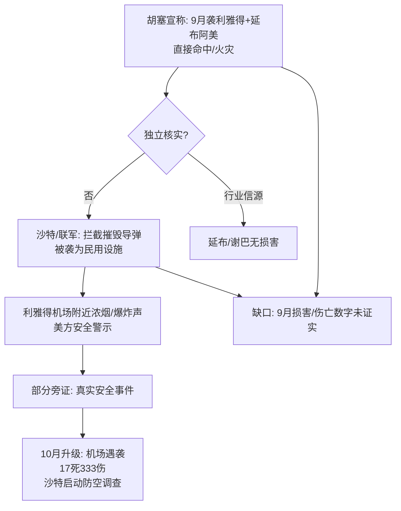

## 结论

理由：袭击宣称、沙特拦截表态、利雅得出现爆炸声与机场附近浓烟，均有多个独立来源交叉印证；但"胡塞导弹是否真正命中并损毁利雅得'敏感目标'与延布阿美设施""9月的实际损害与伤亡数字"缺乏独立核实，双方各执一词，且部分关键来源（路透社、阿拉伯周刊、Argus）仅存摘要或抓取失败。

<!-- confidence:mid -->
**置信度：中**

## 争议与不确定

| 争议点 | 胡塞武装说法 | 沙特/多国联军说法 | 可能口径原因 |
|---|---|---|---|
| **打击效果** | 行动"成功""直接命中"，延布与利雅得目标区"发生火灾" 5（引用未登记）[32] | "拦截并摧毁"导弹、"挫败"袭击图谋；未确认命中与火灾 4（引用未登记）[29] | 各自服务军事叙事与威慑/降级需要 |
| **目标性质** | 针对利雅得"敏感目标"、延布**阿美油气设施**、吉赞军事目标 5（引用未登记） | 被企图打击的是**平民与民用设施**（含机场） 29（引用未登记） | 争夺"合法性"话语权 |
| **规模与伤亡** | 动用"大量"导弹与无人机；称吉赞行动造成"数百人死伤" [22] | 9月仅确认拦截数量，**未通报任何伤亡** 12（引用未登记）；10月才公布机场伤亡 [25] | 伤亡披露涉及政治与情报考量 |
| **叙事框架** | 报复沙特对也门（"700多次""1018次"空袭）的打击 9（引用未登记）[24] | 自卫，呼吁国际社会承担遏制胡塞威胁的责任 [17] | 争夺国际舆论支持 |
| **延布设施是否受损** | 称延布、谢巴（Shaybah）袭击致两地起火 [32] | — | 行业信源（Argus）称延布、谢巴"无损害"，但覆盖面有限 [32] |

**无法核实/单方宣称的要点：** 胡塞关于9月19日"两次行动均成功、目标区大规模火灾"的说法，除胡塞自身声明与部分转述外，缺乏独立第三方现场核查 5（引用未登记）；沙特关于"拦截6枚导弹"的具体数字，亦主要由沙特/联军单方发布 11（引用未登记）。

## 证据与来源

### 时间线 / Timeline

| 日期 | 事件 | 来源 |
|---|---|---|
| 2026年7月起 | 胡塞与沙特冲突升级，双方互袭加强 | 3（引用未登记） |
| **9月10日** | 胡塞称用导弹与无人机袭击利雅得一处"重要目标" | [14] |
| **9月19日（周六）** | 利雅得两度传出爆炸声，哈立德国王国际机场附近升起浓烟；胡塞称对利雅得"敏感目标"及延布阿美设施发动两轮袭击；沙特称拦截并摧毁一枚射向利雅得的弹道导弹，并称挫败对比什、塔伊夫、费尔桑、延布的袭击企图；美国发布安全警示 | 4（引用未登记）10（引用未登记） |
| 9月20日 | 媒体持续报道，胡塞指责沙特在也门发动700多次空袭 | [9] |
| **9月23日** | 胡塞称过去24小时沙特对也门5省控制区发动52次空袭与导弹袭击 | [24] |
| **9月24日（周四）** | 胡塞称袭击利雅得"敏感目标"、延布阿美设施及吉赞军事目标；沙特称拦截并摧毁6枚弹道导弹、挫败袭击塔伊夫与延布企图；未立即确认利雅得遇袭或相关损害伤亡 | 11（引用未登记）[22] |
| 9月29日 | （据路透）沙特民防部门发布针对奈季兰的空袭警报 | [23] |
| 10月3日 | 胡塞称袭击利雅得一处沙特阿美石油设施，"直接命中" | 2（引用未登记） |
| 10月4日 | 沙特主导联军发言人称胡塞有关袭击利雅得的说法"存在误导" | 17（引用未登记） |
| 10月6—12日 | 胡塞对沙特三座机场发动系列导弹及无人机袭击 | [8] |
| 10月12日 | 沙特就拦截胡塞空袭失败启动调查 | [23] |
| 10月15日 | 沙特称胡塞10月以来对利雅得机场袭击共致17死333伤 | [25] |

### Evidence / 证据

- **2026年9月19日**，胡塞武装称使用弹道导弹、巡航导弹和无人机，对沙特首都利雅得"敏感目标"及红海港口延布的沙特阿美设施发动两轮袭击 [5]。胡塞军事发言人萨雷亚否认刻意针对平民，称袭击利雅得是对沙特空袭的回应 [19]。
- **9月19日**，据法新社、CNN证实，胡塞武装发布相关声明 [10]；沙特阿拉伯首都利雅得当天两度传出爆炸声，哈立德国王国际机场附近升起浓烟 [4]。
- **9月19日**，沙特主导的多国联军发言人马利基称，胡塞持续企图袭击利雅得"平民和民用设施"，并在**比什、塔伊夫、费尔桑和延布**的袭击企图"均被防空部队挫败" [29]。
- **9月19日**，美国国务院发布安全警示 [10]。
- **9月24日**，胡塞称袭击利雅得、延布阿美设施及吉赞军事目标；"截至当时沙特已实施1018次打击" [22]。沙特方面称拦截并摧毁**6枚**弹道导弹，挫败袭击塔伊夫与延布的企图 11（引用未登记），**没有立即确认对利雅得的袭击、也未确认塔伊夫或延布的损害或伤亡** [12]。
- **9月23日**，胡塞称过去24小时内沙特对也门5个省的胡塞控制区发动**52次**空袭和导弹袭击 [24]。
- **9月10日**，胡塞称用导弹和无人机袭击了利雅得一处"重要目标" [14]。
- **10月3日**，胡塞称使用弹道导弹和无人机袭击利雅得一处石油设施 [2]；联军发言人称胡塞说法"存在误导" 17（引用未登记）。
- **10月6—12日**，胡塞对沙特三座机场发动系列袭击，据维基百科摘要称造成至少**20死、逾370伤** [8]。
- **10月12日**，沙特就防空系统未能全部拦截胡塞大批导弹和无人机启动调查；初步调查显示胡塞先发射成群无人机干扰沙特雷达，为发射巡航导弹和弹道导弹袭击哈立德国王国际机场打掩护；10月10日机场遇袭造成**12死309伤** [23]。
- **10月15日**，沙特主导多国联军发言人马利基称，胡塞10月以来对利雅得哈立德国王国际机场的袭击共致**17死333伤** [25]。
- **延布/谢巴设施状况**：胡塞称对延布和谢巴的袭击造成两地起火（该说法曾推动布伦特原油近月价格波动）；一家行业信源称延布、谢巴设施"无损害" [32]。

## 深入了解

### 内容分析 / Content Analysis

- **角色/主张**：胡塞武装（军事发言人萨雷亚）主张"报复性打击、成功命中"；沙特主导多国联军（发言人图尔基·马利基）主张"拦截成功、被袭为民用设施、胡塞说法误导"。
- **时间线要点**：9月为冲突"首都化"的关键节点，10月进一步"机场化"，伤亡数字从9月的"未通报"转为10月的官方披露。
- **舆情与谣言交叉验证阅读**：胡塞倾向以"命中+火灾"强化威慑叙事；沙特倾向以"拦截+民用设施"争取国际支持。双方数字（1018次、52次、6枚、17死333伤）均需标注发布主体，避免单一信源确证。

### 关系拓扑 / Relationship Map

### 已确认 vs 未确认 / Confirmed vs Unconfirmed

- **已确认**：
  - 胡塞武装于9月（含19日、24日等）发表了针对利雅得与延布阿美设施的具体、可查的公开袭击声明 5（引用未登记）19（引用未登记）。
  - 沙特/多国联军公开确认拦截射向利雅得的导弹（9月24日称拦截6枚）并挫败对塔伊夫、延布的袭击企图 11（引用未登记）[29]。
  - 利雅得发生了真实的、多方可见的安全事件：爆炸声、哈立德国王机场附近浓烟、美国国务院发布安全警示 4（引用未登记）。
  - 冲突在10月延续升级，利雅得机场遇袭伤亡由沙特官方公布（10月10日12死309伤；至10月15日累计17死333伤），沙特并启动防空失败调查 23（引用未登记）。

- **未确认 / 无法确认**：
  - 胡塞导弹是否真正**命中并损毁**利雅得"敏感目标"与延布阿美设施（沙特否认/不确认；行业信源称延布、谢巴"无损害"，但覆盖不全）12（引用未登记）。
  - **9月的具体损害与伤亡数字**：胡塞称火灾、称吉赞"数百人死伤"，均缺乏独立核实；沙特9月未通报伤亡 12（引用未登记）。
  - **哈立德国王机场浓烟的确切成因与打击点**：浓烟出现的报道存在，但未被官方确认为"被命中" [4]。
  - **武器类型与数量的精确性**：除双方各自表述外，无独立核实 5（引用未登记）。
  - **9月10日事件的具体细节**：仅有维基百科摘要线索，独立报道不足 [14]。

### Gaps in Knowledge / 知识空白

1. **缺乏中立第三方现场核查**：9月事件主要依赖双方声明与转述，无独立机构进入目标区核实损害。
2. **关键来源无法读取全文**：路透社（9月24日）12（引用未登记）、阿拉伯周刊 [15]、Argus [32] 等页面抓取失败或仅有摘要，限制了对损害与伤亡数字的验证。
3. **9月内袭击的完整序列不清**：9月3日、10日、19日、23日、24日均有相关线索，但部分事件（如9月3日）独立报道不足，细节存疑 [24]。
4. **拦截成功率与防空评估**：沙特10月启动调查才间接披露9月防空存在缺口，但9月当时的具体拦截数据不完整 [23]。

## References

- [1] [中东冲突风险升级！胡塞武装：对沙特首都及关键能源设施 ...](<https://www.custeel.com/reform/view.mv?articleID=8428806&group=&cat=1003006>) — 已抓取全文（不代表事实核实）
  据央视新闻，当地时间周六，也门胡塞武装发布声明称称，其对沙特首都利雅得，以及沙特红海沿岸的能源设施发动了无人机与弹道导弹袭击。 不过，沙特官方 ...

- [2] [也门胡塞武装称袭击沙特首都利雅得石油设施](<https://www.news.cn/world/20261004/c5664d395ba8458f8f062c33f9a451f4/c.html>) — 仅摘要
  新华社科威特城10月3日电（记者尹炣）萨那消息：也门胡塞武装3日称，该组织使用弹道导弹和无人机袭击了位于沙特阿拉伯首都利雅得的一处石油设施，以 ...

- [3] [中东冲突升级胡塞首袭沙特首都利雅得\| 八点最热报21/09/2026](<https://www.youtube.com/watch?v=pnRkaMP1X7Q>) — 仅摘要
  中东冲突持续升级，也门胡塞武装宣称袭击沙特首都利雅得，并同时攻击红海港口城市延布的沙特国家石油公司设施。这是胡塞武装自7月与沙特冲突升级以来 ...

- [4] [\[视频\]也门胡塞武装称袭击沙特首都和延布目标沙特主导联军称 ...](<https://tv.cctv.com/2026/09/20/VIDEE3cMTAg5RzSheAbAJzx5260920.shtml>) — 已抓取全文（不代表事实核实）
  央视网消息（新闻联播）：沙特阿拉伯首都利雅得19日两度传出爆炸声，哈立德国王国际机场附近升起浓烟。也门胡塞武装当晚称，为回应沙特对也门的空袭， ...

- [5] [胡塞武装袭击利雅得及延布，沙特能源设施再受冲击](<https://finance.sina.com.cn/stock/usstock/c/2026-09-21/doc-inisqkzy8911380.shtml?finpagefr=p_108>) — 已抓取全文（不代表事实核实）
  也门胡塞武装称，当地时间9月19日使用弹道导弹、巡航导弹和无人机，对沙特首都利雅得的“敏感目标”以及红海港口城市延布的沙特阿美设施发动两轮袭击。

- [6] [胡塞武装称对沙特首都及关键原油设施发动袭击](<https://zhuanlan.zhihu.com/p/2084947733970941156>) — 仅摘要
  据央视新闻，也门胡塞武装19日发表声明说，当天对沙特首都利雅得的“敏感目标”以及沙特阿美公司位于延布的设施发动了两次军事行动，使用了大量弹道导弹、

- [7] [胡塞武装袭击利雅得及延布，沙特能源设施再受冲击 - ZAKER](<https://app.myzaker.com/news/article.php?pk=6ab21aef8e9f091a3737321e>) — 仅摘要
  也门胡塞武装称，当地时间9 月19 日使用弹道导弹、巡航导弹和无人机，对沙特首都利雅得的&quot; 敏感目标&quot; 以及红海港口城市延布的沙特阿美设施发动两轮袭击。

- [8] [2026年10月沙特阿拉伯机场空袭 - 维基百科](<https://zh.wikipedia.org/zh-hans/2026%E5%B9%B410%E6%9C%88%E6%B2%99%E5%9C%B0%E9%98%BF%E6%8B%89%E4%BC%AF%E6%A9%9F%E5%A0%B4%E7%A9%BA%E8%A5%B2>) — 仅摘要
  2026年10月6日至12日，也门胡塞武装对沙特阿拉伯境内的三座机场发动了一系列弹道导弹及无人机袭击，造成至少20人死亡、逾370人受伤。这是自2015年5月盖提夫与达曼 ...

- [9] [当地拉响紧急警报。胡塞武装指责沙特在也门发动700多次空袭](<https://www.facebook.com/che.hong.nian/posts/%E5%B1%80%E5%8A%BF%E6%98%BE%E8%91%97%E5%8D%87%E7%BA%A7%E8%83%A1%E5%A1%9E%E6%AD%A6%E8%A3%85%E8%A2%AD%E5%87%BB%E6%B2%99%E7%89%B9%E9%A6%96%E9%83%BD-2026%E5%B9%B49%E6%9C%8820%E6%97%A52026%E5%B9%B49%E6%9C%8820%E6%97%A5%E4%B9%9F%E9%97%A8%E8%83%A1%E5%A1%9E%E6%AD%A6%E8%A3%85%E4%BB%A5%E5%AF%BC%E5%BC%B9%E5%92%8C%E6%97%A0%E4%BA%BA%E6%9C%BA%E8%A2%AD%E5%87%BB%E6%B2%99%E7%89%B9%E9%A6%96%E9%83%BD%E5%88%A9%E9%9B%85%E5%BE%97%E5%8F%8A%E5%BB%B6%E5%B8%83%E7%9F%B3%E6%B2%B9%E8%AE%BE%E6%96%BD%E6%A0%87%E5%BF%97%E7%9D%80%E5%8F%8C%E6%96%B9%E5%86%B2%E7%AA%81%E6%98%BE%E8%91%97%E5%8D%87%E7%BA%A7%E6%B2%99%E7%89%B9%E5%86%9B/1688339986043856/>) — 仅摘要
  局势显著升级，胡塞武装袭击沙特首都 2026年9月20日 2026年9月20日，也门胡塞武装以导弹和无人机袭击沙 特首都利雅得及延布石油设施，标志着双方冲突 ...

- [10] [胡塞武装两次袭击沙特首都，能源设施成为目标，美国发布安全 ...](<https://news.qq.com/rain/a/20260920A09DM600>) — 已抓取全文（不代表事实核实）
  当地时间9月19日（周六），胡塞武装 宣称向沙特首都利雅得及红海沿岸能源设施发动弹道导弹、巡航导弹和无人机袭击。 据法新社、CNN证实，胡塞武装军事 ...

- [11] [Saudi Arabia says it intercepted missiles fired by the Iran ...](<https://www.facebook.com/aljazeera/videos/saudi-arabia-says-it-intercepted-missiles-fired-by-the-iran-backed-houthis-in-ye/951956821105757/>) — 仅摘要
  This post reports on a claim made by the Yemeni Houthis that they launched six missile and drone strikes against Saudi Arabia. The Houthis ...

- [12] [Houthis say they attacked Riyadh and Aramco facilities in ...](<https://www.reuters.com/world/middle-east/houthis-say-they-attacked-riyadh-aramco-facilities-yanbu-2026-09-24/>) — 抓取失败（仅摘要）
  There ⁠was no immediate Saudi confirmation ​of an attack on ​Riyadh ⁠or of damage or casualties in either ⁠Taif ​and Yanbu. Reporting ​by Enas ...

- [13] [\#IGR: Houthis Claim Missile And Drone Attacks On Saudi ...](<https://www.facebook.com/igr.media/videos/igr-houthis-claim-missile-and-drone-attacks-on-saudi-arabiayemens-houthi-group-c/1553098883392761/>) — 仅摘要
  This post reports on a claim made by the Yemeni Houthis movement that they carried out a missile and drone attack on a Saudi Aramco facility in ...

- [14] [Houthi–Saudi conflict](<https://en.wikipedia.org/wiki/Houthi%E2%80%93Saudi_conflict>) — 仅摘要
  On 10 September, the Houthis claimed that they attacked an &quot;important target&quot; in Riyadh using a missile and drones. On 23 November, a Houthi missile attacked an ...

- [15] [Houthi attacks bring wider regional war to Saudi capital \| \| AW](<https://thearabweekly.com/houthi-attacks-bring-wider-regional-war-saudi-capital>) — 抓取失败（仅摘要）
  Yemen&\#x27;s Houthis said they attacked “sensitive” sites in the Saudi capital Riyadh on Saturday with missiles and drones, hours after flames and a ...

- [16] [Saudi Arabia said ​it was facing a new barrage of incoming fire ...](<https://www.facebook.com/cgtnamerica/videos/saudi-arabia-said-it-was-facing-a-new-barrage-of-incoming-fire-on-monday-and-tha/1753286525787419/>) — 仅摘要
  The Houthis reportedly fired ballistic, cruise, and drone missiles at Saudi targets in Riyadh, targeting sensitive sites like King Khalid ...

- [17] [Houthis claim strike on Aramco site as Yemen fighting ...](<https://www.aljazeera.com/news/2026/10/4/houthis-claim-strike-on-saudi-energy-facility-as-yemen-fighting-intensifies>) — 仅摘要
  Spokesman for Saudi-led coalition supporting Yemen government says Houthi claims of targeting Riyadh are &\#x27;misleading&\#x27;.

- [18] [Yemen&\#x27;s Houthis claim to have attacked Riyadh, Aramco ...](<https://www.jpost.com/middle-east/article-909637>) — 仅摘要
  Yemen&\#x27;s Houthis claim to have launched missiles, drones at Riyadh, Aramco facilities in Yanbu · The statement came after Saudi Arabia said it had ...

- [19] [Yemen&\#x27;s Houthi group said on Saturday, Sept 19 that it had ...](<https://www.facebook.com/cgtnamerica/posts/yemens-houthi-group-said-on-saturday-sept-19-that-it-had-launched-large-scale-at/1527333906091852/>) — 仅摘要
  Sarea, the Houthi spokesperson, denied that the group deliberately targeted civilians, saying that the attacks against Riyadh were in response ...

- [20] [Conflict in Yemen and the Red Sea \| Global Conflict Tracker](<https://www.cfr.org/global-conflict-tracker/conflict/war-yemen>) — 仅摘要
  Houthi Forces Claim to Strike Saudi Military and Oil Infrastructure. November 7, 2026. Houthi forces claimed to conduct strikes targeting Saudi forces, oil ...

- [21] [Houthi–Saudi conflict - Wikipedia](<https://en.wikipedia.org/wiki/Houthi%E2%80%93Saudi_conflict>) — 已抓取全文（不代表事实核实）
  未返回摘要。

- [22] [胡塞武装称袭击利雅得敏感目标沙特称已拦截并摧毁导弹](<https://www.zaobao.com.sg/news/world/story20260925-9732576>) — 已抓取全文（不代表事实核实）
  也门胡塞武装称对沙特阿拉伯首都利雅得一处“敏感目标”、西部城市延布的沙特阿美设施，以及西南部吉赞地区多处军事目标发动袭击。沙特方面说，已拦截射 ...

- [23] [沙特就拦截胡塞武装空袭失败启动调查](<https://www.news.cn/world/20261013/dd896e96c2d94ad0bd63cf2d7488bf00/c.html>) — 已抓取全文（不代表事实核实）
  美联社12日以两名不愿公开姓名的官员为消息源报道，初步调查显示，胡塞武装先是发射成群的无人机，干扰沙特雷达系统，为发射巡航导弹和弹道导弹袭击哈立 ...

- [24] [9·3胡塞武装袭击沙特事件](<https://baike.baidu.com/item/9%C2%B73%E8%83%A1%E5%A1%9E%E6%AD%A6%E8%A3%85%E8%A2%AD%E5%87%BB%E6%B2%99%E7%89%B9%E4%BA%8B%E4%BB%B6/69066953>) — 仅摘要
  ... 利雅得的“敏感目标”以及沙特阿美石油公司位于延布的设施。9月23日，胡塞武装称，过去24小时内，沙特阿拉伯对也门5个省的胡塞武装控制区发动52次空袭和导弹袭击。当地 ...

- [25] [沙特称胡塞武装袭击利雅得机场共致17死333伤](<https://app.xinhuanet.com/news/article.html?articleId=2026101695f355405b234504b2ef5b4ff9d1e58f>) — 仅摘要
  ... 沙特阿拉伯主导的多国联军发言人图尔基·马利基15日在沙特首都利雅得举行的新闻发布会上说，也门胡塞武装10月以来对利雅得哈立德国王国际机场的袭击 ...

- [26] [沙特与胡塞武装互袭不断，美方多重顾虑之下介入意愿有限](<https://xinwen.bjd.com.cn/content/s6acd68ede4b039a8e2f23a70.html>) — 仅摘要
  也门胡塞武装军事发言人发表声明称，当晚使用一枚弹道导弹再次袭击了利雅得的哈立德国王国际机场，并称精准命中目标。沙特主导的多国联军则表示，拦截并 ...

- [27] [沙特主导联军：胡塞武装有关袭击利雅得说法存在误导](<https://world.people.com.cn/n1/2026/1004/c1002-40809375.html>) — 仅摘要
  胡塞武装3日早些时候称，该组织使用弹道导弹和无人机袭击了位于沙特首都利雅得的一处沙特阿美公司石油设施。袭击实现预定目标，“直接命中”导致目标地点 ...

- [28] [胡塞武装称袭击利雅得石油设施沙特主导联军回应](<https://news.cri.cn/20261004/1b6fa39b-fa1a-4a79-a0b8-15f04eac6e02.html>) — 仅摘要
  也门胡塞武装3日称，该组织使用弹道导弹和无人机袭击了位于沙特阿拉伯首都利雅得的一处石油设施，以回应沙特近期对也门境内的袭击。 胡塞武装军事发言 ...

- [29] [沙特主导联军称拦截胡塞武装射向利雅得的弹道导弹](<https://www.xhby.net/content/s6aaf16f5e4b086d2d5fecfd6.html>) — 仅摘要
  马利基表示，胡塞武装持续企图袭击利雅得的平民和民用设施。此外，胡塞武装还企图袭击比什、塔伊夫、费尔桑和延布的平民及民用设施，相关袭击均被防空部队 ...

- [30] [Saudi Arabia says it intercepted Houthi missiles](<https://www.reuters.com/world/middle-east/yemen-says-government-forces-repel-houthi-push-key-taiz-aden-route-2026-09-24/>) — 抓取失败（仅摘要）
  Saudi Arabia says it thwarts Houthi attack on the kingdom; Houthis say they attacked Riyadh and Aramco facilities in Yanbu; Houthis have ...

- [31] [Six Claims, No Confirmation \| HOS - House of Saud](<https://houseofsaud.com/houthi-six-operations-aramco-airports/>) — 仅摘要
  On 4 October, the Houthis claimed a strike on an Aramco site in ... The Shabwa attack is independently sourced; the six operations against Saudi ...

- [32] [No damage at Aramco Yanbu, Shaybah facilities: Source](<https://www.argusmedia.com/en/news-and-insights/latest-market-news/2893583-no-damage-at-aramco-yanbu-shaybah-facilities-source>) — 仅摘要
  The Houthis said on Monday its attacks on Yanbu and Shaybah caused fires at both sites, a claim that moved the price of front-month Ice Brent ...

- [33] [Houthis Claim Aramco Strikes in Yanbu as Saudi Defenses ...](<https://www.roic.ai/news/houthis-claim-aramco-strikes-in-yanbu-as-saudi-defenses-intercept-threats-09-24-2026>) — 仅摘要
  The Houthi movement said it used missiles and drones to attack Saudi Aramco ... Longer term, persistent attacks could encourage Saudi Arabia ...

- [34] [Houthis Claim Aramco Yanbu Strike, 2 Missiles Intercepted](<https://houseofsaud.com/houthis-target-yanbu-aramco-samref/>) — 仅摘要
  That attack was attributed to Iranian forces; the IRGC had issued pre-strike evacuation warnings for SAMREF and other Gulf facilities, according ...

- [35] [Houthis claim strikes on Saudi Defense Ministry, Aramco ...](<https://www.reddit.com/r/worldnews/comments/1xckevk/houthis_claim_strikes_on_saudi_defense_ministry/>) — 仅摘要
  Houthis attack on aramco in saudi arabia today, thoughts? ... r/worldnews - Houthis claim attacks on Saudi Aramco&\#x27;s Yanbu refinery, air base.

- [36] [Saudi Arabia confirms Yemen&\#x27;s Houthi rebels tried to attack ...](<https://www.nbcnews.com/world/middle-east/flames-smoke-seen-riyadh-airport-houthis-claim-attacks-saudi-capital-rcna598714>) — 仅摘要
  The statement also said the Houthis tried to attack civilian infrastructure in the Red Sea port city of Yanbu — where a key Saudi pipeline ends ...
