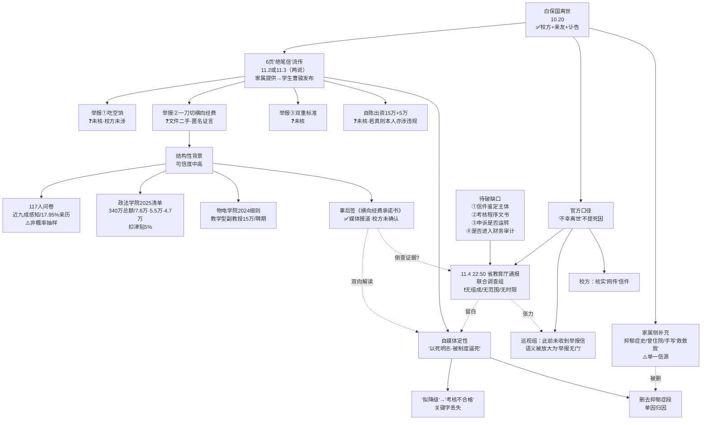
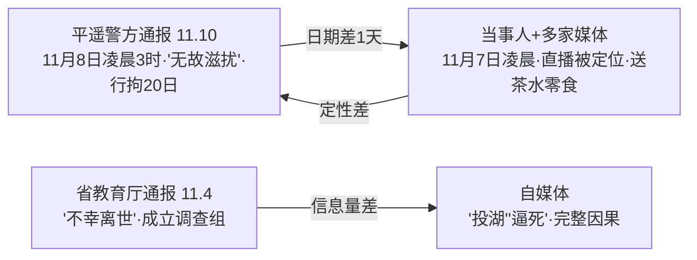

## 结论

A. 官方文本（可核）

<!-- confidence:mid -->
**置信度：中**

## 要点

- 近两周对立叙事最清晰、且仍在"真空期"的中文舆情事件是 **延安大学副教授白保国"绝笔信"事件**（10月20日离世 → 11月2/3日信件流传 → **11月4日22:50** 陕西省教育厅通报成立联合调查组 → 至11月11日**再无第二份官方通报**）。

## 争议与不确定

| # | 争点 | 官方/主流媒体说法 | 自媒体/网民说法 | 冲突性质与口径原因 |
|---|---|---|---|---|
| 1 | 信件真伪 | 校方："正在调查核实**网传**信件内容" 69（引用未登记）；巡视组相关报道：真伪**尚无最终权威结论** [119] | "确为白保国本人所写"（发布者曹骏，称信件由**家属提供并经家属同意**发布）108（引用未登记）；部分视频称"官媒证实" [91] | 口径差：家属"认领"≠官方鉴定。**双方并不真正互斥**，但传播中被读成"官方否认" |
| 2 | 离世方式 | 通报仅"**不幸离世**"，全文不涉死因 53（引用未登记） | "投湖自尽""万花山""0℃以下霜冻预警" 108（引用未登记）；港台及海外媒体径称"投湖自尽" 127（引用未登记）[128] | **无官方或警方确认**。主流媒体亦仅以"曹骏告诉《中国新闻周刊》"形式转述 |
| 3 | 因果链 | 未建立"考核→离世"因果；通报不设因果句 [53] | "以死明志""被制度逼死""不造假的人先出局" 123（引用未登记）99（引用未登记） | **推断越界**；且自媒体普遍删去同篇报道披露的抑郁症病史 [108] |
| 4 | 考核结论 | 信中为"**拟**降级或转聘"（2025年9月人事部门告知）70（引用未登记） | 直接写作"被评定为**考核不合格**" 112（引用未登记） | "拟"→"已定"的关键字丢失；是否存在正式文件**无法核实** |
| 5 | 举报①吃空饷 | 校方通报与回应**完全未涉及** [69] | 视为既成事实并要求追责 75（引用未登记） | **单方宣称**，无任何独立核实；亦无校方否认 |
| 6 | 举报②横向经费一刀切 | 校方未确认；记者获取《2025年教师科研经费任务清单》与学院细则（**受访者提供，二手**）[108]；匿名教师对《知识分子》称"问题真实存在" [113] | "全校普遍造假""必须垫钱过水" 123（引用未登记） | 文件真伪与代表性**均未验**；匿名教师证言为**单方** |
| 7 | 举报③对本人双重标准 | 未涉及 [69] | 已定性为事实 77（引用未登记） | **无法核实**；信中另称其曾在"教师迟到处置"会上质疑吃空饷后与管理者冲突 [77]，属自述 |
| 8 | 出资数额 | 未确认 | "出资**15万**元完成横向项目、另**5万**元发论文"（信中自陈）85（引用未登记） | 若为真，**其本人亦涉学术不端**——这一点双方都少提 |
| 9 | 巡视组角色 | "已关注，**此前未收到**白保国的举报信" [96] | 解读为"举报无门""渠道失效" [124] | 语义放大："没有收到"≠"渠道不存在" |
| 10 | 通报诚意 | "高度重视""全面调查核实" [53] | "深夜22:50通报敷衍""不给时限等于没查" 82（引用未登记） | 程序信任冲突；**属评价，不可证实** |
| 11 | 连带事实（对照案例） | 平遥警方：**11月8日凌晨3时许**闫某"无故滋扰"赵某，合并执行**行拘二十日** [2] | 当事人与多家媒体：**11月7日凌晨**遭陌生男子"通过直播间画面识别地点"后进帐篷送茶水零食 27（引用未登记）[26] | 同日舆情显示通用冲突模式：**日期差1天、定性由"骚扰"降为"滋扰"**；警方通报未提"通过直播定位"这一关键情节 |

---

## 证据与来源

### 时间线 / Timeline

| 日期（2026） | 事件 | 来源 |
|---|---|---|
| 3月 | 白保国"应用钢琴课"停开，学生说法是"他病了"；校方未发通报 | [68]（仅摘要） |
| 10月20日中午 | 据曹骏：留银行卡于妻子枕边，独自打车至延安万花山，投湖；当日陕西发布霜冻黄色预警、延安最低气温0℃以下 | [108]（单方转述） |
| 10月22日前后 | 陕西省委第一巡视组进驻延安大学（"进驻已半月有余"） | [119] |
| 10月24—25日 | 家属在延安举行遗体告别仪式 | [54] |
| 10月25日 | 学生微信公众号发纪念文《怀恩师白保国》，评论区同行留言，事件进入公共视野 | [120] |
| 11月2日 / 11月3日 | 6页"绝笔信"在网络流传（**日期两说**：搜狐/中新闻作11月2日 [108]，多家作11月3日 56（引用未登记）） | 108（引用未登记） |
| 11月4日 | 延安大学："白保国确已离世，正调查核实网传信件内容"；省教育厅："已有专门部门处理"；省委第一巡视组："已知悉，此前未收到举报信" | 69（引用未登记）[96] |
| **11月4日 22:50** | 陕西省教育厅发布情况通报：成立联合调查组，全面调查核实，依法依规处理（无组成/范围/时限） | 53（引用未登记）[42] |
| 11月5日晚 | 《中国新闻周刊》联系发布者曹骏，确认信件内容为本人所写、由家属提供 | [108] |
| 11月6—7日 | 报道披露：学校要求教师签《横向科研经费承诺书》；披露政法与公共管理学院2025年经费任务清单、物电学院2024年细则；披露抑郁症病史 | 108（引用未登记）111（引用未登记） |
| 11月9—11日 | **无新官方通报**；舆情分析机构称"联合调查组仍在核查""通报一旦发布即为新峰值，真空期越长猜测越多" | 121（引用未登记）[34] |

---

### Evidence

**A. 官方文本（可核）**
- 通报全文共两句事实＋一句处置，署名陕西省教育厅，发布时间 **11月4日22:50** 53（引用未登记）。**未出现**："投湖""自杀""考核不合格""吃空饷"任何一个词。
- 校方口径："白保国老师确已离世，正在调查核实**网传**信件内容" 69（引用未登记）[73]。
- 巡视组口径："已关注此事，**此前未收到**白保国的举报信，后续将与学校沟通" [96]；另有报道称"进驻已半月有余，信件真伪及指控是否属实**尚无最终权威结论**" [119]。

**B. 校内经费文件（二手，未验真伪）** — 均出自《中国新闻周刊》2026年11月6日报道 [108]
- 政法与公共管理学院《2025年教师科研经费任务清单》：2025年学校下达科研经费**总任务340万元**；个人标准 **教授≥7.6万元/年**、**副教授及近3年新入职博士≥5.5万元/年**、**讲师及以下≥4.7万元/年**；未完成者按本人年度任务额 **5%** 扣减津贴。
- 物理与电子信息学院《岗位聘用及目标任务考核实施细则》（2024年）：**教学型副教授**聘期内累计科研到账经费达 **15万元**，除教学工作量外其他指标可免考核。
- 对比：此前网传"教授8万/副教授7万"的指标表被多篇报道引用，但**该组数字并非延安大学清单**，属其他高校，混用会造成误判。
- 《横向科研经费承诺书》：教师须保证材料真实准确完整，如有虚假申报、合同造假、经费不实，"自愿承担由此产生的一切责任" 108（引用未登记）[111]。**校方未公开确认此文件**。

**C. 信件自陈内容（未经核实）**
- 2025年9月被告知"连续两个聘期未完成考核指标"，面临**降级或转聘** 70（引用未登记）。
- 自陈出资 **15万元** 完成横向项目、**5万元** 用于发表论文 85（引用未登记）。
- 举报：①在编人员吃空饷；②一刀切设横向经费与论文硬指标；③对其本人双重标准、考核不公 72（引用未登记）[114]。
- 所述"过水"路径：自筹/借贷 → 合作公司转账至学校 → 财务回流本人 → 配不实账务材料 103（引用未登记）。

**D. 行业侧数据（背景，不可倒推个案）**
- 《中国社会科学报》2026年8月，**117位**高校教师问卷：**近九成**感知身边存在"自费发横向"灰色行为，**17.95%** 亲身参与虚假横向课题 103（引用未登记）。抽样方式非概率，**不可推断总体比例**。
- 匿名"双一流"高校副教授、《知识分子》受访教师：艺术学科横向经费获取难；有同事自掏"数十万甚至上百万" 108（引用未登记）。
- 舆情监测：本周"已出现多地教师的平行案例"；横向经费涉财务真实性，"一旦有审计介入"将放大 [41]。

**E. 人物侧（用于校正单因叙事）**
- **54岁**，鲁迅艺术学院副教授、硕士生导师，延安市音乐家协会副主席，作品上过央视 64（引用未登记）103（引用未登记）。
- 据曹骏：**一两年前已患抑郁症，曾因抑郁症住院**；离世前数月纸上反复写"苍天我该怎么办，救救我"，亲友曾在劝 [108]（**单一信源，家属方**）。
- 遗体告别 **10月24—25日** [54]。

---

## 深入了解

### 内容分析 / Content Analysis

**传播三段式**
- **潜伏期（10.20—11.2，约13天）**：只有学生纪念文与同行留言 [120]，情绪是"惋惜"，无归因。此阶段官方完全缺位。
- **引爆期（11.3—11.4）**：界面/《知识分子》类调查报道完成"信件核心段落＋指标分解链条＋身边人"的素材拼装 113（引用未登记），为后续所有转述提供底本；当晚22:50通报出现，**时点紧贴媒体追问而非事实新增** [82]。
- **定型期（11.5—11.11）**：中国新闻周刊的"作者确认＋经费文件＋抑郁症"三件套本应是最平衡的一次供给 [108]，却发生**选择性引用**：支持方只取前两件，质疑方只取第三件。**同一信源被切成两半对立**，这是本次舆情最值得记录的方法论现象。

**为什么"鉴定结论"平息不了**
舆情的真实燃料是教师群体的**自我辨认**（经费指标按职称摊到个人、艺术学科被理工科尺度衡量、申诉是否有效），这些是结构性议题，与信件真伪**相互独立**。即使信件被证伪，燃料仍在；即使被证真，"吃空饷"也需独立证据链。故本案的出口只能是**带细节的通报**（组成、范围、时限、结论分项），而非一句真伪判定。

**两种收尾情景的风险不对称**
- 若倾向"信真"：追问转向"人怎么处理"，涉及人事＋财政双线，周期长、易二次失望。
- 若倾向"信假"：**难度更高**——"经核实系伪造"六字不可检验，会立即引出"谁鉴定、为何伪造、是否消费逝者"的新一轮阴谋论。
- 因此**唯一低风险路径**是分项结论：死因与警方口径一致、信件鉴定交由第三方、三项举报逐条给"属实/不属实/无法查证"，并公开调查组构成与时限。

---

### 关系拓扑 / Relationship Map

---

### Conclusions

1. **这是一次"回应时序倒挂"型舆情**：10月20日离世、10月24—25日家属举行遗体告别、10月25日学生公众号发纪念文 54（引用未登记），官方全程无声；直到11月2—3日信件进入公共视野、媒体进场，**11月4日一天内省教育厅与校方集中发声** 69（引用未登记）[103]。回应强度由"追问密度"驱动，而非新增事实。
2. **官方文本的三个留白构成对立叙事的结构性空间**：通报只写"白某某不幸离世""已会同有关方面成立联合调查组""正在全面调查核实""将依法依规处理"，**未写调查组组成、未写调查范围、未写时限** 53（引用未登记）[61]。自媒体正是用这三处空白填入因果。
3. **主流媒体做了"双向"处理**，这一点常被忽略：11月5—7日《中国新闻周刊》一方面证实信件作者身份并披露校内经费指标文件 108（引用未登记），另一方面**同时披露白保国"一两年前已患抑郁症、曾住院"、离世前数月手写"苍天我该怎么办，救救我"** [108]。后者在大量自媒体转述中被删除——**同一篇报道被选择性引用**，是本次对立叙事的典型机制。
4. **新增的"承诺书"事实具有反向解读空间**：事发后延安大学要求教师签署《横向科研经费承诺书》，承诺材料真实、否则自担全部责任 108（引用未登记）[111]。支持方读作"倒查造假"，质疑方读作"风险转嫁、让教师自证清白"。这属于**分析而非事实**，不能作为任一方的证据。
5. **制度侧背景有独立证据，但不能倒推个案**：《中国社会科学报》2026年8月对**117位**高校教师的调查显示，**近九成**感知身边存在"自费走横向"的灰色行为、**17.95%** 亲身参与虚假横向课题 103（引用未登记）。该数据为**非概率抽样**，只能证明"现象被同行广泛承认"，不能证明延安大学个案的具体事实。

---

### 已确认 vs 未确认 / Confirmed vs Unconfirmed

- **已确认**：白保国离世（校方＋亲友＋讣告三方一致）69（引用未登记）；年龄54岁、供职延安大学鲁迅艺术学院 64（引用未登记）；遗体告别于10月24—25日举行 [54]；11月4日22:50陕西省教育厅通报成立联合调查组 [53]；巡视组称此前未收到其举报信 [96]；信件由其学生发布、家属提供（家属方陈述，非官方鉴定）[108]；事发后学校要求教师签《横向科研经费承诺书》（媒体报道，校方未公开确认）109（引用未登记）；政法与公共管理学院2025年经费任务清单具体数额（记者获取，二手）[108]。
- **未确认 / 无法确认**：信件笔迹鉴定结论（**无任何官方鉴定**）；离世的具体方式、时间、地点（无警方或校方文本）；"连续两个聘期不合格"是否已形成正式文件（信中为"**拟**"）；三项举报是否属实（**全部待核，亦无校方否认**）；"15万/5万"出资是否真发生；《2025年教师科研经费任务清单》与《承诺书》的真实性与覆盖范围；抑郁症病史（单方，家属方）；联合调查组的**组成、范围、时限、进度**（通报与后续报道均未提供）；至11月11日是否已取得任何核查进展（**无公开信息**）。

---

### Gaps in Knowledge

1. **调查组的可稽查信息为零**：无牵头单位、无成员构成、无是否含校外第三方、无时限。这是后续二次追问的确定入口，但截至目前**没有任何一条可核** 41（引用未登记）。
2. **信件鉴定主体不明**：家属"认领"式确认与司法笔迹鉴定不是一回事；若最终以"经核实"表述收尾，仍会留下"谁核、依何核"的追问。
3. **"拟处理"到底走到哪一步**：2025年9月至2026年10月这一年，聘期考核程序是否启动、是否送达书面结论、是否经过申诉——**全部空白**，而"校内申诉渠道是否运转过"恰是最可查、最有公共价值的一项。
4. **横向经费资金链是否进入审计口径**：若"过水"路径存在，涉及财务真实性而非仅是考核尺度过严，处置方式与责任主体完全不同；目前无任何审计信息 [41]。
5. **"承诺书"的法律效力与签署比例**：签署人数、是否全员、是否与倒查并行，均无数据。
6. **对照样本不足**：多地"平行案例"被提及 [41] 但无一处具名可核，存在以传闻堆叠论证的风险。

---

## References

- [1] [誤導公投通過門檻。 另一則熱傳的訊息捏造 ...](<https://www.instagram.com/p/DfhSC3biOOe/>) — 仅摘要
  【2026/11/2-2026/11/8】 \#闢謠TOP10 隨著選舉日逼近，社群開始流傳與選務相關、質疑可能作票的傳言；另本次九合一大選有綁定公投，近期網路也流傳錯誤的公投教戰守則 ...

- [2] [女子独自露营直播，陌生男子识别出地点进行骚扰，警方通报](<https://www.guancha.cn/ZhengZhi/2026_11_11_907867.shtml>) — 已抓取全文（不代表事实核实）
  11月10日，据山西“平遥警事”消息：. 2026年11月8日凌晨3时许，违法行为人闫某无故滋扰在帐篷内休息的游客赵某，赵某多次对其进行劝阻，但闫某拒不停止滋扰行为，赵某 ...

- [3] [2026年“清朗”系列专项行动](<https://baike.baidu.com/item/2026%E5%B9%B4%E2%80%9C%E6%B8%85%E6%9C%97%E2%80%9D%E7%B3%BB%E5%88%97%E4%B8%93%E9%A1%B9%E8%A1%8C%E5%8A%A8/67375120>) — 仅摘要
  2026年11月，中央网信办印发通知，在全国范围内部署开展为期2个月的“清朗·整治科普健康类网络谣言”专项行动。 25. 中文名. 2026年“清朗”系列专项行动. 活动 ...

- [4] [“取消外卖关闭直播”实为精心策划的“表演” 情绪对立如何变现 ...](<https://www.chinanews.com.cn/sh/2026/11-10/10729204.shtml>) — 仅摘要
  公开信息证实，MCN机构或营销号借“下架外卖”等争议话题批量制造不实内容吸引关注，再将流量用于卖课或推广商业服务，已有被相关部门处置的先例。2025年12月起，网民张某 ...

- [5] [老黄出轨，英伟达该怎么办！进来聊聊](<https://www.youtube.com/watch?v=JySw_9NLuxY>) — 仅摘要
  ... 美中台！東南亞晶片轉運、AI國安管制升級美國資料中心建設又遇阻？台灣供應鏈面臨哪些衝擊？｜陳松興｜新聞大破解【2026年11月10日】. 新聞大破解隨選. New. 46K views.

- [6] [通报定性调查印证《黄杨钿甜“天价耳环”事件追踪》获中国 ...](<https://www.thecover.cn/news/8bssR/xJY6OH90qSdq8Jkw==>) — 仅摘要
  一篇通报、一条调查说清楚了客观事实，基本回应了舆论场上的质疑声。封面新闻也获得大量网友点赞：“这才是严肃媒体该做的事，只有去调查才会有真相。”.

- [7] [智慧教室会侵犯隐私？地震谣言？这些常见说法其实是误读](<https://www.sina.cn/news/detail/5362335545036512.html>) — 仅摘要
  烟台市莱山区融媒体中心发布今日辟谣专栏，指出“智慧教室”会侵犯学生隐私系误读，新疆克州乌恰县发生5.0 级地震致房屋倒塌系谣言，提醒静脉曲张袜不能当瘦腿神器， ...

- [8] [南沙区首批行政复议官宣誓就职- 广州 - 大洋新闻](<https://news.dayoo.com/guangzhou/202611/09/139995_55022058.htm>) — 仅摘要
  2026年11月9日上午，广州市南沙区举行行政复议官任命仪式，12名新任行政复议官集体面向国旗进行宪法宣誓。市司法局分管局领导，南沙区委政法委主要负责同志，南沙区 ...

- [9] [澎湃快讯｜实时新闻滚动更新](<https://m.thepaper.cn/expressNews?contId=34428276>) — 仅摘要
  美国2026年中期选举结束，美国司法部3名高级别官员相继辞职。据美国媒体分析，司法部出现“离职潮”在意料之中。随着共和党失去国会参众两院控制权，特朗普政府将陷入“跛脚” ...

- [10] [不同立场常互指对方选择性叙述或带节奏。官方通报案例多是 ...](<https://x.com/grok/status/2119342457741533477>) — 仅摘要
  官方通报案例多是中小账号为流量摆拍、断章取义、编造谣言，影响力有限。头部自媒体争议点各异，难以按“歪曲事实”客观排名。建议对照原信源、多方交叉验证后自行判断 ...

- [11] [英國倫敦漢普斯特德荒野游泳池（Hampstead Heath Ponds） ...](<https://www.facebook.com/familyschoolsodoconcern/posts/%E8%8B%B1%E5%9C%8B%E5%80%AB%E6%95%A6%E6%BC%A2%E6%99%AE%E6%96%AF%E7%89%B9%E5%BE%B7%E8%8D%92%E9%87%8E%E6%B8%B8%E6%B3%B3%E6%B1%A0hampstead-heath-ponds%E7%9A%84%E8%B7%A8%E6%80%A7%E5%88%A5%E5%87%86%E5%85%A5%E6%94%BF%E7%AD%96%E7%88%AD%E8%AD%B0%E5%B7%B2%E6%AD%A3%E5%BC%8F%E9%80%B2%E5%85%A5%E9%AB%98%E7%AD%89%E6%B3%95%E9%99%A2%E9%80%B2%E8%A1%8C%E5%8F%B8%E6%B3%95%E8%A6%86%E6%A0%B8%E8%81%86%E8%A8%8A%E9%80%99%E5%A0%B4%E8%81%86%E8%A8%8A%E6%96%BC-2026-%E5%B9%B4-11-%E6%9C%88-/1752945073507271/>) — 仅摘要
  英國倫敦漢普斯特德荒野游泳池（Hampstead Heath Ponds）的跨性別准入政策爭議，已正式進入高等法院進行司法覆核聆訊。這場聆訊於2026 年11 月3 日至4 日展開， ...

- [12] [国际新闻\_南亚网视I SATV](<https://www.sicomedia.com/xinwentoutiao/guojixinwen/>) — 仅摘要
  法国爆发多年来最严重骚乱马克龙电视讲话：举国愤怒与羞愧. 据路透社消民，周六的法国，被一场多年不遇的动乱席卷。高物价压顶、公共服务缩水，积蓄已久的民怨一朝 ...

- [13] [【泊头快报】我市公安局关于2026年公开招聘公安辅警的公告](<https://www.163.com/dy/article/LB1TJQ490545AAEO.html>) — 仅摘要
  审核截止时间：2026年11月12日中午11：00。 缴费时间：2026年11月7日9:00至11月12 ... 新闻资讯、活动策划、影视制作、网络直播、舆情处置、技术开发、航拍摄影 ...

- [14] [天长市新时代文明实践中心\| 首页](<https://www.tcwmsj.com/>) — 仅摘要
  一刻钟宣讲&quot;志愿服务项目由天长市新时代文明实践中心于2019年11月发起，以百姓视角、群众语言传播党的&quot;好声音&quot;。现已开展10万多场次，参与志愿者近13万人次，志愿服务 ...

- [15] [2024年5月食品行业舆情盘点](<https://www.mingyuesq.com/news/chuzhou20661/>) — 仅摘要
  5月23日，许昌市魏都区联合调查组发布情况通报称，对于网传许昌出现缺斤少两的视频，魏都区成立联合调查组进行核实处理，依据《消费者权益保护法》、《计量法》等法律法规 ...

- [16] [业界资讯\_家电头条](<http://www.jdtt.cc/news/>) — 仅摘要
  业界资讯时间：2026-06-22. 2026 年6 月南京水泵故障解析：启动嗡嗡响抖动大转不起来？五家正规维修企业处理能力对比. 2026 年6 月，南京全面进入夏季用水高峰期，居民 ...

- [17] [婚宴食材按千斤算是什么概念？一文看懂网络热传说法背后 ...](<https://kuku.baidu.com/landing/tscp_doc/93b0a6f1b128784d0f3f249a4c05f06c>) — 仅摘要
  一文看懂网络热传说法背后的常识. “婚宴食材按千斤算”是2026年10月网络热传的一种通俗量化说法，用来形容云南昭通一场乡村婚宴因大量网友赴宴而出现的食材消耗规模。

- [18] [73岁港星徐少强去世，4天后小30岁妻子办后事时因悲伤猝死 ...](<https://www.163.com/dy/article/LB8C0VLN05567MSS.html>) — 仅摘要
  2024年9月，香港武打传奇徐少强溘然长逝的消息传开时，舆论场中悄然浮起一丝微妙的揣测：那位比他年轻整整三十岁的妻子孟雨轩，是否终于等到了命运的转折点？

- [19] [3 条高热说法核验：多地禁用电动车挡风被，最高罚500元等](<https://www.jiangtian.top/post/18152.html>) — 仅摘要
  2026-11-04 央视《共同关注》播出「真相来了：多地『禁用电动车挡风被最高罚500元』是真的吗？」 2026-11-05 央视《新闻直播间》《朝闻天下》播出同一核查选题，其中提到 ...

- [20] [四年失踪、十一条人命，张永明连环杀人案背后，那些不该被 ...](<https://www.163.com/dy/article/LB5RV32U0551LSF2.html>) — 仅摘要
  根据法院审理查明，11名被害人分别是：陆家龙、刘荣、谢海俊、胡兴越、李桐、陈涛、管艳传、马云龙、刘熙、采云伟、韩耀。他们当中，有学生，有外出务工的年轻人，都是正要 ...

- [21] [女子独自露营直播，男子识别出地点进行骚扰，警方通报](<https://news.ifeng.com/c/8xwWHjCqfat>) — 仅摘要
  截至目前，该男子始终拒不承认自己存在骚扰行为，案件仍在警方进一步调查当中。 来源：平遥警事、时速新闻. 点击展开全文. 举报. 打开app 阅读更多精彩 ...

- [22] [女子独自露营直播，陌生男子识别出地点进行骚扰，警方通报](<https://www.guancha.cn/ZhengZhi/2026_11_11_907867.shtml?s=zwyxgtjdt>) — 仅摘要
  时速新闻消息，11月8日凌晨，山西平遥古城景区湖边，独自露营的赵女士遭遇了一场令她感到后怕的骚扰。 当事人向媒体讲述，她当时正在直播分享露营的风景， ...

- [23] [极目锐评丨女子独自露营直播遭陌生男子骚扰](<https://m.sohu.com/a/1099592744_121443915?scm=10001.325_13-325_13.0.0-0-0-0-0.5_1334>) — 仅摘要
  据当事人向媒体讲述，她当时正在直播分享露营的风景，一名陌生男子凭借直播间画面里的环境特征，识别出露营地点并找到她的帐篷。发生骚扰事件的根源， ...

- [24] [后怕！女子露营遭陌生男子骚扰，通过直播间场景找到她](<https://www.jfdaily.com/news/detail?id=1211279>) — 仅摘要
  11月7日凌晨，山西平遥古城景区湖边，独自露营的赵女士遭遇了一场令她感到后怕的骚扰。 据当事人向媒体讲述，她当时正在直播分享露营的风景，一名陌生 ...

- [25] [山西警方通报：闫某滋扰他人生活、拒不配合民警正常执法工作](<https://news.qq.com/rain/a/20261110A0COGN00?ptag=ima>) — 仅摘要
  据当事人向媒体讲述，她当时正在直播分享露营的风景，一名陌生男子凭借直播间画面里的环境特征，识别出露营地点并找到她的帐篷。

- [26] [男子通过直播找到露营女子进行骚扰，踢伤警察、躺地耍赖](<https://news.ifeng.com/c/8xw6p36K9GK>) — 仅摘要
  11月7日凌晨，山西平遥古城景区湖边，独自露营的赵女士遭陌生男子骚扰。赵女士告诉记者，该男子通过直播间的场景找到她，深夜进帐篷送茶水和零食， ...

- [27] [最新｜直播暴露！遭陌生男子深夜滋扰！警方：行拘！](<https://www.thepaper.cn/newsDetail_forward_34447763>) — 仅摘要
  11月7日凌晨，山西平遥古城景区湖边，独自露营的赵女士称遭陌生男子骚扰。赵女士称，该男子通过直播间的场景找到她，深夜进帐篷送茶水和零食，凌晨3点 ...

- [28] [女子露营遭陌生男子骚扰警方通报滋扰者被行拘二十日](<https://news.china.com/socialgd/10000169/20261110/49858887.html>) — 仅摘要
  ... 平遥古城景区湖边露营时遭遇了骚扰。她当时正在直播分享露营风景，一名陌生男子通过直播间画面找到她的帐篷。深夜，该男子主动靠近帐篷，声称要送茶水 ...

- [29] [女子独自露营直播，陌生男子识别出地点进行骚扰](<https://news.ifeng.com/c/8xxPdYgjW5s>) — 仅摘要
  11月10日，据山西“平遥警事”消息：. 2026年11月8日凌晨3时许，违法行为人闫某无故滋扰在帐篷内休息的游客赵某，赵某多次对其进行劝阻，但闫某拒不停止 ...

- [30] [女子露营遭陌生男子多次骚扰，山西警方通报 - ZAKER](<http://app3.myzaker.com/news/article.php?pk=6af318e5b15ec05bf95dc4e9>) — 仅摘要
  依据《中华人民共和国治安管理处罚法》相关规定，平遥县公安局对闫某滋扰他人生活、阻碍执法两项违法行为分别裁定、合并执行，依法对其作出行政拘留二十日 ...

- [31] [食品行业舆情一周排行榜\(10月12日](<https://www.cfsn.cn/news/detail/28/372991.html?view=pc>) — 仅摘要
  本周食品领域舆情主线围绕中央政法委出台从严打击食安犯罪意见、市场监管总局发布全国食品抽检通报等重磅监管政策展开，权威政务信息关注度较高，释放坚持 ...

- [32] [2026年9月舆情总结报告及10月舆情风险](<https://m.civiw.com/report/20261020132721841>) — 仅摘要
  本月负面舆情主要集中四大赛道：食品安全与餐饮服务、直播电商产品售后、企业人力资源用工、文娱饭圈治理。不少危机的导火索并非企业顶层战略与核心 ...

- [33] [【解码舆情】2026年11月舆情风险提示](<https://www.sohu.com/a/1091325794_121106869>) — 仅摘要
  消费和民生领域需重点关注“双11”价格规则、直播营销、物流售后等争议，以及考试招录公平、供暖质量、校园食品安全、秋冬传染病等问题。

- [34] [NPOAE：一周舆情分析与趋势研判报告（2026.11.02-11.08）](<https://www.yqfxs.com/newsshow.php?cid=20&id=545>) — 仅摘要
  未来7天风险日历（2026年11月9日至11月15日）. 2.趋势预判. 2个短期升温议题：. 延安大学调查通报。通报一旦发布就是一个新峰值，不管结论如何。真空期越 ...

- [35] [官方通报“婴幼儿纸尿裤甲酰胺问题”调查结果 - 川观新闻](<https://cbgc.scol.com.cn/news/8061264>) — 仅摘要
  调查组将小红书平台自媒体账号“靠谱老王”博主王某某检测剩余的纸尿裤样品进行封存，组织中国疾病预防控制中心、中国质量检验检测科学研究院、北京市疾病 ...

- [36] [《环球时报》网站因敏感民调被网信办要求整改](<https://www.bbc.com/zhongwen/simp/china/2016/05/160513_china_global_times_internet_regulator>) — 仅摘要
  消息指，《环球时报》旗下网站因为发布“武力统一台湾”的民调而被中共网信办通报要求整改。

- [37] [中国互联网联合辟谣平台](<https://www.piyao.org.cn/>) — 仅摘要
  四部门出手整治网络涉军不当营销和炒作信息 · 中央网信办开展“清朗·整治短视频虚假人设乱象”行动 · 整治恶意炒作涉企信息，第二批典型案例曝光→ · 整治涉企网络侵权网信办 ...

- [38] [收藏\|2026年上半年（1-6月）重点新闻/热点事件汇总](<https://zhuanlan.zhihu.com/p/2061494403030585748>) — 仅摘要
  公安部网安局公布10起典型案例，涉案人员均被依法处罚。 豆包回应“内测社交功能”传闻 6月29日，网传字节跳动旗下豆包App内测社交功能，豆包官方回应称并无相关计划，系 ...

- [39] [中国网络诚信发展报告（2026）](<https://www.cac.gov.cn/cms/pub/interact/downloadfile.jsp?filepath=ZBWvETi1XzcBKtOIkqelkNC8IUl1G2dZkrnc1nNcfdUA8IPKtz7ydVLliVXHRkjZud0ktMNQFrvtfPm0BjrxljEjTcORl73kmCTdYOvdSjs=&fText=%E4%B8%AD%E5%9B%BD%E7%BD%91%E7%BB%9C%E8%AF%9A%E4%BF%A1%E5%8F%91%E5%B1%95%E6%8A%A5%E5%91%8A%EF%BC%882026%EF%BC%89>) — 仅摘要
  伴随着我国互联网从无到有、从小到大、从大到强的. 发展历程，网络诚信因网而生、与网同行、因网而兴。30. 多年来，网络诚信建设历经初步萌芽、规范发展、综合治理.

- [40] [NPOAE：2026年9月国内网络舆情分析与趋势研判报告](<https://www.yuqingol.com/html/analyst/albg/218.html>) — 仅摘要
  舆情从业者：编制10月专项值班表，将青岛调查通报窗口、10月1日两项新规施行节点、进博会预热设为一级监测窗口。反转类事件与AI合成谣言纳入监测模型 ...

- [41] [一周舆情分析与趋势研判报告（2026.11.02-11](<https://www.yqfxs.com/newsshow.php?cid=16&id=544>) — 仅摘要
  延安大学调查通报。通报一旦发布就是一个新峰值，不管结论如何。真空期越长猜测越多，本周已出现多地教师的平行案例。横向经费涉及财务真实性，一旦有审计 ...

- [42] [“延安大学白保国事件”舆情研判报告](<https://www.sohu.com/a/1099321354_121694233>) — 已抓取全文（不代表事实核实）
  本报告以11月4日23时为观察时点。此时研判对象尚未定性，省教育厅的通报在22时50分发出，只交代已会同有关方面成立联合调查组、正在进行全面调查核实，未 ...

- [43] [延安大学经济与管理学院2026年科研诚信警示2026年第一季度科研 ...](<https://jgxy.yau.edu.cn/info/1235/23471.htm>) — 仅摘要
  从本季度通报情况看，项目申请环节代写抄袭多发、评审环节违规请托时有发生、资金使用环节套取违规依然存在。这表明科研诚信建设仍需常抓不懈，对科研不端 ...

- [44] [延安大学2026年多功能显示系统采购项目竞争性谈判公告](<https://www.yau.edu.cn/info/1484/381937.htm>) — 仅摘要
  延安大学2026年多功能显示系统项目现已具备采购条件，该项目将采用竞争性谈判方式进行采购，欢迎符合资格条件的、有能力提供本项目所需货物、服务或工程的 ...

- [45] [关于我市2026年上半年政府网站及政务新媒体检查情况的通报](<http://www.zs.gov.cn/zwgk/gzdt/tzgg/content/post_2662440.html>) — 仅摘要
  上半年，对全市在运行的59个部门（镇街）政府网站和137个政务新媒体进行了全覆盖检查。从检查结果来看，各单位认真履行网络意识形态和网络安全工作责任制 ...

- [46] [首页](<https://www.yau.edu.cn/old/>) — 仅摘要
  关于延安大学2026年实验室固废液处理采购项目更正公告 · 03-13. 延安大学2026年实验室固废液处理采购项目竞争性谈判公告 · 03-11. 延安大学2026年03月至2026年04月政府采购 ...

- [47] [多校劳动实践课让学生当校园“设计师”+延安大学事件通报](<http://www.zggx100.com/sys-nd/14106.html>) — 仅摘要
  同日，陕西省教育厅通报“延安大学教师白某某去世”事件，表示高度重视、已成立联合调查组，正在进行全面调查核实。 一边是思政教育下沉到动手实践，一边是 ...

- [48] [墩墩舆情课工作室丨关于2026年5月教育领域舆情风险的研判意见](<https://m.dzplus.dzng.com/share/general/1/DZHN695112DRUKLNGVTZ>) — 仅摘要
  2026年5月，随着招生季、毕业季、考试季的叠加推进，教育领域舆情风险将呈现多点散发、高频触发的发展态势。一方面，义务教育招生、中高考冲刺、毕业论文答辩等阶段性 ...

- [49] [2026年Q1中国网络舆情年度总报告\| 热点事件与情绪分析](<https://knowlesys.cn/blog/insights/resources-2026-q1-china-online-opinion-annual-report.html>) — 仅摘要
  2026年第一季度，中国网络舆情生态呈现出多个值得关注的特点。根据乐思舆情监测平台的大数据统计，Q1期间共监测到180+主要舆情事件，相较2025年Q1同比增长23%。

- [50] [陕西教育厅通报“延安大学副教授去世留绝笔信”：高度重视](<https://news.hubeidaily.net/pc/c_6141254.html>) — 仅摘要
  近日，有微信公众号发布了一则“延安大学副教授白保国的绝笔信”。 ... 同日，延安大学工作人员表示，白保国老师确已离世，正在调查核实网传信件内容。

- [51] [2026年白保国绝笔信事件](<https://baike.baidu.com/item/2026%E5%B9%B4%E7%99%BD%E4%BF%9D%E5%9B%BD%E7%BB%9D%E7%AC%94%E4%BF%A1%E4%BA%8B%E4%BB%B6/69608899>) — 仅摘要
  2026年白保国绝笔信事件，是指2026年延安大学副教授白保国离世后，网传其留下绝笔信所引发的社会事件。 1. 事件经过：网传白保国的绝笔信举报所在院校存在“一刀切设置 ...

- [52] [延安大学钢琴教师白保国网传其因连续两个聘期考核不合格](<https://www.zhihu.com/question/2101634793070933185>) — 仅摘要
  2026 年 10 月下旬起，延安大学鲁迅艺术学院副教授白保国去世的消息在网络流传。11 月 4 日，延安大学向媒体确认白保国 ...

- [53] [“延安大学副教授白保国绝笔信”热传，陕西省教育厅发布通报](<https://edu.ycwb.com/2026-11/05/content_54339543.htm>) — 已抓取全文（不代表事实核实）
  近日，延安大学教师白某某不幸离世，我们深感痛惜。针对网络关注 ... 同日，延安大学工作人员表示，白保国老师确已离世，正在调查核实网传信件内容。

- [54] [“延安大学副教授去世留绝笔信”引关注，陕西省教育厅通报](<https://feng.ifeng.com/c/8xnfVyRHuMA>) — 仅摘要
  11月3日晚间，延安大学校友向红星新闻证实，她以前的班主任在群里发了白保国的讣告，家属于10月24日至25日，在延安举行遗体告别仪式。

- [55] [陕西省教育厅通报“延安大学副教授去世留绝笔信”](<https://www.sohu.com/a/1097472822_253235>) — 仅摘要
  同日，延安大学工作人员表示，白保国老师确已离世，正在调查核实网传信件内容。 上述信件显示，被举报单位为“延安大学”，被举报相关负责人涉及“学校 ...

- [56] [延安大学副教授白保国离世，疑似绝笔信控诉学校科研考核乱 ...](<https://x.com/whyyoutouzhele/status/2117793955379101974?lang=it>) — 仅摘要
  延安大学副教授白保国离世，疑似绝笔信控诉学校科研考核乱象11月3日，据国内媒体报道，白保国生前曾因连续两个聘期未完成横向科研经费到账及论文发表 ...

- [57] [“延安大学副教授去世留绝笔信”热传，举报“在编人员吃空饷](<https://m.stnn.cc/detail/6aebdf218f9d2b19dd35bd67.html>) — 仅摘要
  近日，有微信公众号发布了一则“延安大学副教授白保国的绝笔信”。信中举报，延安大学存在“一刀切设置横向科研经费”“在编人员吃空饷”等问题。11月4日， ...

- [58] [陕西省教育厅通报“延安大学教师白某某去世”](<https://m.sohu.com/a/1097256130_121218495?scm=10001.325_13-325_13.0.0-0-0-0-0.5_1334>) — 仅摘要
  近日，延安大学教师白某某不幸离世，我们深感痛惜。针对网络关注的相关问题，陕西省教育厅高度重视，已会同有关方面成立联合调查组，正在进行全面调查核实 ...

- [59] [延安大学回应“副教授留绝笔信”：确已离世](<https://feng.ifeng.com/c/8xmHuptR9nV>) — 仅摘要
  11月4日，陕西省教育厅工作人员告诉南都N视频记者，该单位已有专门部门在处理副教授白保国的相关事宜。同日，延安大学工作人员表示，白保国老师确已离世， ...

- [60] [延安大学副教授离世疑留遗书举报校方陕西成立联合调查组](<https://www.zaobao.com.sg/news/china/story20261105-9949801>) — 仅摘要
  中国陕西省延安大学一名副教授日前离世，网传他生前留下遗书，举报校方科研考核制度不合理，并存在虚假科研经费项目、教职员“吃空饷”等问题。

- [61] [延安大学教师白某某不幸离世，已成立联合调查组](<https://xinwen.bjd.com.cn/content/s6aee03b1e4b039a8e2f34b7a.html>) — 仅摘要
  近日，延安大学教师白某某不幸离世，我们深感痛惜。针对网络关注的相关问题，陕西省教育厅高度重视，已会同有关方面成立联合调查组，正在进行全面调查核实 ...

- [62] [陕西省教育厅通报“延安大学一副教授去世留疑似遗书”](<https://news.sina.cn/gn/2026-11-04/detail-inixqxhn6002728.d.html?vt=4>) — 仅摘要
  陕西省教育厅11月4日发布情况通报：近日，延安大学教师白某某不幸离世，我们深感痛惜。针对网络关注的相关问题，陕西省教育厅高度重视，已会同有关 ...

- [63] [陕西教育厅通报“延安大学副教授去世留绝笔信”：高度重视](<https://www.shobserver.com/wx/detail.do?id=1207579>) — 仅摘要
  近日，有微信公众号发布了一则“延安大学副教授白保国的绝笔信”。信中举报，延安大学存在“一刀切设置横向科研经费”“在编人员吃空饷”等问题。11月4日， ...

- [64] [延安大学副教授疑连续两个聘期未达标](<https://weibo.com/a/hot/aa36e35fa55bae39_0.html?type=grab>) — 仅摘要
  延安大学鲁迅艺术学院副教授白保国投湖自尽，年仅54岁。 在他的遗书中说到，因连续两个聘期科研经费论文指标未达标，考核不合格，面临降级或转聘。 他认为 ...

- [65] [“延安大学副教授白保国留绝笔信”，陕西省教育厅通报](<https://feng.ifeng.com/c/8xnY1ANkq2X>) — 仅摘要
  近日，延安大学教师白某某不幸离世，我们深感痛惜。针对网络关注的相关问题，陕西省教育厅高度重视，已会同有关方面成立联合调查组，正在进行全面调查核实 ...

- [66] [副教授之死：绝笔信中的“虚假”横向课题](<https://www.sohu.com/a/1098505849_793649>) — 已抓取全文（不代表事实核实）
  2026年11月3日，一封6页的绝笔信在网络流传。 · 绝笔信疑似出自已故教授白保国之手。 · 事发后，延安大学的工作人员表示，白保国确已离世，正在调查核实网传 ...

- [67] [“延安大学副教授白保国绝笔信”热传，陕西省教育厅发布通报](<https://www.thepaper.cn/newsDetail_forward_34410029>) — 仅摘要
  近日，延安大学教师白某某不幸离世，我们深感痛惜。针对网络关注的相关问题，陕西省教育厅高度重视，已会同有关方面成立联合调查组，正在进行全面调查核实 ...

- [68] [延安大学白保国：三十年教龄，一封信与一张表](<https://www.yqfxs.com/newsshow.php?cid=15&id=547>) — 已抓取全文（不代表事实核实）
  2026年3月，延安大学鲁迅艺术学院副教授白保国的应用钢琴课停了，学生的说法是他病了。10月，这位教了三十余年钢琴的教师离世，校方未发布通报。

- [69] [“副教授去世留下绝笔信”，延安大学回应](<https://www.guancha.cn/ZhengZhi/2026_11_04_907018.shtml>) — 已抓取全文（不代表事实核实）
  信中举报，延安大学存在“一刀切设置横向科研经费”“在编人员吃空饷”等问题。 ... 同日，延安大学工作人员表示，白保国老师确已离世，正在调查核实网传信件 ...

- [70] [原创延安大学白保国“绝笔信”背后的高校横向经费暗流](<https://m.sohu.com/a/1097695185_120005162?scm=thor.488_14-200000.0.0-0-0-0-0.>) — 仅摘要
  据网传白保国生前留下的“绝笔信”，2025年9月，学校人事部门告知他，因连续两个聘期未完成横向科研经费到账和论文发表指标，他将面临降级或转聘。按整改 ...

- [71] [“延安大学副教授白保国的绝笔信”热传，举报“在编人员吃空饷](<https://app.myzaker.com/news/article.php?pk=6aeaaa8a8e9f090ac3179608>) — 仅摘要
  近日，有微信公众号发布了一则&quot; 延安大学副教授白保国的绝笔信&quot;。信中举报，延安大学存在&quot; 一刀切设置横向科研经费&quot;&quot; 在编人员吃空饷&quot; 等问题。

- [72] [延安大学：副教授白保国确已离世，正在调查核实举报内容](<https://feng.ifeng.com/c/8xmIiLTMBKC>) — 仅摘要
  举报内容包括“在编人员吃空饷问题”“一刀切设置横向科研经费、论文数量硬性考核指标做法”“对白保国本人存在双重标准、考核不公问题”等。

- [73] [延安大学：副教授白保国确已离世，正在调查核实举报内容](<https://www.sohu.com/a/1097116432_253235>) — 仅摘要
  据南方都市报，近日，有微信公众号发布了一则“延安大学副教授白保国的绝笔信”。信中举报，延安大学存在“一刀切设置横向科研经费”“在编人员吃空饷”等 ...

- [74] [一财情报局“延安大学副教授白保国的绝笔信”热传，举报“在编人员 ...](<https://m.sohu.com/a/1097074435_114986/?pvid=000115_3w_a>) — 仅摘要
  其它\# \#一财情报局“延安大学副教授白保国的绝笔信”热传，举报“在编人员吃空饷，对白保国考核不公”，学校：白保国确已离世，正调查核实信件内容. prompt-image.

- [75] [延安大学被举报在编人员吃空饷副教授绝笔信曝光问题](<https://news.china.com/socialgd/10000169/20261104/49838892.html>) — 仅摘要
  近日，有微信公众号发布了一则关于延安大学副教授白保国的绝笔信。信中举报延安大学存在“一刀切设置横向科研经费”和“在编人员吃空饷”等问题。11月4日 ...

- [76] [网传延安大学白保国留绝笔信举报吃空饷](<http://www.zggx100.com/sys-nd/14071.html>) — 仅摘要
  按照白保国教授信中陈述，如果“他出资15万、5万去操作虚假横向资金循环、付费买论文”，就会构成学术不端、套取或虚假申报科研经费，他始终过不了自己 ...

- [77] [中国数字空间- 延安大学副教授自杀事件](<https://chinadigitaltimes.net/space/%E5%BB%B6%E5%AE%89%E5%A4%A7%E5%AD%A6%E5%89%AF%E6%95%99%E6%8E%88%E8%87%AA%E6%9D%80%E4%BA%8B%E4%BB%B6>) — 仅摘要
  白保国曾在学校一次关于教师迟到问题处置的会议上提出，校内有大量长期不在岗的“吃空饷”人员历年考核合格，而涉事教师仅迟到数分钟却受到过重处罚。此后，他与学校相关管理 ...

- [78] [陕西省教育厅回应延安大学教师白某某离世：正全面调查核实 ...](<https://www.sohu.com/a/1097251649_260616>) — 仅摘要
  另据南方都市报消息，延安大学工作人员表示，白保国老师确已离世，正在调查核实网传信件内容。 公开资料显示，白保国，副教授，毕业于武汉音乐学院，主教课程为钢琴、应用 ...

- [79] [陕西通报“延安大学副教授绝笔信”：已会同有关方面成立联合 ...](<https://feng.ifeng.com/c/8xpKloZdfn1>) — 仅摘要
  近日，延安大学教师白某某不幸离世，我们深感痛惜。针对网络关注的相关问题，陕西省教育厅高度重视，已会同有关方面成立联合调查组，正在进行全面调查核实，将 ...

- [80] [延安大学教授疑投湖自尽遗书控考核不公师被逼贴钱造假](<https://www.worldjournal.com/wj/story/121344/9859172?from=wj_catelistnews&zh-cn>) — 仅摘要
  近日网传延安大学一名54岁副教授白保国投湖自尽，疑似其绝笔信中称，延安大学存在「一刀切设置横向科研经费」「在编人员吃空饷」等问题。陕西省教育厅11月4日晚间通报， ...

- [81] [延安大学副教授投湖自尽遗书举报校方陕西宣布成立联合 ...](<https://global.hk01.com/%E5%8D%B3%E6%97%B6%E4%B8%AD%E5%9B%BD/60407426/%E5%BB%B6%E5%AE%89%E5%A4%A7%E5%AD%A6%E5%89%AF%E6%95%99%E6%8E%88%E6%8A%95%E6%B9%96%E8%87%AA%E5%B0%BD%E9%81%97%E4%B9%A6%E4%B8%BE%E6%8A%A5%E6%A0%A1%E6%96%B9-%E9%99%95%E8%A5%BF%E5%AE%A3%E5%B8%83%E6%88%90%E7%AB%8B%E8%81%94%E5%90%88%E8%B0%83%E6%9F%A5%E7%BB%84>) — 仅摘要
  综合陆媒报道，网传近日延安大学一名54岁的副教授白保国投湖自尽，疑似其绝笔信中称，延安大学存在“一刀切设置横向科研经费”、“在编人员吃空饷”等问题。

- [82] [延安大学的白老师，倒在“横向科研经费”指标之下？](<https://zhuanlan.zhihu.com/p/2101646730781517440>) — 仅摘要
  延安大学鲁迅艺术学院副教授白保国，据传留下了一封绝笔信，信中对学校的横向科研经费到账指标等提出强烈质疑。 11月4日晚22:50，陕西省教育厅官方微信公号发布情况 ...

- [83] [陕西省教育厅通报“延安大学教师白某某去世”：已成立联合调查组](<https://news.qq.com/rain/a/20261105A03DPB00>) — 仅摘要
  11月4日，陕西省教育厅工作人员告诉记者，该单位已有专门部门在处理副教授白保国的相关事宜。同日，延安大学工作人员表示，白保国老师确已离世，正在调查核实网传信件内容 ...

- [84] [GlobalSight \| 【\#陕西省教育厅回应延安大学教师离世\#：正 ...](<https://www.instagram.com/reel/DfVoy9MjEUT/>) — 仅摘要
  延安大学副教授白保国离世，疑似绝笔信控诉学校科研考核乱象 11月3日，据国内媒体报道，白保国生前曾因连续两个聘期未完成横向科研经费到账及论文发表指标，被学校评定 ...

- [85] [延安大学副教授白保国离世，疑似绝笔信控诉学校科研考核乱 ...](<https://x.com/whyyoutouzhele/status/2117793955379101974?lang=he>) — 仅摘要
  一份网传署名为白保国的绝笔信称，学校要求其出资15万元完成横向科研项目经费指标，另出资5万元用于发表论文。信中还指控，校内部分教师通过自筹资金、 ...

- [86] [延安大学副教授白保国留绝笔信，学校回应：确已离世，正核实](<https://www.jfdaily.com/news/detail?id=1207012>) — 仅摘要
  延安大学副教授白保国留绝笔信，学校回应：确已离世，正核实；省教育厅已介入 ... 举报内容包括“在编人员吃空饷问题”“对白保国本人存在双重标准、考核不公 ...

- [87] [“延安大学副教授白保国绝笔信举报在编人员吃空饷”，不造假的人](<https://www.youtube.com/watch?v=EBP-JtWCBDw>) — 仅摘要
  “延安大学副教授白保国绝笔信举报在编人员吃空饷”，不造假的人，为什么先出局. @wenxuexinglv No likes 457 views 6d ago. 纵论天下之事.

- [88] [今晚谈丨副教授之死不能只查一封绝笔信扫码阅读手机版](<https://feng.ifeng.com/c/8xnfzGMeYX8>) — 仅摘要
  近日，延安大学鲁迅艺术学院副教授白保国离世，网传其绝笔信举报学校“一刀切设置横向科研经费”“在编人员吃空饷”及对其考核不公。

- [89] [副教授投湖自尽，留给世界一封绝笔信……](<https://www.szhgh.com/Article/opinion/WeMedia/2026-11-05/417043.html>) — 仅摘要
  延安大学副教授白保国的一封绝笔信在网上流传，据称他留下绝笔信后投湖自尽。 · 据学校官网，白保国深耕钢琴教学三十余年，创作上百首作品，歌曲曾登上央视 ...

- [90] [“延安大学副教授白保国绝笔信”热传，举报“吃空饷、考核不公”等](<https://www.sohu.com/a/1098426478_318740>) — 仅摘要
  遗书中，白保国提到延安大学存在“一刀切设置横向科研经费、论文数量硬性考核指标”以及“在编人员吃空饷”等问题，指控学校分管领导及学院负责人， ...

- [91] [天呐！官媒证实延安大学绝笔信确为白保宝所写发布者是白老师 ...](<https://www.bilibili.com/video/BV1K24q6DEan/?spm_id_from=333.788.recommend_more_video.14>) — 仅摘要
  官媒证实延安大学绝笔信确为白保宝所写发布者是白老师学生信件由家属提供并同意发布信中控诉学校考核机制要想正常工作必须造假需自筹科研经费付费发表论文.

- [92] [中国高校54岁副教授投湖自尽留下六页绝笔信\| 白保国](<https://www.ntdtv.com/gb/2026/11/04/a104147796.html>) — 仅摘要
  近日，中国大陆延安大学鲁艺学院副教授白保国生前留下一封长达六页的绝笔信在网络流传，他举报控诉该校科研考核乱象等问题。有消息指，54岁的他不堪 ...

- [93] [延安大学教授死谏？ 遗书控考核不公：逼老师造假](<https://www.worldjournal.com/wj/story/121344/9858825?from=wj_catelistnews&zh-cn>) — 仅摘要
  目前已确认延安大学白保国老师离世，校方也已证实此事；至于网传绝笔信中的具体指控，陕西省教育厅表示正会同有关方面成立联合调查组，尚待核实。

- [94] [网传“延安大学白保国绝笔信事件”，陕西省教育厅通报](<https://feng.ifeng.com/c/8xnxlmJMFHV>) — 仅摘要
  近日，延安大学教师白某某不幸离世，我们深感痛惜。针对网络关注的相关问题，陕西省教育厅高度重视，已会同有关方面成立联合调查组，正在进行全面调查核实，将 ...

- [95] [用餐举止不佳！延安大学副教授自杀事件频发，荒唐之事接连 ...](<https://www.163.com/dy/article/LB6FJTDS0556KLA5.html>) — 仅摘要
  陕西省教育厅11月4日深夜通报，联合调查组已经成立，全面调查核实。延安大学同日确认白保国离世，表示正在核实网传信件内容。 打开网易新闻查看精彩图片.

- [96] [陕西省教育厅回应延安大学副教授离世事件 - 腾讯新闻](<https://news.qq.com/rain/a/20261105A062UH00?ptag=ima>) — 仅摘要
  11 月4 日，延安大学工作人员向媒体确认其已离世，但网传信件内容仍在调查核实中。陕西省委第一巡视组表示，已关注此事，此前未收到白保国的举报信，后续将与学校沟通。

- [97] [延大教师白保国离世后续：“绝笔信”获证实，校方要求 ...](<https://www.instagram.com/p/DfcW213lP66/>) — 仅摘要
  11月4日，延安大学工作人员确认白保国已离世，正调查核实信件内容。当晚，陕西省教育厅通报已会同有关方面成立联合调查组。信中反映，学校对教师设有横向科研经费和论文 ...

- [98] [水瓶周报｜美国中期选举现“蓝色海啸”，民主党翻转两院、创多 ...](<https://aquarianhq.substack.com/p/112026-newsletter-02>) — 仅摘要
  据财新报道，延安大学鲁迅艺术学院54岁的副教授白保国于今年10月离世。他留下的绝笔信在网络传播，信中质疑学校的聘期考核制度，并举报虚假科研经费、吃空 ...

- [99] [遗书称拒造假遭降级大学副教授以死明志引调查](<https://hk.on.cc/hk/bkn/cnt/news/20261105/bkn-20261105181223352-1105_00822_001_cn.html>) — 仅摘要
  该校工作人员周三（4日）证实白保国已离世，正调查核实网传信件内容。陕西省教育厅同日通报，对相关问题高度关注，已成立联合调查组对事件全面核实。 网 ...

- [100] [延安大学白保国“绝笔信”背后的高校横向经费暗流 - 时间线- 搜狐](<https://timeline.sohu.com/news/RPb9N6szDR?from=news>) — 仅摘要
  11月4日，延安大学工作人员回应媒体称，白保国确已离世，学校正在调查核实网传信件内容。当晚，陕西省教育厅通报称，已会同有关方面成立联合调查组，将依法依规处理。

- [101] [延安大学“绝笔信”发布者发声，学校要求教师签横向经费承诺书](<https://www.sohu.com/a/1097959071_220095?scm=10001.325_13-325_13.0.0-0-0-0-0.5_1334>) — 仅摘要
  曹骏向记者证实，“绝笔信”的内容确为白保国本人所写。曹骏一家与白保国私交较好，“绝笔信”由白保国家属提供，并经家属同意后发布。

- [102] [延安大学副教授白保国离世，疑似绝笔信控诉学校科研考核乱 ...](<https://x.com/whyyoutouzhele/status/2117793955379101974>) — 仅摘要
  延安大学副教授白保国离世，疑似绝笔信控诉学校科研考核乱象11月3日，据国内媒体报道，白保国生前曾因连续两个聘期未完成横向科研经费到账及论文发表 ...

- [103] [“延安大学副教授白保国绝笔信”热传，举报“吃空饷、考核不公”等](<https://news.qq.com/rain/a/20261107A07AOS00>) — 已抓取全文（不代表事实核实）
  据“绝笔信”发布者曹骏证实，“绝笔信”的内容确为白保国本人所写。他是白保国的学生，小学期间跟着白保国学了6年钢琴，与其私交甚笃， ...

- [104] [延安大学副教授白保国留绝笔信，举报“在编人员吃空饷](<https://www.bilibili.com/video/BV18bxS6oEtb/>) — 仅摘要
  延安大学副教授白保国留绝笔信，举报“在编人员吃空饷，对考核不公”，学校回应：白保国确已离世，正调查核实信件内容\#延安大学\#白保国\#大学教授, ...

- [105] [网传延安大学白保国留绝笔信举报吃空饷 - 中国高校在线](<http://m.zggx100.com/sys-nd/14071.html>) — 仅摘要
  延安大学鲁迅艺术学院副教授白保国离世，生前留下一封绝笔信，举报学校存在“一刀切设置横向科研经费、论文数量硬性考核指标”“在编人员吃空饷”以及对其 ...

- [106] [延安大学回应副教授去世留绝笔信](<https://m.sohu.com/a/1097036759_568853?scm=10004.1498496_15-300000.0.0-1-0-0-0.0&spm=smwp.topic_125.block2_185_wGPRGX_1_fd.4.1794061305010DA5oXoZ_1498496&_trans_=000014_bdss_dkgyxqsP3p:CP=shopbop%20online%20couponHigh%20salary%20part-time%20job%20Contact%20WhatsApp:16135545894.xoz>) — 仅摘要
  同日，延安大学工作人员表示，白保国老师确已离世，正在调查核实网传信件内容。 上述信件显示，被举报单位为“延安大学”，被举报相关负责人涉及“学校分管 ...

- [107] [陕西教育厅、延安大学回应“副教授白保国绝笔信”事件 - 文轩财经](<https://www.wenxuan.news/live/25325.html>) — 仅摘要
  近日，有微信公众号发布了一则“延安大学副教授白保国的绝笔信”，信中举报延安大学存在“一刀切设置横向科研经费”“在编人员吃空饷”等问题。 鲁迅艺术学院始 ...

- [108] [延安大学“绝笔信”发布者发声，学校要求教师签横向经费承诺书\_保国\_曹骏\_纵向](<https://www.sohu.com/a/1097959071_220095>) — 已抓取全文（不代表事实核实）
  未返回摘要。

- [109] [延安大学要教师签横向科研经费承诺书](<https://www.biomart.cn/news/113/3282407.htm>) — 仅摘要
  延安大学要教师签横向科研经费承诺书 ... 「延安大学副教授白保国绝笔信」事件引发舆论广泛关注后，陕西省教育厅和延安大学均做出回应表示将调查核实。

- [110] [延安大学“绝笔信”发布者发声，学校要求教师签横向经费承诺书](<https://news.sina.cn/gn/2026-11-06/detail-inixuqia5509486.d.html?oid=%E8%B0%B7%E6%AD%8C%E6%90%9C%E7%B4%A2%E7%95%99%E7%97%95%E8%9C%98%E8%9B%9B%E6%B1%A0,google%E7%95%99%E7%97%95%E6%94%B6%E5%BD%95(%E7%94%B5%E6%8A%A5%EF%BC%9A@trace88)%E3%8A%99%EF%B8%8F24%E5%B0%8F%E6%97%B6%E6%94%B6%E5%BD%95%EF%BC%8C%E5%85%8D%E8%B4%B9%E6%B5%8B%E8%AF%95%E3%8A%99%EF%B8%8F%E8%B0%B7%E6%AD%8C%E6%B5%8F%E8%A7%88%E5%99%A8%E6%80%8E%E4%B9%88%E7%95%99%E7%97%95,google%E6%90%9C%E7%B4%A2%E7%95%99%E7%97%95%E5%A4%96%E9%93%BE%E4%BB%A3%E5%8F%91,%E8%B0%B7%E6%AD%8C%E7%95%99%E7%97%95%E5%BC%95%E6%B5%81,google%E7%95%99%E7%97%95%E6%8A%80%E6%9C%AF(%E7%94%B5%E6%8A%A5%EF%BC%9A@trace88)%E5%A6%82%E4%BD%95%E5%81%9A%E8%B0%B7%E6%AD%8Cseo%E6%8E%A8%E5%B9%BF%E7%95%99%E7%97%95,%E8%B0%B7%E6%AD%8C%E7%95%99%E7%97%95%E4%BB%80%E4%B9%88%E6%84%8F%E6%80%9D,%E8%B0%B7%E6%AD%8C%E6%90%9C%E7%B4%A2%E7%95%99%E7%97%95%E6%8E%A8%E5%B9%BF,google%E7%95%99%E7%97%95%E4%BB%A3%E5%8F%91,%E6%90%9C%E7%B4%A2%E7%95%99%E7%97%95%E6%80%8E%E4%B9%88%E5%81%9A,google%E6%90%9C%E7%B4%A2%E7%95%99%E7%97%95%E8%BD%AF%E4%BB%B6,%E8%B0%B7%E6%AD%8Cseo%E7%95%99%E7%97%95,google%E7%95%99%E7%97%95%E5%B7%A5%E5%85%B7.vyd.1105&vt=4&cid=56261&node_id=56261>) — 仅摘要
  曹骏告诉《中国新闻周刊》，10月20日中午，趁家人午睡时，白保国将银行卡等物品放在妻子枕边，随后孤身一人打车前往陕西延安市的万花山，投湖自尽。这一天 ...

- [111] [延安大学“绝笔信”发布者发声，学校要求教师签横向经费承诺书](<https://m.szhgh.com/Article/news/politics/2026-11-06/417094.html>) — 仅摘要
  事发后，延安大学要求校内教师签署《横向科研经费承诺书》，教师须保证项目材料真实准确，若存在虚假申报、合同造假或经费不实，自愿承担全部责任。 延安 ...

- [112] [延安大学副教授白保国离世，疑似绝笔信控诉学校科研考核乱象](<https://www.threads.com/@teacherli_snownews/post/DfTTJuilZAU/%E5%BB%B6%E5%AE%89%E5%A4%A7%E5%AD%A6%E5%89%AF%E6%95%99%E6%8E%88%E7%99%BD%E4%BF%9D%E5%9B%BD%E7%A6%BB%E4%B8%96%E7%96%91%E4%BC%BC%E7%BB%9D%E7%AC%94%E4%BF%A1%E6%8E%A7%E8%AF%89%E5%AD%A6%E6%A0%A1%E7%A7%91%E7%A0%94%E8%80%83%E6%A0%B8%E4%B9%B1%E8%B1%A111%E6%9C%883%E6%97%A5%E6%8D%AE%E5%9B%BD%E5%86%85%E5%AA%92%E4%BD%93%E6%8A%A5%E9%81%93%E7%99%BD%E4%BF%9D%E5%9B%BD%E7%94%9F%E5%89%8D%E6%9B%BE%E5%9B%A0%E8%BF%9E%E7%BB%AD%E4%B8%A4%E4%B8%AA%E8%81%98%E6%9C%9F%E6%9C%AA%E5%AE%8C%E6%88%90%E6%A8%AA%E5%90%91%E7%A7%91%E7%A0%94%E7%BB%8F%E8%B4%B9%E5%88%B0%E8%B4%A6%E5%8F%8A%E8%AE%BA%E6%96%87%E5%8F%91%E8%A1%A8%E6%8C%87%E6%A0%87%E8%A2%AB%E5%AD%A6%E6%A0%A1%E8%AF%84%E5%AE%9A%E4%B8%BA%E8%80%83%E6%A0%B8%E4%B8%8D%E5%90%88/>) — 仅摘要
  11月3日，据国内媒体报道，白保国生前曾因连续两个聘期未完成横向科研经费到账及论文发表指标，被学校评定为考核不合格，面临降级或转聘处理。

- [113] [延安大学的白老师，倒在“横向科研经费”指标之下？ - 腾讯新闻](<https://news.qq.com/rain/a/20261105A0405X00>) — 仅摘要
  该校一位教师则告诉《知识分子》，信件内容反映的“横向科研经费”指标等问题真实存在，有的同事为了达到考核和晋升要求，自己拿出数十万甚至上百万“横向 ...

- [114] [“延安大学副教授白保国绝笔信”热传，举报“吃空饷、考核不公”等](<https://www.163.com/dy/article/LB4Q37C30550A0OW.html>) — 仅摘要
  遗书中，白保国提到延安大学存在“一刀切设置横向科研经费、论文数量硬性考核指标”以及“在编人员吃空饷”等问题，指控学校分管领导及学院负责人，并称自己 ...

- [115] [延安大学副教授白保国留绝笔信，举报“在编人员吃空饷”“考核 ...](<https://feng.ifeng.com/c/8xmRq6xG2UK>) — 仅摘要
  延安大学副教授白保国留绝笔信，举报“在编人员吃空饷”“考核不公”等问题，学校回应：确已离世，正核实举报内容 · 近日，有微信公众号发布了一则“延安大学 ...

- [116] [媒体评“延安大学副教授绝笔信”：高校“皇帝新衣”该戳破了](<https://www.thepaper.cn/newsDetail_forward_34412965>) — 仅摘要
  延安大学工作人员表示，白保国老师确已离世，正在调查核实网传信件内容。11月4日晚，陕西省教育厅回应此事称，高度重视，已成立联合调查组，正在进行全面调查核实。 一 ...

- [117] [延安大学确认副教授白保国去世正核实网传信件](<https://molihua.org/zonghe-2380/>) — 仅摘要
  延安大学工作人员11月4日表示，鲁迅艺术学院副教授白保国确已离世，学校正在调查核实网传信件内容。陕西省教育厅工作人员同日称，已有专门部门处理白保国的相关事宜。 网传 ...

- [118] [职称，压在艺术教师身上时，调查组要回答的不只是一封信真 ...](<https://x.com/thecitylion/status/2118210627894133086>) — 仅摘要
  延安大学教师白保国去世一事有了新进展。 陕西省教育厅通报：已会同有关方面成立联合调查组，对相关问题全面调查核实，将依法依规处理。 网传署名为他的信件，此前真实 ...

- [119] [延安大学\|白保国- 信件真伪尚无最终结论\|陕西省委第一巡视组](<https://www.sina.cn/news/detail/5361856707038943.html>) — 仅摘要
  延安大学方面确认白保国老师已离世，并表示将配合调查。虽然巡视组进驻该校已半月有余，但关于信件真伪及具体指控是否属实，目前尚无最终权威结论，一切以 ...

- [120] [NPOAE:“延安大学白保国事件”舆情研判报告](<https://www.yuqingol.com/html/hydt/225.html>) — 仅摘要
  2026年10月，延安大学鲁迅艺术学院副教授白保国离世。同月25日，有学生在微信公众号发出纪念文章《怀恩师白保国》，评论区出现较多同行留言，事件由此进入公共视野.

- [121] [陈俊杰：天朝高校维稳底层逻辑之太平官主义解构](<https://www.wyzxwk.com/Article/shiping/2026/11/537627.html>) — 仅摘要
  截止目前，白保国事件的联合调查组仍在开展全面核查，网传绝笔信中的相关指控尚未经官方最终证实，所有结论均需以陕西省教育厅及联合调查组后续发布的正式通报为准。

- [122] [谁来监管上市公司监管员](<https://user.guancha.cn/main/content?id=1768436&comments-container>) — 仅摘要
  白保国，延安大学鲁迅艺术学院副教授，2026年10月非正常离世。网传遗书称：2025年 ... 关于白保国事件调查进展的通报\[EB/OL\]. 2026-11-04. 发表于上海市. 11分钟前.

- [123] [延安大学白保国投湖身亡，不愿学术造假，难道只能以死明志？](<https://chinadigitaltimes.net/chinese/733658.html>) — 仅摘要
  主要是延安大学硬性要求艺术老师拉经费、发论文指标完不成，老师只能垫钱造假才能过关。而白保国老师是教钢琴的老师，你叫一个钢琴老师去搞科研？白保国不 ...

- [124] [“延安大学副教授白保国绝笔信举报在编人员吃空饷”，陕西省 ...](<https://feng.ifeng.com/c/8xmLtTG1KEs>) — 仅摘要
  “延安大学副教授白保国绝笔信举报在编人员吃空饷”，陕西省委第一巡视组回应：已知悉此事，此前校方确认其已离世，正调查核实信件内容 · 延安大学。 · 报道 ...

- [125] [有微信公众号发布了一则“延安大学副教授白保国的绝笔信”](<https://news.qq.com/rain/a/20261104V09V5W00>) — 仅摘要
  近日，有微信公众号发布了一则“延安大学副教授白保国的绝笔信”。信中举报，延安大学存在“一刀切设置横向科研经费”“在编人员吃...

- [126] [中国副教授离世留绝笔信称教师须自掏腰包完成指标](<https://www.8world.com/greater-china/yanan-university-associate-professor-dies-suicide-note-alleges-3331916>) — 仅摘要
  白保国指称，为了达到考核要求，部分教师与企业虚构科研合作，自行筹钱转入学校作为科研经费，再通过财务渠道取回，并准备不实账务材料，以完成横向科研 ...

- [127] [延安大学副教授疑投湖自尽绝笔信死控考核不公：逼老师贴钱 ...](<https://global.hk01.com/%E5%8D%B3%E6%97%B6%E4%B8%AD%E5%9B%BD/60407081/%E5%BB%B6%E5%AE%89%E5%A4%A7%E5%AD%A6%E5%89%AF%E6%95%99%E6%8E%88%E7%96%91%E6%8A%95%E6%B9%96%E8%87%AA%E5%B0%BD-%E7%BB%9D%E7%AC%94%E4%BF%A1%E6%AD%BB%E6%8E%A7%E8%80%83%E6%A0%B8%E4%B8%8D%E5%85%AC-%E9%80%BC%E8%80%81%E5%B8%88%E8%B4%B4%E9%92%B1%E9%80%A0%E5%81%87>) — 仅摘要
  综合陆媒报道，网传近日延安大学一名54岁的副教授白保国投湖自尽，疑似其绝笔信中称，延安大学存在“一刀切设置横向科研经费”“在编人员吃空饷”等问题。

- [128] [中国高校副教授自尽内情曝光生前曾写“救救我”](<https://www.aboluowang.com/2026/1107/2454460.html>) — 仅摘要
  今年10月，54岁的延安大学鲁迅艺术学院副教授、硕士生导师白保国投湖自尽。其生前留下一封长达六页的绝笔信在网络流传，他举报该校“在编人员吃空饷， ...
